# LIONESS edges are quadratic functions of expression: closed forms, an interferon artifact, and equivalence with first-order features
TO CONFIRM: first author, TO
CONFIRM: second author, the supervisor
2026-11-20

**Draft.** This rendering is a draft: its numbers come from the run
labeled below and will be replaced by the production run; highlighted
numbers and markers are apparatus and are stripped in final mode.

- Run: **quick**, 10 replicates per cell over 18 cells, 2026-11-19
  05:40:18; the simulation study of protocol.md.
- Markers: 10 to confirm, 0 claims without a usable source, 0 unfilled
  slots (listed at the end).

**Status** (the drafting log’s opening line):

Status: LIONESS edges, network metrics, and pathway connectivity and
crosstalk are, to first order and in practice, fixed quadratic functions
of the sample’s own expression, so over repeated visits they describe,
explain, and predict as the expression scores do; there is no correction
(pilot-f) and no fix, only a diagnostic (compare with the expression
terms); prediction with pathway metrics and real gene sets has not been
piloted.

The seven paper-test answers are in the drafting log.

# Abstract

<!-- The headings and word limit of the target journal's profile (journals/profiles/<slug>.md).
BMC Bioinformatics: Background, Results, Conclusions, 350 words. PLOS ONE: unstructured, 300 words.
Every claim carries a numeric result with its uncertainty, through prov(): an estimate with its
confidence interval or Monte Carlo SE, a rate with its band, a count against its permutation count.
Quick-run numbers in the first draft. Write it last. -->

**Background.** LIONESS builds a co-expression network for each sample,
and network metrics of those networks, read by pathway, are used as
personal markers that should track a patient over repeated visits. What
these metrics measure has not been derived.

**Results.** A Pearson LIONESS edge is an exact function of the cohort
correlation and the sample’s own standardized expression, and a
pathway’s connectivity and crosstalk are, to first order, the squared
pathway score and the product of two scores. In simulated children
followed over visits, every network metric, among them degree,
betweenness, transitivity, and the numbers of edges and nodes, was as
stable as the same metric on the first-order network (largest difference
0.0024); connectivity and crosstalk had
$R^2$ of at least 0.99999 on their
expression terms, and the residual’s stability was at most
0.044 once fourth-order terms were
added. Pathway scores predicted same-visit activity, with power up to
0.80, while LIONESS metrics were
declared predictive in no replicate at any effect and were equivalent to
first-order metrics in every replicate. In 131 children with lupus
followed over 897 visits (GSE65391), LIONESS metrics of BloodGen3
pathways were as stable as their first-order versions (largest
difference 0.0058), and predicted SLEDAI no better (concordance 0.523
against 0.628 for module scores).

**Conclusions.** The stability of a LIONESS network over a person’s
visits is the stability of the person’s expression. A network metric
should be compared with the expression terms of its closed form before
it is read as co-expression.

# Introduction

<!-- Paragraph 1: open with why (the scientific question the procedure serves and what a user hopes to
learn from it), then the procedure people use, where and how it is used, and what its output is taken
to estimate, ending with one concrete published example: the data, what was computed, and how its
authors read the estimate. Paragraph 2: the realistic condition; what the procedure estimates under it, in words and
then as a formula; what has been observed or derived before, saying for each source what it did and
did not do, and ending with what has not been derived. Paragraph 3: what this paper does, in the
order of the sections. Almost every sentence is a fact with a reference; the rest build the tension
and resolve it. Plain language before the formal statement. The claims are the aims, as questions. -->

Blood is sampled again and again in people with lupus, to follow a
disease that flares and remits \[[1](#ref-banchereau2016personalized)\].
A gene network for each sample promises to show how a patient’s
co-expression changes from one visit to the next, beyond how much each
gene is expressed. LIONESS builds such a network for each sample of a
cohort: it compares the co-expression network of all samples with the
network of all samples but one, and assigns the scaled difference to the
sample left out \[[2](#ref-kuijjer2019lioness)\]. With Pearson
correlation as the network, the default of its R implementation, every
sample receives one weight for every pair of genes
\[[3](#ref-kuijjer2019lionessr)\]. In the paper that introduced
lionessR, single-sample networks of bone tumours were built in this way,
edges whose weights differed between patients with short and long
metastasis-free survival were selected, and limma tested them, beside a
separate test of expression levels \[[3](#ref-kuijjer2019lionessr)\]. A
difference in a sample’s edge is read there as a difference in how that
sample adds to the co-expression of the two genes. Co-expression is
summarized by gene sets in two established ways: cohort networks by
module eigengenes and module connectivity
\[[4](#ref-langfelder2008wgcna)\], and blood transcriptomes by fixed
module repertoires \[[5](#ref-altman2021bloodgen3)\]. For a
single-sample network, the natural summaries of a pathway are the mean
edge among its genes, its connectivity, and the mean edge between its
genes and those of a second pathway, their crosstalk.

Repeated blood samples differ in expression between people and within a
person over time. Blood gene expression is partly specific to the
individual \[[6](#ref-whitney2003individuality)\], the interferon
signature of lupus is stable within patients
\[[7](#ref-petri2019stability)\], and cell composition drives much of
the co-expression seen in bulk data
\[[8](#ref-farahbod2020composition)\]. A Pearson LIONESS edge between
genes $i$ and $j$ in sample $q$ is, to first order in $1/N$ for a cohort
of $N$ samples, a function of that sample’s own standardized expression
$z_{qi}$ and $z_{qj}$ and of the cohort correlation $r_{ij}$:
$$
e_{qij} \approx r_{ij} + z_{qi} z_{qj} - \tfrac{r_{ij}}{2}\left(z_{qi}^2 + z_{qj}^2\right).
 \qquad(1)$$ The product term is the single-sample correlation of
earlier work \[[9](#ref-yu2017iena)\]. Averaged over the pairs of a
pathway, the product term becomes the square of the pathway’s summed
expression, so a sample’s connectivity follows its pathway score. In a
network built from all samples, module networks are approximately
factorizable, and a gene’s connectivity has a counterpart computed from
the module eigengene \[[10](#ref-horvath2008geometric)\]. That result
concerns connectivity across the genes of one cohort network. What has
not been derived is the closed form of one sample’s pathway connectivity
and crosstalk, and what it implies for their stability over a person’s
visits and for their value as predictors.

We derive the exact closed form of a Pearson LIONESS edge and, from it,
what the usual network metrics of a single-sample network measure when
read through pathways: connectivity, crosstalk, total edge weight,
strength, degree, betweenness, transitivity, and the numbers of edges
and nodes. We then ask three questions. How much do these LIONESS
metrics change across a person’s visits? Is that change the change in
the person’s own expression, as the closed forms say? Do the LIONESS
metrics identify a person and predict disease activity, at the same
visit and at the next, better than pathway expression scores, and
differently from the same metrics computed on the first-order form of
the edges? In the Methods, we give the closed forms and a diagnostic
that compares a network metric with its expression terms. In a
simulation study of repeated visits, we vary how stable and how strong a
pathway’s driving factor is, the pathway’s size, and person-specific
co-expression. Finally, we follow children with lupus over repeated
visits and apply the same analyses to their blood.

# Methods

We first define LIONESS networks and the metrics read from them through
pathways (<a href="#sec-lioness" class="quarto-xref">Section 2.1</a>,
<a href="#sec-metrics" class="quarto-xref">Section 2.2</a>), then derive
what the edges and the metrics measure
(<a href="#sec-closed" class="quarto-xref">Section 2.3</a>), and give a
diagnostic that follows from that result
(<a href="#sec-diagnostic" class="quarto-xref">Section 2.4</a>). We then
define how we measured the stability of a metric over a person’s visits
(<a href="#sec-stability" class="quarto-xref">Section 2.5</a>), whether
it identifies the person
(<a href="#sec-identification" class="quarto-xref">Section 2.6</a>), and
how well it predicts disease activity
(<a href="#sec-prediction" class="quarto-xref">Section 2.7</a>), and
close with the data and the software.

## LIONESS single-sample networks

A user who builds a LIONESS network for a blood sample reads it as the
co-expression specific to that sample, and reads a network metric of it,
such as the connectivity of the interferon genes, as how tightly that
pathway’s genes move together in that person at that visit. Over
repeated visits, the stability of the metric is then read as the
stability of the person’s network. The procedure is the following.
Consider a cohort of $N$ samples, indexed by $q$, measured on $p$ genes,
indexed by $i$ and $j$. Let $r_{ij}$ be the Pearson correlation of genes
$i$ and $j$ over all $N$ samples, and $r^{(-q)}_{ij}$ their correlation
over the $N - 1$ samples left when sample $q$ is removed. The LIONESS
edge between genes $i$ and $j$ in sample $q$ is
\[[2](#ref-kuijjer2019lioness)\] $$
e_{qij} = N r_{ij} - (N - 1)\, r^{(-q)}_{ij}.
 \qquad(2)$$ The edge is large and positive when leaving sample
$q$ out lowers the correlation of the two genes, and large and negative
when leaving it out raises it; the factor $N - 1$ scales one sample’s
influence up to the size of a correlation. Every metric in this paper is
built from the edges of
<a href="#eq-lioness" class="quarto-xref">Equation 2</a>, so what an
edge measures decides what every metric measures. For that reason the
rest of this section starts from the edge.

## Network metrics read through pathways

A pathway is a set of genes; let $A$ be a pathway of $m_A$ genes and $B$
a second pathway of $m_B$ genes, with no gene in common with $A$. For
sample $q$, the connectivity $W_{qA}$ of pathway $A$ is the mean edge
among its genes, $$
W_{qA} = \binom{m_A}{2}^{-1} \sum_{i < j \in A} e_{qij},
 \qquad(3)$$ where $\binom{m_A}{2} = m_A (m_A - 1)/2$ is the
number of pairs of genes in $A$ and the sum runs over those pairs. The
crosstalk $X_{qAB}$ between pathways $A$ and $B$ is the mean edge
between their genes, $$
X_{qAB} = \frac{1}{m_A m_B} \sum_{i \in A} \sum_{j \in B} e_{qij},
 \qquad(4)$$ where the sums pair every gene $i$ of $A$ with every
gene $j$ of $B$. The total edge weight $T_q$ is the sum of all edges of
the network, and the strength $s_{qi}$ of gene $i$ the sum of its edges,
$$
T_q = \sum_{i < j} e_{qij}, \qquad s_{qi} = \sum_{j \ne i} e_{qij},
 \qquad(5)$$ where the first sum runs over all pairs of the $p$
genes and the second over the $p - 1$ genes other than $i$. For the
graph metrics, we kept in a graph $G_q$ the pairs with
$\lvert e_{qij}\rvert$ above a threshold, either fixed or chosen so that
a fixed share of pairs is kept, and computed the number of edges and of
nodes (genes with at least one edge) of $G_q$, its transitivity (the
share of connected triples that close into triangles), and each gene’s
degree and betweenness, the latter with distance
$1/\lvert e_{qij}\rvert$. We averaged the gene-level metrics over the
genes of each pathway. Reading the network through pathways turns many
thousands of edges per sample into a few numbers with a biological
label. The metrics fall into two groups: sums of edges
(<a href="#eq-conn" class="quarto-xref">Equation 3</a>,
<a href="#eq-cross" class="quarto-xref">Equation 4</a>, and
<a href="#eq-total" class="quarto-xref">Equation 5</a>) and functions of
the edges above a threshold (degree, betweenness, transitivity, and the
numbers of edges and nodes). A closed form for the edge therefore
carries over exactly to the first group and constrains the second.

## What LIONESS edges and metrics measure

We show that every LIONESS edge is an exact function of the cohort
correlation and the sample’s own standardized expression. Let $x_{qi}$
be the expression of gene $i$ in sample $q$, and let $$
z_{qi} = \frac{x_{qi} - \bar x_i}{\sigma_i}, \qquad \varepsilon = \frac{1}{N - 1},
 \qquad(6)$$ where $\bar x_i$ is the mean of gene $i$ over all
$N$ samples, $\sigma_i$ its standard deviation with divisor $N$, so that
$z_{qi}$ is the number of standard deviations by which sample $q$ lies
above the cohort mean of gene $i$, and $\varepsilon$ is a small number
that shrinks as the cohort grows. Removing sample $q$ changes the
correlation to (supplement, S1.1) $$
r^{(-q)}_{ij} = \frac{r_{ij} - \varepsilon z_{qi} z_{qj}}{\sqrt{(1 - \varepsilon z_{qi}^2)(1 - \varepsilon z_{qj}^2)}},
 \qquad(7)$$ so that, by
<a href="#eq-lioness" class="quarto-xref">Equation 2</a>, the edge is
$$
e_{qij} = N r_{ij} - (N - 1)\, \frac{r_{ij} - \varepsilon z_{qi} z_{qj}}{\sqrt{(1 - \varepsilon z_{qi}^2)(1 - \varepsilon z_{qj}^2)}}.
 \qquad(8)$$ In
<a href="#eq-exact" class="quarto-xref">Equation 8</a>, $r_{ij}$ is the
cohort correlation of the two genes and $z_{qi}$ and $z_{qj}$ are the
sample’s two standardized values; nothing else enters. This is the
central result of the paper. For a given cohort, the edge of sample $q$
is fixed once the sample’s two standardized values are known: the rest
of the cohort enters only through the correlation $r_{ij}$ and the
standardization of <a href="#eq-z" class="quarto-xref">Equation 6</a>.
Two samples with the same $z_{qi}$ and $z_{qj}$ therefore receive the
same edge, whatever the rest of their expression, and an edge carries no
information about the sample beyond these two numbers. Expanding
<a href="#eq-exact" class="quarto-xref">Equation 8</a> in powers of
$\varepsilon$ gives the first-order form and a remainder (S1.2):
$$
e_{qij} = r_{ij} + z_{qi} z_{qj} - \tfrac{r_{ij}}{2}\left(z_{qi}^2 + z_{qj}^2\right) + O(\varepsilon),
 \qquad(9)$$ where $O(\varepsilon)$ stands for a term no larger
than a constant times $\varepsilon$, which vanishes as the cohort grows
and is a polynomial of degree four in $z_{qi}$ and $z_{qj}$. This is the
form given in
<a href="#eq-edge-approx" class="quarto-xref">Equation 1</a> of the
Introduction. Each of its three terms has a plain reading. The first,
$r_{ij}$, is the same for every sample. The second, $z_{qi} z_{qj}$, is
positive when the sample lies on the same side of the cohort mean for
both genes and negative when it lies on opposite sides, and it grows
with how far the sample lies from the mean. The third pulls the edge
back toward the cohort correlation when either value is large. A sample
far from the mean on both genes therefore receives a strong edge between
them, whether or not the two genes are co-regulated in that person.

Summing <a href="#eq-first-order" class="quarto-xref">Equation 9</a>
over the pairs of a pathway gives the connectivity and crosstalk as
linear functions of three expression terms each (S1.3). For pathway $A$
and sample $q$, let $$
S_A = \sum_{i \in A} z_{qi}, \qquad Q_A = \sum_{i \in A} z_{qi}^2, \qquad R^B_i = \sum_{j \in B,\, j \ne i} r_{ij},
 \qquad(10)$$ where $S_A$ is the sum of the sample’s standardized
values over the genes of $A$, $Q_A$ the sum of their squares, and
$R^B_i$ the summed cohort correlation of gene $i$ with the genes of $B$
($R^A_i$ is the same with the other genes of $A$). With
$C_A = \binom{m_A}{2}$ the number of pairs in $A$, $\bar r_A$ the mean
cohort correlation among the genes of $A$, and $\bar r_{AB}$ the mean
cohort correlation between the genes of $A$ and of $B$, the connectivity
of <a href="#eq-conn" class="quarto-xref">Equation 3</a> and the
crosstalk of <a href="#eq-cross" class="quarto-xref">Equation 4</a> are,
to first order, $$
W_{qA} \approx \bar r_A + \frac{S_A^2 - Q_A}{2 C_A} - \frac{1}{2 C_A} \sum_{i \in A} R^A_i z_{qi}^2,
 \qquad(11)$$ $$
X_{qAB} \approx \bar r_{AB} + \frac{S_A S_B}{m_A m_B} - \frac{1}{2 m_A m_B} \Big( \sum_{i \in A} R^B_i z_{qi}^2 + \sum_{j \in B} R^A_j z_{qj}^2 \Big).
 \qquad(12)$$ The pathway score of $A$ in sample $q$ is the mean
standardized expression of its genes, $S_A/m_A$. By
<a href="#eq-conn-cf" class="quarto-xref">Equation 11</a>, the
connectivity is, up to small terms, the squared pathway score
$(S_A/m_A)^2$; by
<a href="#eq-cross-cf" class="quarto-xref">Equation 12</a>, the
crosstalk is, up to small terms, the product of two pathway scores. Two
consequences follow. First, a pathway’s connectivity is high when its
genes lie, on average, far from the cohort mean in either direction: it
records how unusual the pathway’s level is in that sample, not its
direction, so a sample with the pathway strongly up and one with it
strongly down both receive a high connectivity. Second, to first order,
connectivity and crosstalk hold no information beyond the standardized
expression of the pathways’ own genes and the cohort correlations. The
total edge weight of
<a href="#eq-total" class="quarto-xref">Equation 5</a> is the same sum
over all genes, and the strength of gene $i$ is, to first order (S1.4),
$$
s_{qi} \approx R_i + z_{qi}(S - z_{qi}) - \tfrac{1}{2} R_i z_{qi}^2 - \tfrac12 \sum_{j \ne i} r_{ij} z_{qj}^2,
 \qquad(13)$$ where $S = \sum_{j} z_{qj}$ is the sum of the
sample’s standardized values over all $p$ genes and
$R_i = \sum_{j \ne i} r_{ij}$ the summed cohort correlation of gene $i$
with all other genes. The graph metrics have no closed form, but they
are functions of the edges of
<a href="#eq-exact" class="quarto-xref">Equation 8</a>, and so of the
same standardized expression. A metric is therefore stable over a
person’s visits to the extent that the person’s expression terms are:
the squared score of a pathway driven by a factor whose within-person
intraclass correlation
(<a href="#eq-icc" class="quarto-xref">Equation 14</a>) is $\kappa$ has
intraclass correlation $\kappa^2$ when the factor is normal (S1.5). This
makes the stability of a metric predictable: a metric that squares an
expression term is as stable as that square, and less stable than the
term itself, since $\kappa^2 < \kappa$ whenever $0 < \kappa < 1$.

## A diagnostic: comparing a metric with its expression terms

We propose two checks that tell a user whether a LIONESS metric carries
anything beyond the sample’s expression. In the first, we recompute the
metric on the first-order form of the edges
(<a href="#eq-first-order" class="quarto-xref">Equation 9</a> without
the remainder), the network that the closed form predicts from
expression alone, and compare the two metrics’ stability over visits and
their predictions. In the second, we regress connectivity and crosstalk
over samples on their three first-order expression terms of
<a href="#eq-conn-cf" class="quarto-xref">Equation 11</a> and
<a href="#eq-cross-cf" class="quarto-xref">Equation 12</a>, then with
the fourth-order terms of the remainder added ($S_A^4$, $S_A^2 Q_A$,
$Q_A^2$, and $\sum_{i \in A} z_{qi}^4$ for connectivity; the
corresponding products for crosstalk), and report the $R^2$ and the
stability of the residual. A metric that matches its first-order
version, and whose residual is not stable, measures expression. The two
checks answer different questions. The first applies to every metric,
including the graph metrics that have no closed form, and asks whether
the LIONESS network gives a metric anything that the expression-only
network does not. The second applies to connectivity and crosstalk,
whose closed forms name the terms, and asks how much of the metric those
terms explain and whether what remains is stable over visits. A metric
that fails either check carries something beyond expression; for a
metric that passes both, its expression terms serve in its place without
loss.

## Stability over visits

For each feature set, a vector of numbers for person $p$ at visit $v$
(the LIONESS metrics, the first-order metrics, the pathway scores, or
the genes), we measured how stable it is over a person’s visits, whether
it identifies the person, and how well it predicts disease activity at
the same visit and at the next one. For one feature, let $u_{pv}$ be its
value for person $p$ at visit $v$, $n_p$ the number of visits of person
$p$, $P$ the number of people, and $n = \sum_p n_p$ the number of
samples; let $\bar u_{p\cdot}$ be the mean of person $p$’s visits and
$\bar u_{\cdot\cdot}$ the mean of all samples. We used the one-way
intraclass correlation $$
\begin{aligned}
\mathrm{MSB} &= \frac{1}{P - 1} \sum_{p} n_p \left(\bar u_{p\cdot} - \bar u_{\cdot\cdot}\right)^2, \\
\mathrm{MSW} &= \frac{1}{n - P} \sum_{p} \sum_{v} \left(u_{pv} - \bar u_{p\cdot}\right)^2, \\
n_0 &= \frac{1}{P - 1}\Big(n - \frac{1}{n}\sum_p n_p^2\Big), \\
I &= \frac{\mathrm{MSB} - \mathrm{MSW}}{\mathrm{MSB} + (n_0 - 1)\,\mathrm{MSW}},
\end{aligned}
 \qquad(14)$$ where MSB is the mean square between people (how
far the people’s means lie from the overall mean), MSW the mean square
within people (how far a person’s visits lie from that person’s mean),
and $n_0$ the average number of visits per person, corrected for unequal
numbers. $I$ is the share of the feature’s variance that belongs to the
person rather than to the visit: it is zero when a person’s visits
differ as much as different people do, and one when every visit of a
person gives the same value. We chose this measure because the question
a user asks of a personal network is whether it stays with the person,
and the intraclass correlation of
<a href="#eq-icc" class="quarto-xref">Equation 14</a> answers it
directly: it weighs the differences within a person over time against
the differences between people. It also allows people to have different
numbers of visits, as in the application. And because a metric that
squares an expression term has the square of that term’s stability
(S1.5), the intraclass correlation also tests the closed forms against
data.

## Identification of a person

For each person, let $\mathbf{f}_{p1}$ and $\mathbf{f}_{p2}$ be the
feature vectors of the first two visits, each feature standardized over
all samples. The person predicted for the second visit of person $p$ is
the person whose first visit is most correlated with it, and the
fingerprinting accuracy is the share of people predicted correctly
\[[11](#ref-finn2015fingerprinting)\]: $$
\hat p = \arg\max_{p'} \operatorname{cor}\left(\mathbf{f}_{p2}, \mathbf{f}_{p'1}\right), \qquad \mathrm{Acc} = \frac{1}{P} \sum_{p} \mathbb{1}\left(\hat p = p\right),
 \qquad(15)$$ where $p'$ runs over all $P$ people,
$\operatorname{cor}$ is the Pearson correlation over the features,
$\hat p$ is the person whose first visit correlates most with the second
visit of person $p$, and $\mathbb{1}(\cdot)$ is one when its condition
holds and zero otherwise; guessing gives $\mathrm{Acc} = 1/P$.
Identification is a stronger test of a personal network than stability:
a network specific to a person should single that person out among all
others from one visit to the next. Comparing the accuracy of
<a href="#eq-finger" class="quarto-xref">Equation 15</a> for the LIONESS
metrics with that for the first-order metrics and for the genes asks
whether any identifying information lies in the network rather than in
the expression it is built from.

## Prediction of disease activity

Throughout, $\mathbf{s}_{pv}$ is the vector of pathway scores of person
$p$ at visit $v$ (the mean standardized expression of each pathway’s
genes), $\mathbf{s}^{2}_{pv}$ its elementwise square, $\mathbf{g}_{pv}$
the standardized expression of all genes of the network,
$\mathbf{m}_{pv}$ the LIONESS metrics of
<a href="#sec-metrics" class="quarto-xref">Section 2.2</a>,
$\mathbf{m}^{(1)}_{pv}$ the same metrics computed on the first-order
network, and $y_{pv}$ the disease activity (SLEDAI in the application).
The models named A, B, and C below are not the pathways $A$ and $B$ of
<a href="#sec-metrics" class="quarto-xref">Section 2.2</a>.

### The common form of the models

Every model predicts activity at the same visit as $$
y_{pv} = \alpha + \boldsymbol{\gamma}^\top \mathbf{b}_{pv} + \boldsymbol{\theta}^\top \mathbf{w}_{pv} + \xi_{pv},
 \qquad(16)$$ and at the next visit as $$
y_{p,v+1} = \alpha + \delta\, y_{pv} + \boldsymbol{\gamma}^\top \mathbf{b}_{pv} + \boldsymbol{\theta}^\top \mathbf{w}_{pv} + \xi_{p,v+1},
 \qquad(17)$$ where $\alpha$ is an intercept, $\mathbf{b}_{pv}$
the model’s base terms with coefficients $\boldsymbol{\gamma}$,
$\mathbf{w}_{pv}$ its features under test with coefficients
$\boldsymbol{\theta}$, $\delta$ the coefficient of the current activity,
and $\xi$ an error with mean zero. The base terms and the current
activity are not penalized; the features under test are, by the elastic
net \[[12](#ref-friedman2010glmnet)\], which over the $n_{\mathrm{tr}}$
training samples minimizes $$
\frac{1}{2n_{\mathrm{tr}}} \sum_{t = 1}^{n_{\mathrm{tr}}} \left(y_t - \alpha - \delta y^{\mathrm{cur}}_t - \boldsymbol{\gamma}^\top \mathbf{b}_t - \boldsymbol{\theta}^\top \mathbf{w}_t\right)^2 + \lambda \left[\frac{1 - a}{2} \lVert \boldsymbol{\theta} \rVert_2^2 + a \lVert \boldsymbol{\theta} \rVert_1\right],
 \qquad(18)$$ where $t$ indexes the training samples, $y_t$ is
the activity to be predicted, $y^{\mathrm{cur}}_t$ the current activity
(absent, $\delta = 0$, for same-visit prediction),
$\lVert \boldsymbol{\theta} \rVert_2^2$ the sum of the squared
coefficients and $\lVert \boldsymbol{\theta} \rVert_1$ the sum of their
absolute values, $a$ the mixing between the two penalties, set to 0.50,
and $\lambda$ the strength of the penalty, chosen by 5-fold
cross-validation inside the training samples, with all visits of a
person in one fold, at the value with the smallest mean squared error. A
model with no features under test was fitted by least squares, that is,
<a href="#eq-enet" class="quarto-xref">Equation 18</a> with
$\lambda = 0$. Every prediction was made out of fold: the people were
split into 5 folds, and each person’s predictions came from a model
fitted on the other folds. The models below differ only in
$\mathbf{b}_{pv}$ and $\mathbf{w}_{pv}$; moving up the ladder from R0 to
N1 adds one source of information at a time. Two choices keep the
comparison fair. The base terms are left unpenalized, so that each model
starts from the same information and the penalty acts only on what the
model adds. And the folds keep all visits of a person together, because
a person’s visits resemble one another, and a model trained on one of
them predicts the others too well.

### Model R0: the current activity alone

R0 predicts the next visit from today’s activity only, and is the floor
any expression model must beat for the next visit: $$
y_{p,v+1} = \alpha + \delta\, y_{pv} + \xi_{p,v+1},
 \qquad(19)$$ fitted by least squares. It is
<a href="#eq-next" class="quarto-xref">Equation 17</a> with no base
terms and no features under test, and has no same-visit version, since
it has no predictor at the same visit. Activity is partly stable within
a person, so R0 is the bar every other model must clear for the next
visit: a model whose next-visit concordance
(<a href="#eq-concordance" class="quarto-xref">Equation 27</a>) does not
exceed that of R0 has learned nothing from expression.

### Model R1: the pathway scores

R1 uses the pathway scores and their squares, the expression terms that
the closed forms
(<a href="#eq-conn-cf" class="quarto-xref">Equation 11</a>,
<a href="#eq-cross-cf" class="quarto-xref">Equation 12</a>) say the
LIONESS metrics are made of: $$
y_{pv} = \alpha + \boldsymbol{\gamma}_1^\top \mathbf{s}_{pv} + \boldsymbol{\gamma}_2^\top \mathbf{s}^{2}_{pv} + \xi_{pv},
 \qquad(20)$$ where $\boldsymbol{\gamma}_1$ and
$\boldsymbol{\gamma}_2$ hold one unpenalized coefficient per pathway for
the score and its square; the model is fitted by least squares, and for
the next visit $\delta\, y_{pv}$ is added. R1 is the simplest model that
holds what the closed forms say the LIONESS metrics contain; if the
metrics carry nothing more, the models built on them do no better than
R1.

### Model E1: the genes

E1 adds every gene of the network, penalized, to the terms of R1:
$$
y_{pv} = \alpha + \boldsymbol{\gamma}_1^\top \mathbf{s}_{pv} + \boldsymbol{\gamma}_2^\top \mathbf{s}^{2}_{pv} + \boldsymbol{\theta}_g^\top \mathbf{g}_{pv} + \xi_{pv},
 \qquad(21)$$ where $\boldsymbol{\theta}_g$ holds one penalized
coefficient per gene; for the next visit, $\delta\, y_{pv}$ is added. E1
is the expression baseline: everything the network is built from.
Comparing E1 with R1 shows how much the individual genes add to their
pathway averages.

### Model N1: the genes and the LIONESS metrics

N1 adds the LIONESS metrics, penalized, to E1: $$
y_{pv} = \alpha + \boldsymbol{\gamma}_1^\top \mathbf{s}_{pv} + \boldsymbol{\gamma}_2^\top \mathbf{s}^{2}_{pv} + \boldsymbol{\theta}_g^\top \mathbf{g}_{pv} + \boldsymbol{\theta}_m^\top \mathbf{m}_{pv} + \xi_{pv},
 \qquad(22)$$ where $\boldsymbol{\theta}_m$ holds one penalized
coefficient per metric; for the next visit, $\delta\, y_{pv}$ is added.
The contrast $\Delta_1 = C(\mathrm{N1}) - C(\mathrm{E1})$, with $C$ the
concordance of
<a href="#eq-concordance" class="quarto-xref">Equation 27</a>, is what
the LIONESS network adds to the genes. If the LIONESS network carries
co-expression that the genes do not, N1 exceeds E1. The closed forms
imply that it does not, since by
<a href="#eq-exact" class="quarto-xref">Equation 8</a> every metric is a
function of the genes’ standardized values and the cohort correlations;
$\Delta_1$ tests that implication.

### Model F1: the genes and the first-order metrics

F1 is N1 with the LIONESS metrics replaced by the same metrics computed
on the first-order network: $$
y_{pv} = \alpha + \boldsymbol{\gamma}_1^\top \mathbf{s}_{pv} + \boldsymbol{\gamma}_2^\top \mathbf{s}^{2}_{pv} + \boldsymbol{\theta}_g^\top \mathbf{g}_{pv} + \boldsymbol{\theta}_f^\top \mathbf{m}^{(1)}_{pv} + \xi_{pv},
 \qquad(23)$$ where $\boldsymbol{\theta}_f$ holds one penalized
coefficient per first-order metric; for the next visit,
$\delta\, y_{pv}$ is added. The contrast
$\Delta_2 = C(\mathrm{N1}) - C(\mathrm{F1})$ is what the LIONESS network
adds to its own first-order form. Equivalence of N1 and F1 means that
whatever the LIONESS metrics contribute to prediction is already in
their first-order form, which is a function of expression alone.

### Model A: the LIONESS metrics alone

A uses only the LIONESS metrics, penalized, with no base terms:
$$
y_{pv} = \alpha + \boldsymbol{\theta}_m^\top \mathbf{m}_{pv} + \xi_{pv}.
 \qquad(24)$$ A is the prediction available to a user who reads
only the network.

### Model B: the pathway scores, penalized

B uses the pathway scores and their squares like R1
(<a href="#eq-r1" class="quarto-xref">Equation 20</a>), but penalized,
so that it is fitted the same way as A and C: $$
y_{pv} = \alpha + \boldsymbol{\theta}_1^\top \mathbf{s}_{pv} + \boldsymbol{\theta}_2^\top \mathbf{s}^{2}_{pv} + \xi_{pv},
 \qquad(25)$$ where $\boldsymbol{\theta}_1$ and
$\boldsymbol{\theta}_2$ are the penalized counterparts of
$\boldsymbol{\gamma}_1$ and $\boldsymbol{\gamma}_2$. B keeps the sign of
each pathway score, which the metrics lose when they square it
(<a href="#eq-conn-cf" class="quarto-xref">Equation 11</a>); comparing A
with B shows what that loss costs.

### Model C: the first-order metrics alone

C is A (<a href="#eq-a" class="quarto-xref">Equation 24</a>) with the
first-order metrics in place of the LIONESS metrics: $$
y_{pv} = \alpha + \boldsymbol{\theta}_f^\top \mathbf{m}^{(1)}_{pv} + \xi_{pv}.
 \qquad(26)$$ For the next visit, A, B, and C each add
$\delta\, y_{pv}$ unpenalized. Comparing A with C repeats the contrast
of N1 with F1 without the genes.

### Scoring and tests

Predictions were scored by the concordance $$
C = \frac{\sum_{(k, l):\, y_k > y_l} \left[\mathbb{1}(\hat y_k > \hat y_l) + \tfrac12\, \mathbb{1}(\hat y_k = \hat y_l)\right]}{\#\{(k, l): y_k > y_l\}},
 \qquad(27)$$ where $k$ and $l$ index samples, $y_k$ is the
observed activity of sample $k$, $\hat y_k$ its out-of-fold prediction,
the sums run over the pairs of samples whose activity differs, and
$\#\{\cdot\}$ counts those pairs. $C$ is the share of such pairs that
the predictions put in the right order, ties counting one half;
$C = 1/2$ is chance and $C = 1$ a perfect ordering (S1.6). To test, we
drew $B^{*} = 200$ bootstrap samples of people, with replacement and
with all of a person’s visits, and recomputed
<a href="#eq-concordance" class="quarto-xref">Equation 27</a> as
$C^{*}_b$ for each bootstrap sample $b = 1, \dots, B^{*}$ without
refitting. With $Q_{\pi}(\cdot)$ the $\pi$ quantile over the bootstrap
samples, the decisions were $$
\begin{aligned}
\text{better than chance:}\quad & Q_{0.05}(C^{*}) > \tfrac12, \\
M_1 \text{ better than } M_2:\quad & Q_{0.05}(\Delta^{*}) > 0, \\
M_1 \text{ equivalent to } M_2:\quad & \left[Q_{0.05}(\Delta^{*}),\, Q_{0.95}(\Delta^{*})\right] \subset (-\eta, \eta),
\end{aligned}
 \qquad(28)$$ where $\Delta^{*}$ is the bootstrap difference
$C^{*}(M_1) - C^{*}(M_2)$ between two models $M_1$ and $M_2$ and
$\eta = 0.05$ is the equivalence margin. We scored by concordance
because it depends only on the order of the predictions, so that models
fitted on different terms are compared on the same scale. We resampled
people rather than visits because the visits of one person are not
independent. And we tested equivalence as well as superiority because
failing to show that one model is better is not evidence that two models
are the same; the equivalence test makes that claim directly, within a
stated margin.

## Data

For the application, we used the longitudinal study of children with
systemic lupus erythematosus of
\[[1](#ref-banchereau2016personalized)\], Gene Expression Omnibus series
GSE65391, whole-blood expression on the Illumina HumanHT-12 array with
disease activity (SLEDAI) recorded at every visit. We kept the 131
children with two or more visits, 897 visits in all, ordered by time
within child, and the authors’ split into training and test children. We
mapped probes to gene symbols with the platform table, keeping for each
gene the probe with the highest mean expression, and dropped genes with
no variance or with variance in a single sample only (for which the
leave-one-out correlation is undefined), leaving 10,084 genes that
belong to a module. We took the modules of the BloodGen3 repertoire,
built from co-clustering in blood transcriptomes of sixteen
immunological and physiological states
\[[5](#ref-altman2021bloodgen3)\], from its R package
\[[13](#ref-rinchai2021bloodgen3module)\], and analysed one by one the
382 modules with at least 10 genes on the array. We built the network
over the genes of four pathways, which we chose by their BloodGen3
function label before computing any network: interferon (103 genes),
neutrophil (145), lymphocyte (181), and plasma cell (106). We computed
each child’s LIONESS network and its first-order version sample by
sample from the exact closed form, and used the metrics, feature sets,
and tests of the simulation study, with SLEDAI as the activity.

## Software and reproducibility

We organized the code as a research compendium
\[[14](#ref-marwick2018)\]: an R package whose functions are documented
and tested, analysis scripts that call those functions and write every
result to a results folder, and this manuscript, which reads only from
that folder, so that every number, table, and figure in it is computed
from the saved results when the document is rendered. Each simulation
cell has its own random seed, derived from the design table, and we
saved the per-replicate results rather than summaries. We recorded the
software and package versions with the results.

We used R version 4.6.2 (2026-10-29), with glmnet
\[[12](#ref-friedman2010glmnet)\] for the elastic net and igraph for the
graph metrics.

## Use of AI

We used an AI assistant (Claude, Anthropic) to draft the analysis code,
to propose the structure of the simulation study, to summarize the
literature, and to produce a first draft of the text; we directed and
reviewed the work throughout. We reviewed, corrected, and take
responsibility for every part of the manuscript and the code. We checked
every derivation numerically, and we verify every citation against the
cited paper before submission. The figures are drawn from simulated data
and computed results by code in the accompanying repository. No AI tool
is an author.

TO CONFIRM: whether the journal wants the figure
legends to name the AI-assisted code

# Simulation study

## Design

The simulation study is reported in the ADEMP structure
\[[15](#ref-morris2019)\]: aims, data-generating mechanisms, estimands,
methods, and performance measures, with a Monte Carlo standard error for
every reported rate and average.

<!-- Aims (the paper's claims, as questions); data-generating mechanisms with the factors varied, their
levels, and the reason for each, the factors fixed and why, and the cells where the answer is known;
estimands; methods precise enough to reimplement; performance measures by target; replicates and the
Monte Carlo SE they give. This is the production design, approved at the design stop; the run behind the
numbers is named in the banner, not here. -->

The study has three aims, the paper’s questions: how stable over a
person’s visits each LIONESS metric is (aim 1); whether that stability
equals the stability of the same metric on the first-order network, and
whether connectivity and crosstalk are their expression terms (aim 2);
and whether LIONESS metrics identify a person and predict activity
better than pathway scores, or differently from first-order metrics (aim
3).

Every simulated cohort had 131 people, the number of children with two
or more visits in the application, and ninety or more genes in six
pathways. Four pathways each loaded on their own factor, a person level
plus a visit deviation: an interferon-like pathway, whose factor’s
within-person intraclass correlation, loading, and size were varied, and
neutrophil-like, lymphocyte-like, and plasmablast-like pathways with
loading 0.60 and intraclass correlations 0.41, 0.48, and 0.39, the
values measured in the application for the neutrophil and lymphocyte
percentages and for disease activity. A fifth pathway had a noise
correlation that differed between people by up to the spread $\tau$
(person-specific co-expression), and a sixth had a fixed noise
correlation. Every gene carried a person level of variance 0.50 and unit
normal noise, and the factors were independent. Each visit had an
activity score: the activity effect $\beta$ times the mean of the
interferon and plasmablast factors, plus a person level and visit noise
with within-person intraclass correlation 0.39. Study S1 varied one
factor at a time around a base setting at the measured values
(<a href="#tbl-design" class="quarto-xref">Table 1</a>), and added a
null setting with no stable factor and no person-specific co-expression,
where every residual stability is zero. Study S2 used the base setting
with 5 activity effects, the first zero, which gives the tests’ type I
error and power.

The estimands were the intraclass correlation over visits of every
metric, on the LIONESS network and on its first-order form, and their
difference; for connectivity and crosstalk, the $R^2$ on the expression
terms of first and of fourth order and the stability of each residual;
fingerprinting accuracy, the share of people whose second-visit metrics
correlate most with their own first-visit metrics
\[[11](#ref-finn2015fingerprinting)\]; and the concordance of
predictions of activity with the observed activity. The graph metrics
used the fixed threshold $\lvert e_{qij}\rvert > 1$ and, separately, the
5 percent of pairs with the largest $\lvert e_{qij}\rvert$. Three
feature sets were compared: A, the metrics of the LIONESS network; B,
the six pathway scores (mean standardized expression) and their squares;
and C, the metrics of the first-order network. Each predicted activity
by a Gaussian elastic net with mixing 0.50
\[[12](#ref-friedman2010glmnet)\], the penalty chosen by inner
cross-validation, in 5-fold cross-validation with all visits of a person
in one fold; next-visit prediction used the features and activity of one
visit for the activity of the next, with the current activity
unpenalized, against a regression on the current activity alone ($R_0$).
A second comparison followed the model ladder of earlier work on LIONESS
edges: R1, a linear regression on the pathway scores and their squares;
E1, an elastic net on all genes of the network with the R1 terms
unpenalized; N1, E1 with the LIONESS metrics added; F1, E1 with the
first-order metrics added; and, for the next visit, R0, the current
activity alone, whose term entered every other model unpenalized. The
contrast N1 minus E1 measures what the LIONESS network adds beyond the
genes it is built from, and N1 minus F1 what it adds beyond its own
first-order form. A concordance was declared above one half when the
lower 5 percent quantile of 200 bootstrap resamples of people exceeded
one half, two feature sets were declared equivalent when the 90 percent
bootstrap interval of their difference lay within $\pm 0.05$, and N1 was
declared better than E1 when the lower 5 percent quantile of their
difference exceeded zero. Each setting had 100 replicates in the
production design, which give a Monte Carlo standard error of a few
thousandths for a stability and at most 0.05 for a rejection rate.

Table 1: Factors of the simulation design. Study S1 varied one factor at
a time around the base setting (marked with an asterisk); study S2 used
the base setting with the listed activity effects. $\kappa_1$:
within-person intraclass correlation of the interferon factor;
$\lambda_1$: its loading; $m_1$: the interferon pathway’s size; $\tau$:
spread of person-specific co-expression; $\beta$: activity effect.

| Factor | Levels | Reason |
|----|----|----|
| Interferon stability $\kappa_1$ | 0, 0.25, 0.55\*, 0.75, 0.9 | from no stable driver to a strongly stable one; the base is the stability of the interferon score in the application |
| Interferon loading $\lambda_1$ | 0.4, 0.6, 0.8\* | a weak to a strong driving factor, which sets the size of the remainder beyond first order |
| Interferon pathway size $m_1$ | 5, 15\*, 40 | small to large gene sets |
| Co-expression spread $\tau$ | 0, 0.1, 0.25\* | none to strong person-specific co-expression, the signal a network should carry |
| Visits per person | 3, 6\* | fewer visits, as in many cohorts; the base is the application’s median |
| Activity effect $\beta$ (S2) | 0, 0.15, 0.18, 0.21, 0.24 | no effect, for the type I error, then effects from low to high power |

## Results

<!-- One subsection per aim. Each has its figure or table chunk reading results/ (never hard-coding
factor levels) and prose that states facts in past tense, cites nothing, and states a difference only
when it exceeds about three Monte Carlo SEs; otherwise [TO CONFIRM: ...]{.tc}. Every figure and
table is referenced in the text. Register each output with gap_register() in its chunk. -->

### LIONESS metrics changed from visit to visit

Every LIONESS metric changed from visit to visit, and none was stable.
In the base setting, the stability over visits was
0.274 (MCSE
0.022) for interferon connectivity,
0.227 (MCSE
0.013) for the interferon genes’ degree,
0.099 (MCSE
0.013) for their betweenness,
0.045 (MCSE
0.009) for transitivity,
0.127 (MCSE
0.008) for the number of edges,
0.087 (MCSE
0.013) for the number of nodes, and
0.083 (MCSE
0.010) for the total edge weight
(<a href="#fig-stability" class="quarto-xref">Figure 7</a>). Single
interferon edges had a mean stability of
0.150 (MCSE
0.005). The network of one simulated
child looked different at two visits
(<a href="#fig-net-v1" class="quarto-xref">Figure 1</a>,
<a href="#fig-net-v2" class="quarto-xref">Figure 2</a>), and so did its
pathway summary
(<a href="#fig-path-v1" class="quarto-xref">Figure 3</a>,
<a href="#fig-path-v2" class="quarto-xref">Figure 4</a>). Across
children, interferon connectivity and the mean degree of the interferon
genes rose and fell over the six visits without a consistent order
(<a href="#fig-traj-conn" class="quarto-xref">Figure 5</a>,
<a href="#fig-traj-degree" class="quarto-xref">Figure 6</a>).
Fingerprinting accuracy was 0.018 for
the LIONESS metrics and 0.034 for the
pathway scores, against 0.01 by chance.

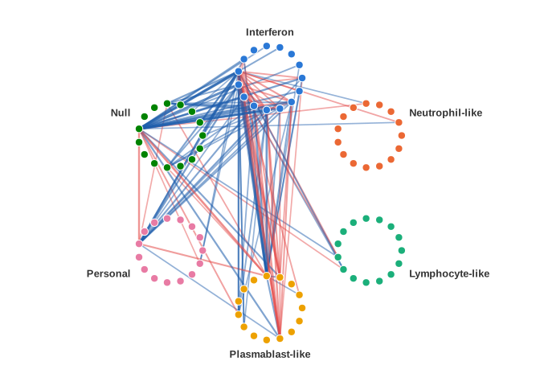

Figure 1: LIONESS gene network of one simulated child at visit 1, base
setting. Each dot is a gene; the genes sit on six circles, one per
pathway, and are coloured by pathway (interferon blue, neutrophil-like
orange, lymphocyte-like green, plasmablast-like yellow, personal pink,
null dark green), with each circle labelled by its pathway. Each line is
one of the 120 strongest edges of the child’s network: red for a
positive edge and blue for a negative one, thin for a weak edge and
thick for a strong one, with width proportional to the absolute edge on
a scale shared with the child’s network at visit 2.

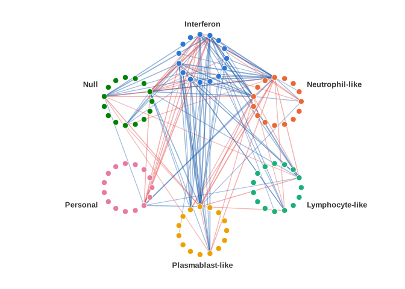

Figure 2: LIONESS gene network of the same simulated child at visit 2,
drawn as at visit 1 (same colours, same scale).

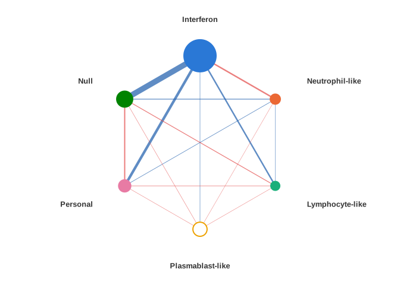

Figure 3: Pathway network of the same simulated child at visit 1: its
LIONESS network read through the six pathways. Each circle is a pathway,
coloured as in the gene network and labelled by name; its area is the
pathway’s connectivity (the mean edge among its genes), and it is filled
when the connectivity is positive and hollow when negative. Each line
joins two pathways and shows their crosstalk (the mean edge between
their genes): red when positive and blue when negative, thicker when
stronger. Scales are shared with the child’s pathway network at visit 2.

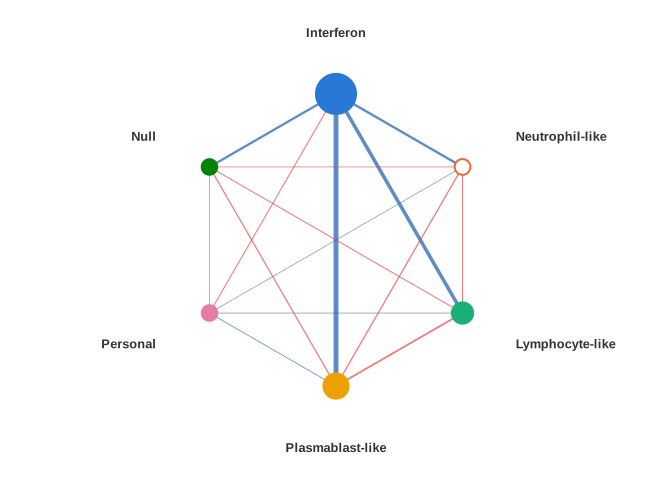

Figure 4: Pathway network of the same simulated child at visit 2, drawn
as at visit 1 (same colours, same scales).

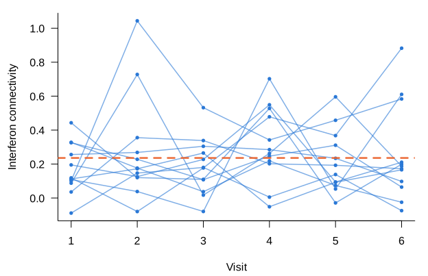

Figure 5: Interferon connectivity of the LIONESS networks of twelve
simulated children over their six visits, base setting. Each blue line
is one child, its points the child’s values at each visit, joined in
visit order. The orange dashed line is the no-change line, drawn at the
mean of all values: the flat line that a child whose connectivity did
not change between visits follows.

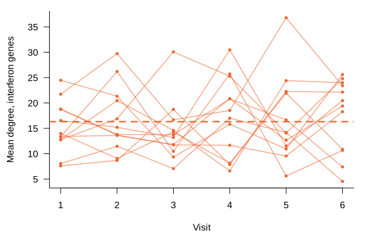

Figure 6: Mean degree of the interferon genes over the six visits of the
same twelve simulated children, in the LIONESS networks thresholded at
an absolute edge of 1. Each blue line is one child, joined in visit
order; the orange dashed line is the no-change line, drawn at the mean
of all values, the flat line that a child whose degree did not change
between visits follows.

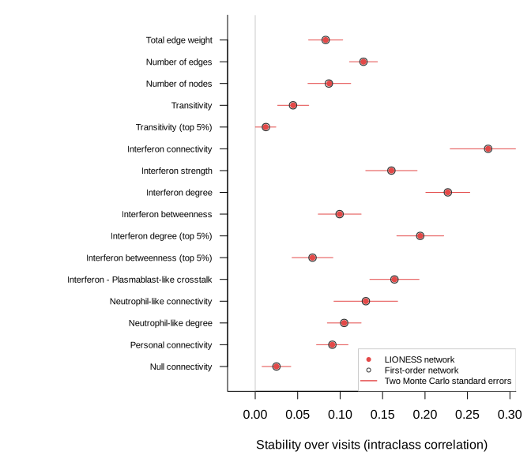

Figure 7: Stability over visits of each LIONESS metric in the base
setting, measured by the intraclass correlation
(<a href="#eq-icc" class="quarto-xref">Equation 14</a>): on the LIONESS
network (filled red points, with bars of two Monte Carlo standard
errors) and on the first-order network (open circles). Top 5% marks
metrics computed on the graph of the strongest 5% of edges.

### The stability of LIONESS metrics was the stability of expression

Each LIONESS metric was exactly as stable as the same metric on the
first-order network: over every metric and every setting of study S1,
the stability on the LIONESS network differed from the stability on the
first-order network by at most 0.0024
(<a href="#fig-stability" class="quarto-xref">Figure 7</a>,
<a href="#tbl-equivalence" class="quarto-xref">Table 2</a>).
Connectivity and crosstalk were linear in their first-order expression
terms, with $R^2$ at least 0.99999.
Interferon connectivity followed the squared interferon score closely in
one cohort (correlation 0.973,
<a href="#fig-conn-score" class="quarto-xref">Figure 8</a>), and its
stability followed that of the squared score along the gradient of the
interferon factor’s stability
(<a href="#fig-gradient" class="quarto-xref">Figure 9</a>):
0.274 (MCSE
0.022) against
0.286 (MCSE
0.022) in the base setting and
0.644 (MCSE
0.012) against
0.684 (MCSE
0.012) at the most stable factor. The
residual after the first-order terms was stable only when the factor
was: its stability was 0.244 (MCSE
0.051) at the most stable factor. With
the fourth-order terms added, the residual’s stability was at most
0.044 over every connectivity,
crosstalk, and setting.

Table 2: Largest absolute difference between the stability of a metric
on the LIONESS network and on the first-order network, over the S1
settings, by type of metric. Top share marks the proportional threshold.

| Metric | Largest difference |
|----|----|
| Total edge weight | 0.0001 |
| Number of edges | 0.0002 |
| Number of nodes | 0.0024 |
| Transitivity | 0.0013 |
| Number of nodes (top share) | 0.0021 |
| Transitivity (top share) | 0.0010 |
| Connectivity | 0.0003 |
| Crosstalk | 0.0001 |
| Strength (pathway mean) | 0.0002 |
| Degree (pathway mean) | 0.0005 |
| Degree, top share (pathway mean) | 0.0004 |
| Betweenness (pathway mean) | 0.0010 |
| Betweenness, top share (pathway mean) | 0.0012 |

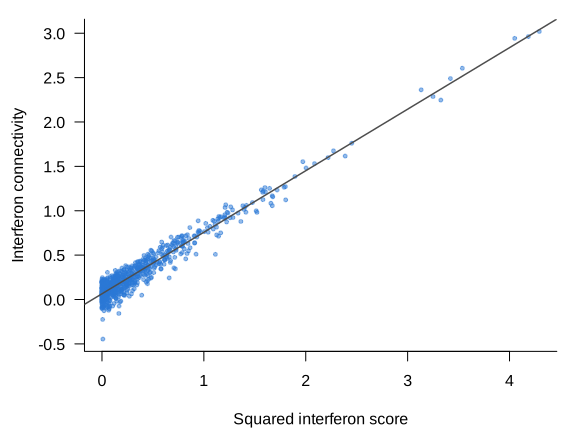

Figure 8: Interferon connectivity against the squared interferon score,
one simulated cohort in the base setting. Each point is one sample (one
child at one visit); the line is the least-squares fit.

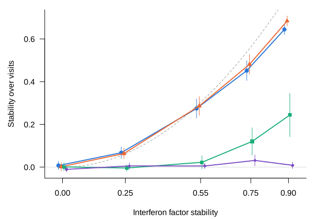

Figure 9: Stability over visits along the stability of the interferon
factor (its within-person intraclass correlation): interferon
connectivity, the squared interferon score, and the residual of
connectivity after the first-order and after the fourth-order expression
terms, with bars of two Monte Carlo standard errors. The dashed line is
the stability of a squared normal factor, the square of the factor’s own
stability.

### LIONESS metrics did not predict beyond expression

The LIONESS metrics predicted neither same-visit nor next-visit activity
beyond what expression gave. Same-visit activity was predicted by the
pathway scores, whose superiority test declared a concordance above one
half in a share of replicates that rose from
0.00 with no effect to
0.80
(<a href="#fig-power" class="quarto-xref">Figure 10</a>). The LIONESS
metrics and the first-order metrics were declared above one half in no
replicate at any effect, and their concordance stayed below one half,
between 0.464 and
0.477
(<a href="#tbl-prediction" class="quarto-xref">Table 3</a>). The LIONESS
metrics were declared equivalent to the first-order metrics in every
replicate, for same-visit and next-visit activity alike. For next-visit
activity, every feature set reached the concordance of the current
activity alone (0.618 to
0.632).

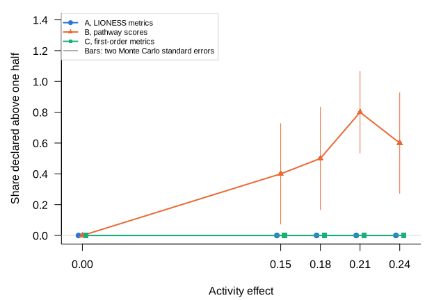

Figure 10: Type I error and power of the test that a model predicts
same-visit activity better than chance
(<a href="#eq-tests" class="quarto-xref">Equation 28</a>), by activity
effect: the share of replicates in which the test was positive for the
LIONESS metrics (A), the pathway scores (B), and the first-order metrics
(C), with bars of two Monte Carlo standard errors. At no effect, the
share is the type I error.

Table 3: Prediction of activity in S2, by activity effect: mean
concordance of the LIONESS metrics (A), pathway scores (B), first-order
metrics (C), and, for the next visit, the current activity alone (R0);
and the share of replicates in which A and C were declared equivalent.

| Effect | Same visit, A | Same visit, B | Same visit, C | Next visit, A | Next visit, R0 | A equivalent to C |
|----|----|----|----|----|----|----|
| 0.00 | 0.477 | 0.473 | 0.480 | 0.627 | 0.627 | 1.00 |
| 0.15 | 0.473 | 0.499 | 0.473 | 0.630 | 0.631 | 1.00 |
| 0.18 | 0.471 | 0.518 | 0.472 | 0.631 | 0.632 | 1.00 |
| 0.21 | 0.465 | 0.539 | 0.467 | 0.620 | 0.622 | 1.00 |
| 0.24 | 0.464 | 0.527 | 0.461 | 0.619 | 0.618 | 1.00 |

In the model ladder, adding the LIONESS metrics to the genes did not
raise the concordance: N1 was declared better than E1 in at most
0.30 of replicates in any setting, and
N1 and F1 were declared equivalent in every replicate
(<a href="#tbl-ladder" class="quarto-xref">Table 4</a>). The mean
difference in concordance between N1 and E1 was at most
0.002 in absolute value in every
setting, and N1 and E1 were declared equivalent in every replicate where
N1 was declared better. TO CONFIRM: the pre-registered
limit of one in ten replicates for N1 declared better than E1 was
exceeded at the largest activity effect for next-visit activity in the
quick run; the production run decides The genes themselves added
little to the pathway scores: E1 exceeded R1 by at most
0.002 in mean same-visit concordance.

Table 4: The model ladder in S2, by activity effect: mean concordance of
same-visit predictions from R1 (pathway scores and their squares), E1
(all genes on top of R1), N1 (E1 with the LIONESS metrics), and F1 (E1
with the first-order metrics); and the share of replicates in which N1
was declared better than E1 and in which N1 and F1 were declared
equivalent, for same-visit and next-visit activity.

| Effect | R1 | E1 | N1 | F1 | N1 better than E1, same / next | N1 equivalent to F1, same / next |
|----|----|----|----|----|----|----|
| 0.00 | 0.494 | 0.496 | 0.496 | 0.496 | 0.00 / 0.00 | 1.00 / 1.00 |
| 0.15 | 0.511 | 0.510 | 0.509 | 0.508 | 0.00 / 0.00 | 1.00 / 1.00 |
| 0.18 | 0.527 | 0.529 | 0.528 | 0.528 | 0.10 / 0.10 | 1.00 / 1.00 |
| 0.21 | 0.544 | 0.542 | 0.544 | 0.543 | 0.00 / 0.10 | 1.00 / 1.00 |
| 0.24 | 0.543 | 0.541 | 0.541 | 0.542 | 0.00 / 0.30 | 1.00 / 1.00 |

# Application

## Data and comparison

GSE65391 placed the children on the simulation’s gradients. In the 131
children with repeated visits, the interferon score had a within-child
intraclass correlation of 0.55, the base setting’s value, and SLEDAI one
of 0.39. Across the 382 modules, the stability of the module score had
median 0.30 and the first principal component explained a median share
of 0.27 of the module’s variance.

## A child’s LIONESS network over visits is the child’s expression

A user reading the LIONESS networks of these children sees networks that
change from visit to visit and metrics that follow the children’s
expression. The LIONESS network of the child with the highest mean
interferon score differed between the first two visits
(<a href="#fig-app-net-v1" class="quarto-xref">Figure 11</a>,
<a href="#fig-app-net-v2" class="quarto-xref">Figure 12</a>), as did its
pathway summary
(<a href="#fig-app-path-v1" class="quarto-xref">Figure 13</a>,
<a href="#fig-app-path-v2" class="quarto-xref">Figure 14</a>). At the
second visit, 146 of the 150 strongest edges touched one plasma cell
gene, against 35 at the first: the network was organized around the gene
whose expression lay farthest from its mean, as the product term of the
closed form implies
(<a href="#eq-first-order" class="quarto-xref">Equation 9</a>). Over
children, interferon connectivity had a stability of 0.304, against
0.349 for the squared interferon score; the number of edges had 0.278,
the number of nodes 0.236, transitivity 0.184, the interferon genes’
degree 0.260, and their betweenness 0.203
(<a href="#tbl-app" class="quarto-xref">Table 7</a>). For every metric,
the stability on the LIONESS networks differed from the stability on the
first-order networks by at most 0.0058. Across modules, the stability of
connectivity followed that of the squared module score (correlation
0.91, <a href="#fig-app-modules" class="quarto-xref">Figure 15</a>).
Connectivity was linear in its first-order terms with $R^2$ of at least
0.981; 2 of the 382 modules fell below 0.99, and with the fourth-order
terms every module reached 0.9992. The residual after the fourth-order
terms, less than 0.08 percent of the variance, still had a median
stability of 0.08 over modules. TO CONFIRM: the
pre-registered claim that every module has R squared of at least 0.99 on
the first-order terms failed for two modules; and the small stable
residual in real data, unlike the simulation, is either higher-order
expression or person-specific co-expression

The LIONESS metrics identified 0.122 of the children from their first to
their second visit, the first-order metrics 0.122, and the four pathway
scores 0.069, against 0.008 by chance. Same-visit SLEDAI was predicted
by the pathway scores (concordance 0.628, declared above one half) but
not by the LIONESS metrics (0.523) or the first-order metrics (0.524),
and the LIONESS and first-order metrics were declared equivalent. For
next-visit SLEDAI, every feature set reached the concordance of the
current SLEDAI alone (0.760). On the authors’ test children, the
concordance was 0.551 for the LIONESS metrics, 0.557 for the first-order
metrics, and 0.622 for the pathway scores.
<a href="#tbl-app-pred" class="quarto-xref">Table 5</a> collects these
results. In the model ladder, adding the LIONESS metrics to the
network’s genes changed the same-visit concordance by -0.007 and the
next-visit concordance by 0.001; N1 was declared better than E1 at
neither visit, and N1 and F1 were declared equivalent at both
(<a href="#tbl-app-ladder" class="quarto-xref">Table 6</a>). The genes
identified 0.221 of the children.

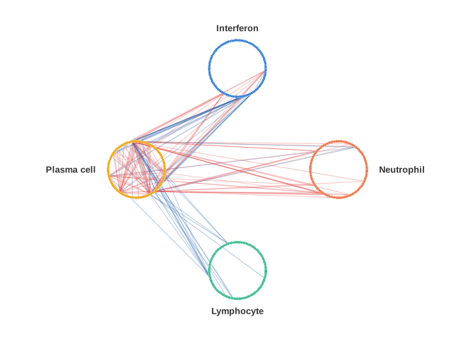

Figure 11: LIONESS gene network of the GSE65391 child with the highest
mean interferon score, at visit 1. Each dot is a gene; the genes sit on
four circles, one per pathway, coloured by pathway (interferon blue,
neutrophil orange, lymphocyte green, plasma cell yellow) and labelled by
name. Each line is one of the 150 strongest edges: red for a positive
edge and blue for a negative one, thin for a weak edge and thick for a
strong one, with width on a scale shared with the child’s network at
visit 2.

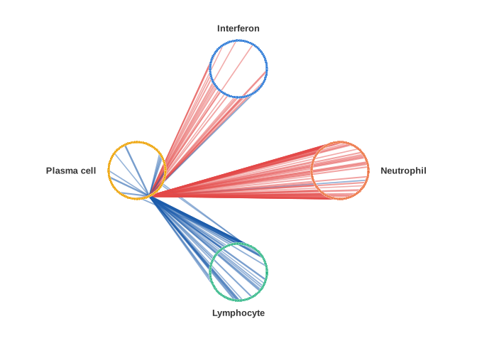

Figure 12: LIONESS gene network of the same GSE65391 child at visit 2,
drawn as at visit 1 (same colours, same scale).

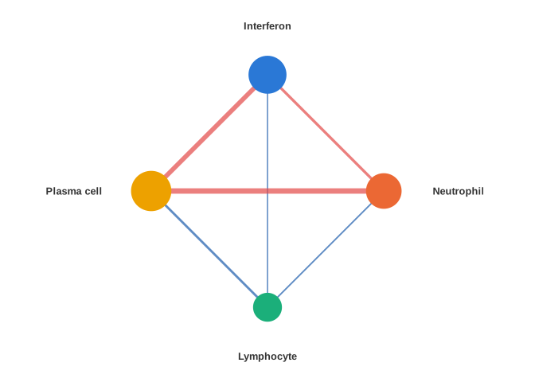

Figure 13: Pathway network of the same GSE65391 child at visit 1. Each
circle is a pathway, coloured as in the gene network and labelled by
name; its area is the pathway’s connectivity, filled when positive and
hollow when negative. Each line shows the crosstalk between two
pathways: red when positive and blue when negative, thicker when
stronger. Scales are shared with the child’s pathway network at visit 2.

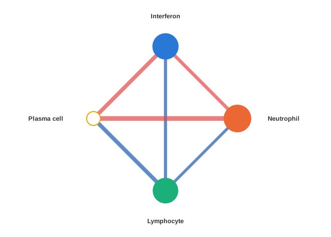

Figure 14: Pathway network of the same GSE65391 child at visit 2, drawn
as at visit 1 (same colours, same scales).

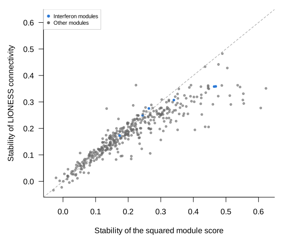

Figure 15: Stability over visits of each BloodGen3 module’s LIONESS
connectivity against the stability of its squared module score,
GSE65391; one point per module, interferon modules highlighted, with the
identity line.

Table 5: Identity and prediction in GSE65391 by feature set: the LIONESS
metrics, the four pathway scores and their squares, the first-order
metrics, and the current SLEDAI alone. Identity is the share of children
whose second-visit features correlate most with their own first-visit
features. SLEDAI is predicted by elastic net with all visits of a child
in one cross-validation fold (concordance; one half is chance), and on
the authors’ test children after fitting on their training children.
Above one half: the lower bootstrap bound exceeds one half.

| Quantity | LIONESS metrics | Pathway scores | First-order metrics | Current SLEDAI alone |
|----|----|----|----|----|
| Identity (chance in the last row) | 0.122 | 0.069 | 0.122 |  |
| Same-visit SLEDAI, concordance | 0.523 | 0.628 | 0.524 |  |
| Same-visit SLEDAI, above one half | no | yes | no |  |
| Next-visit SLEDAI, concordance | 0.760 | 0.759 | 0.760 | 0.760 |
| Next-visit SLEDAI, above one half | yes | yes | yes | yes |
| Authors’ test children, same-visit concordance | 0.551 | 0.622 | 0.557 |  |
| Chance level of identity |  |  |  | 0.008 |

Table 6: The model ladder in GSE65391: concordance of SLEDAI predictions
at the same and the next visit from R0 (current SLEDAI alone), R1
(pathway scores and their squares), E1 (the network’s genes on top of
R1), N1 (E1 with the LIONESS metrics), and F1 (E1 with the first-order
metrics); then the contrasts, with whether N1 was declared better than
E1 and whether the two models of a contrast were declared equivalent.

| Row | Same visit | Next visit |
|----|----|----|
| R0 |  | 0.760 |
| R1 | 0.633 | 0.755 |
| E1 | 0.645 | 0.755 |
| N1 | 0.638 | 0.755 |
| F1 | 0.640 | 0.756 |
| N1 minus E1 | -0.007 (better: no; equivalent: yes) | 0.001 (better: no; equivalent: yes) |
| N1 minus F1 | -0.002 (equivalent: yes) | -0.000 (equivalent: yes) |
| E1 minus R1 | 0.013 (better: no) | -0.001 (better: no) |

Table 7: LIONESS metrics of the four-pathway network in GSE65391:
stability over visits on the LIONESS networks and on their first-order
versions.

| Metric                             | LIONESS | First order |
|------------------------------------|---------|-------------|
| Interferon connectivity            | 0.304   | 0.304       |
| Neutrophil connectivity            | 0.222   | 0.220       |
| Lymphocyte connectivity            | 0.258   | 0.258       |
| Plasma cell connectivity           | 0.354   | 0.354       |
| Interferon - Plasma cell crosstalk | 0.196   | 0.196       |
| Total edge weight                  | 0.107   | 0.107       |
| Number of edges                    | 0.278   | 0.278       |
| Number of nodes                    | 0.236   | 0.236       |
| Transitivity                       | 0.184   | 0.184       |
| Interferon degree                  | 0.260   | 0.260       |
| Interferon betweenness             | 0.203   | 0.203       |
| Interferon strength                | 0.166   | 0.166       |

# Discussion

<!-- What was found and what a user should do differently; the novelty table; limitations from the
critique table's rows that did not become design factors; future work from the spec's out-of-scope
list, item by item. No new results. -->

A Pearson LIONESS edge is an exact function of the cohort correlation
and the sample’s own standardized expression
(<a href="#eq-exact" class="quarto-xref">Equation 8</a>), and its
first-order form
(<a href="#eq-first-order" class="quarto-xref">Equation 9</a>) keeps
nearly all of it. Every network metric built on the edges, read whole or
by pathway, inherited that: in simulated children followed over visits,
each metric was exactly as stable as the same metric on the first-order
network, connectivity and crosstalk were their expression terms, and the
stable part that remained beyond first order was the next-order
expression term. Pathway connectivity was more stable than single edges
because it averaged the edges into a squared pathway score. The children
of GSE65391 behaved in the same way: their LIONESS metrics were as
stable as the first-order metrics, identified children no better, and
predicted disease activity no better than the module scores. For a user,
a change in a child’s LIONESS network from one visit to the next is a
change in that child’s expression, and a network metric should be
compared with the expression terms of its closed form before it is read
as co-expression. LIONESS metrics also lost the sign of expression:
activity driven by a factor’s level was predicted by pathway scores,
while the metrics, which carry squared scores, did not predict it.
<a href="#tbl-novelty" class="quarto-xref">Table 8</a> sets these
results beside earlier work.

Table 8: What was known and what this paper adds.

| Element | Prior literature | This paper |
|----|----|----|
| Single-sample correlation | The product of standardized deviations as a single-sample correlation \[[9](#ref-yu2017iena)\] | The exact closed form of the LIONESS edge and its expansion |
| Module connectivity | In a network of all samples, connectivity has an eigengene-based counterpart \[[10](#ref-horvath2008geometric)\] | One sample’s connectivity and crosstalk as its own expression terms |
| LIONESS over repeated samples | LIONESS networks are built per sample from aggregate networks \[[2](#ref-kuijjer2019lioness)\] | The stability of network metrics over visits equals that of their first-order form |
| Prediction from LIONESS metrics | Edges tested between patient groups \[[3](#ref-kuijjer2019lionessr)\] | LIONESS metrics equal first-order metrics in prediction and lose the sign of expression |

The study has limits. The simulation used disjoint pathways of equal
size, independent factors, normal noise, and equal numbers of visits;
real gene sets overlap and real visits are irregular. Person-level
differences in gene levels were independent across genes. The thresholds
of the graph metrics were one fixed value and one proportion. In real
data the residual beyond the fourth-order terms kept some stability; its
source, higher-order expression or person-specific co-expression, is not
separated here. TO CONFIRM: the supervisor’s
confirmation of the re-scope and of the paper’s message

Several questions were left out on purpose. Lupus was not compared with
rheumatoid arthritis or with healthy controls, single-sample methods
other than LIONESS were not studied, and drug effects, ancestry, sex,
and subtypes were not modelled. No dataset was merged with another
study.

# Data and code availability

The expression data are Gene Expression Omnibus series GSE65391. The
code is organized as a research compendium \[[14](#ref-marwick2018)\].
TO CONFIRM: the repository URL

# References

1\. Banchereau R, Hong S, Cantarel B, Baldwin N, Baisch J, Edens M, et
al. Personalized immunomonitoring uncovers molecular networks that
stratify lupus patients. Cell. 2016;165:551–65.
<https://doi.org/10.1016/j.cell.2016.03.008>.

2\. Kuijjer ML, Tung MG, Yuan G, Quackenbush J, Glass K. Estimating
sample-specific regulatory networks. iScience. 2019;14:226–40.
<https://doi.org/10.1016/j.isci.2019.03.021>.

3\. Kuijjer ML, Hsieh P-H, Quackenbush J, Glass K.
lionessR: Single sample network inference in
R. BMC Cancer. 2019;19:1003.
<https://doi.org/10.1186/s12885-019-6235-7>.

4\. Langfelder P, Horvath S. WGCNA: An r package for weighted
correlation network analysis. BMC Bioinformatics. 2008;9:559.
<https://doi.org/10.1186/1471-2105-9-559>.

5\. Altman MC, Rinchai D, Baldwin N, Toufiq M, Whalen E, Garand M, et
al. Development of a fixed module repertoire for the analysis and
interpretation of blood transcriptome data. Nature Communications.
2021;12:4385. <https://doi.org/10.1038/s41467-021-24584-w>.

6\. Whitney AR, Diehn M, Popper SJ, Alizadeh AA, Boldrick JC, Relman DA,
et al. Individuality and variation in gene expression patterns in human
blood. Proceedings of the National Academy of Sciences of the United
States of America. 2003;100:1896–901.
<https://doi.org/10.1073/pnas.252784499>.

7\. Petri M, Fu W, Ranger A, Allaire N, Cullen P, Magder LS, et al.
Association between changes in gene signatures expression and disease
activity among patients with systemic lupus erythematosus. BMC Medical
Genomics. 2019;12:4. <https://doi.org/10.1186/s12920-018-0468-1>.

8\. Farahbod M, Pavlidis P. Untangling the effects of cellular
composition on coexpression analysis. Genome Research. 2020;30:849–59.
<https://doi.org/10.1101/gr.256735.119>.

9\. Yu X, Zhang J, Sun S, Zhou X, Zeng T, Chen L. Individual-specific
edge-network analysis for disease prediction. Nucleic Acids Research.
2017;45:e170. <https://doi.org/10.1093/nar/gkx787>.

10\. Horvath S, Dong J. Geometric interpretation of gene coexpression
network analysis. PLoS Computational Biology. 2008;4:e1000117.
<https://doi.org/10.1371/journal.pcbi.1000117>.

11\. Finn ES, Shen X, Scheinost D, Rosenberg MD, Huang J, Chun MM, et
al. Functional connectome fingerprinting: Identifying individuals using
patterns of brain connectivity. Nature Neuroscience. 2015;18:1664–71.
<https://doi.org/10.1038/nn.4135>.

12\. Friedman J, Hastie T, Tibshirani R. Regularization paths for
generalized linear models via coordinate descent. Journal of Statistical
Software. 2010;33. <https://doi.org/10.18637/jss.v033.i01>.

13\. Rinchai D, Roelands J, Toufiq M, Hendrickx W, Altman MC, Bedognetti
D, et al. BloodGen3Module: Blood transcriptional module repertoire
analysis and visualization using r. Bioinformatics. 2021;37:2382–9.
<https://doi.org/10.1093/bioinformatics/btab121>.

14\. Marwick B, Boettiger C, Mullen L. Packaging data analytical work
reproducibly using R (and friends). The American Statistician.
2018;72:80–8. <https://doi.org/10.1080/00031305.2017.1375986>.

15\. Morris TP, White IR, Crowther MJ. Using simulation studies to
evaluate statistical methods. Statistics in Medicine. 2019;38:2074–102.
<https://doi.org/10.1002/sim.8086>.

# Supplementary note S1

This note derives the closed forms the paper rests on. A Pearson LIONESS
edge turns out to be an exact function of two things: the correlation of
the two genes over the cohort, and the sample’s own standardized values
of the two genes. Its first-order form, and the connectivity, crosstalk,
strength, and total edge weight built from it, are then sums of products
of the sample’s own expression. The last result says how stable a
squared factor is over visits.

Throughout, $N$ is the number of samples, $z_{qi}$ the expression of
gene $i$ in sample $q$ standardized over all $N$ samples with divisor
$N$ (so $\sum_q z_{qi} = 0$, $\sum_q z_{qi}^2 = N$, and
$\sum_q z_{qi} z_{qj} = N r_{ij}$), and $\varepsilon = 1/(N - 1)$.

### S1.1 The exact LIONESS edge

The correlation of genes $i$ and $j$ without sample $q$ is $$
\begin{aligned}
\bar z^{(-q)}_i &= -\varepsilon z_{qi}, \\
\sum_{p \ne q} (z_{pi} - \bar z^{(-q)}_i)(z_{pj} - \bar z^{(-q)}_j) &= N r_{ij} - z_{qi} z_{qj} - (N - 1)\varepsilon^2 z_{qi} z_{qj} = N r_{ij} - N \varepsilon z_{qi} z_{qj}, \\
\sum_{p \ne q} (z_{pi} - \bar z^{(-q)}_i)^2 &= N - N \varepsilon z_{qi}^2, \\
r^{(-q)}_{ij} &= \frac{r_{ij} - \varepsilon z_{qi} z_{qj}}{\sqrt{(1 - \varepsilon z_{qi}^2)(1 - \varepsilon z_{qj}^2)}}.
\end{aligned}
$$ Line 1: the standardized values sum to 0, so without $z_{qi}$ the
other $N - 1$ sum to $-z_{qi}$. Line 2: the centred cross-product is the
raw one, $N r_{ij} - z_{qi} z_{qj}$, minus $(N - 1)$ times the product
of the means; $1 + \varepsilon = N \varepsilon$. Line 3: line 2 with
$j = i$. Line 4: a correlation does not change under the affine map from
expression to standardized expression, and the factor $N$ cancels. The
LIONESS edge $e_{qij} = N r_{ij} - (N - 1) r^{(-q)}_{ij}$ is therefore a
function of $r_{ij}$, $z_{qi}$, and $z_{qj}$ alone. The paper uses this
in the Methods; `LionessEdgesClosedForm()` is tested equal to
leave-one-out LIONESS in `tests/testthat/test-lioness.R`.

### S1.2 The first-order form and its remainder

With $u = z_{qi}^2 + z_{qj}^2$ and
$v = \tfrac38 (z_{qi}^4 + z_{qj}^4) + \tfrac14 z_{qi}^2 z_{qj}^2$, $$
\begin{aligned}
\left[(1 - \varepsilon z_{qi}^2)(1 - \varepsilon z_{qj}^2)\right]^{-1/2} &= 1 + \tfrac{\varepsilon}{2} u + \varepsilon^2 v + O(\varepsilon^3), \\
(N - 1)\, r^{(-q)}_{ij} &= \tfrac{1}{\varepsilon}(r_{ij} - \varepsilon z_{qi} z_{qj})\left(1 + \tfrac{\varepsilon}{2} u + \varepsilon^2 v\right) + O(\varepsilon^2) \\
&= \tfrac{r_{ij}}{\varepsilon} - z_{qi} z_{qj} + \tfrac{r_{ij}}{2} u + \varepsilon\left(r_{ij} v - \tfrac12 z_{qi} z_{qj} u\right) + O(\varepsilon^2), \\
e_{qij} &= r_{ij} + z_{qi} z_{qj} - \tfrac{r_{ij}}{2} u + \varepsilon\left(\tfrac12 z_{qi} z_{qj} u - r_{ij} v\right) + O(\varepsilon^2).
\end{aligned}
$$ Line 1: $(1 - a)^{-1/2} = 1 + a/2 + 3a^2/8 + O(a^3)$ for each factor,
multiplied out; it holds because $z_{qi}^2 \le N - 1$. Lines 2 and 3:
S1.1 multiplied by $N - 1 = 1/\varepsilon$ and expanded. Line 4:
$N r_{ij} - r_{ij}/\varepsilon = r_{ij}$. The first-order form is the
part without $\varepsilon$; the remainder is $\varepsilon$ times a
polynomial of degree four in $z_{qi}$ and $z_{qj}$. The paper uses this
for the diagnostic’s fourth-order terms; the test in `test-lioness.R`
checks that the gap to the first-order form shrinks as $N$ grows.

### S1.3 Connectivity and crosstalk

For disjoint pathways $A$ and $B$, with $S_A$, $Q_A$, $R^B_i$, and $C_A$
as in the Methods, the first-order form summed over pairs gives $$
\begin{aligned}
\sum_{i < j \in A} z_{qi} z_{qj} &= \tfrac12 \left(S_A^2 - Q_A\right), \\
\sum_{i < j \in A} \tfrac{r_{ij}}{2} \left(z_{qi}^2 + z_{qj}^2\right) &= \tfrac12 \sum_{i \in A} R^A_i z_{qi}^2, \\
\sum_{i \in A} \sum_{j \in B} z_{qi} z_{qj} &= S_A S_B, \\
\sum_{i \in A} \sum_{j \in B} \tfrac{r_{ij}}{2} \left(z_{qi}^2 + z_{qj}^2\right) &= \tfrac12 \Big(\sum_{i \in A} R^B_i z_{qi}^2 + \sum_{j \in B} R^A_j z_{qj}^2\Big).
\end{aligned}
$$ Line 1: $S_A^2$ counts each product of two different genes twice and
each square once. Line 2: each $z_{qi}^2$ appears once for every other
gene $j$ of $A$, weighted by $r_{ij}$. Lines 3 and 4: the same over the
pairs between $A$ and $B$. Dividing by $C_A$ and $m_A m_B$, and adding
the mean correlations, gives the Methods’ formulas for $W_{qA}$ and
$X_{qAB}$. The paper uses them in the Methods and the diagnostic;
`KnownAnswerChecksG()` and `tests/testthat/test-pathways.R` check that
first-order connectivity and crosstalk equal them to rounding.

### S1.4 Strength and total edge weight

With $S$ and $R_i = \sum_{j \ne i} r_{ij}$ over all $p$ genes, $$
\begin{aligned}
s_{qi} &= \sum_{j \ne i} \Big[r_{ij} + z_{qi} z_{qj} - \tfrac{r_{ij}}{2}\left(z_{qi}^2 + z_{qj}^2\right)\Big] = R_i + z_{qi}(S - z_{qi}) - \tfrac12 R_i z_{qi}^2 - \tfrac12 \sum_{j \ne i} r_{ij} z_{qj}^2, \\
T_q &= \sum_{i < j} r_{ij} + \tfrac12 \left(S^2 - Q\right) - \tfrac12 \sum_i R_i z_{qi}^2.
\end{aligned}
$$ Line 1: the first-order form summed over the other genes. Line 2:
S1.3 with $A$ the whole gene set. The paper uses these in the Methods;
`tests/testthat/test-study.R` checks the strength formula on first-order
edges.

### S1.5 The stability of a squared factor

Let a person’s factor at a visit be $F = U + V$, with
$U \sim N(0, \kappa)$ the person’s level, $V \sim N(0, 1 - \kappa)$ the
visit’s deviation, independent, so that $F$ has intraclass correlation
$\kappa$. Then $$
\begin{aligned}
\operatorname{E}(F^2 \mid U) &= U^2 + 1 - \kappa, \\
\operatorname{Var}\{\operatorname{E}(F^2 \mid U)\} &= \operatorname{Var}(U^2) = 2\kappa^2, \\
\operatorname{Var}(F^2) &= 2, \\
\operatorname{ICC}(F^2) &= \kappa^2.
\end{aligned}
$$ Line 1: $\operatorname{E}(V) = 0$ and
$\operatorname{E}(V^2) = 1 - \kappa$. Line 2: the variance of the square
of a normal variable with variance $\kappa$ is $2\kappa^2$. Line 3:
$F \sim N(0, 1)$. Line 4: the between-person share of the variance. The
paper uses this to read the stability of connectivity as that of a
squared expression score; `KnownAnswerChecksD()` checks it by
simulation.

### S1.6 The concordance from Kendall’s tau

The concordance of the Methods counts ordered pairs; the code computes
it from Kendall’s tau, which is faster. Let $n$ be the number of
samples, $n_0 = n(n - 1)/2$ the number of pairs, $D$ the number of pairs
ordered the same way by $\hat y$ and $y$ minus the number ordered the
opposite way, $t_{\hat y}$ the number of pairs tied in $\hat y$, $t_y$
the number tied in $y$, and $\tau_b$ Kendall’s tau-b. Then $$
\begin{aligned}
\tau_b &= \frac{D}{\sqrt{(n_0 - t_{\hat y})(n_0 - t_y)}}, \\
C &= \frac{1}{n_0 - t_y}\Big[\tfrac12 \left(n_0 - t_y + D\right)\Big] = \frac12 + \frac{\tau_b \sqrt{(n_0 - t_{\hat y})(n_0 - t_y)}}{2\,(n_0 - t_y)}.
\end{aligned}
$$ Line 1: the definition of tau-b. Line 2: among the $n_0 - t_y$ pairs
with different activity, let $c$ be ordered the same way, $d$ the
opposite way, and $h$ tied in $\hat y$; then $c + d + h = n_0 - t_y$ and
$c - d = D$ (pairs tied in $y$ count in neither), so
$c + h/2 = \tfrac12(n_0 - t_y + D)$, which divided by $n_0 - t_y$ is
$C$; substituting $D$ from line 1 gives the right-hand side. A constant
prediction has $C = 1/2$. The paper uses this for every concordance;
`tests/testthat/test-study.R` checks `ConcordanceFast()` against a
literal count of pairs, ties included.

**Gap table.** One row per figure or table: the run and size behind it
now, against the production run that replaces it.

| Output | What it shows | Run | Cells and replicates now | Production run | Monte Carlo error |
|----|----|----|----|----|----|
| fig-net-v1 | one child’s LIONESS network, visit 1 | quick | 1 cells, 1 replicates | the same cohort |  |
| fig-net-v2 | one child’s LIONESS network, visit 2 | quick | 1 cells, 1 replicates | the same cohort |  |
| fig-path-v1 | one child’s pathway network, visit 1 | quick | 1 cells, 1 replicates | the same cohort |  |
| fig-path-v2 | one child’s pathway network, visit 2 | quick | 1 cells, 1 replicates | the same cohort |  |
| fig-traj-conn | connectivity over visits | quick | 1 cells, 1 replicates | the same cohort |  |
| fig-traj-degree | degree over visits | quick | 1 cells, 1 replicates | the same cohort |  |
| fig-stability | stability of every shown metric | quick | 1 cells, 10 replicates | the base setting, production replicates |  |
| fig-conn-score | connectivity against squared score | quick | 1 cells, 1 replicates | the same cohort |  |
| fig-gradient | stability along the factor’s stability | quick | 5 cells, 10 replicates | the five settings, production replicates |  |
| fig-power | type I error and power | quick | 5 cells, 10 replicates | the S2 settings, production replicates |  |
| fig-app-net-v1 | a child’s LIONESS network, visit 1 | production | NA cells, NA replicates | the application |  |
| fig-app-net-v2 | a child’s LIONESS network, visit 2 | production | NA cells, NA replicates | the application |  |
| fig-app-path-v1 | a child’s pathway network, visit 1 | production | NA cells, NA replicates | the application |  |
| fig-app-path-v2 | a child’s pathway network, visit 2 | production | NA cells, NA replicates | the application |  |
| fig-app-modules | module stabilities | production | NA cells, NA replicates | the application |  |

**Markers.** Every decision still open and every claim without a usable
source, with its section.

| Marker | Text | Section |
|----|----|----|
| TO CONFIRM | first author | (front matter) |
| TO CONFIRM | email | (front matter) |
| TO CONFIRM | affiliation | (front matter) |
| TO CONFIRM | second author, the supervisor | (front matter) |
| TO CONFIRM | affiliation | (front matter) |
| TO CONFIRM | whether the journal wants the figure legends to name the AI-assisted code | Use of AI |
| TO CONFIRM | the pre-registered limit of one in ten replicates for N1 declared better than E1 was exceeded at the largest activity effect for next-visit activity in the quick run; the production run decides | LIONESS metrics did not predict beyond expression |
| TO CONFIRM | the pre-registered claim that every module has R squared of at least 0.99 on the first-order terms failed for two modules; and the small stable residual in real data, unlike the simulation, is either higher-order expression or person-specific co-expression | A child’s LIONESS network over visits is the child’s expression |
| TO CONFIRM | the supervisor’s confirmation of the re-scope and of the paper’s message | Discussion |
| TO CONFIRM | the repository URL | Data and code availability |

