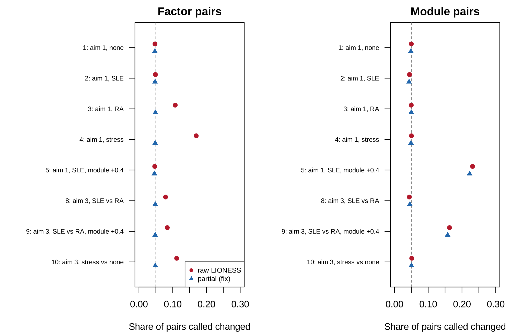
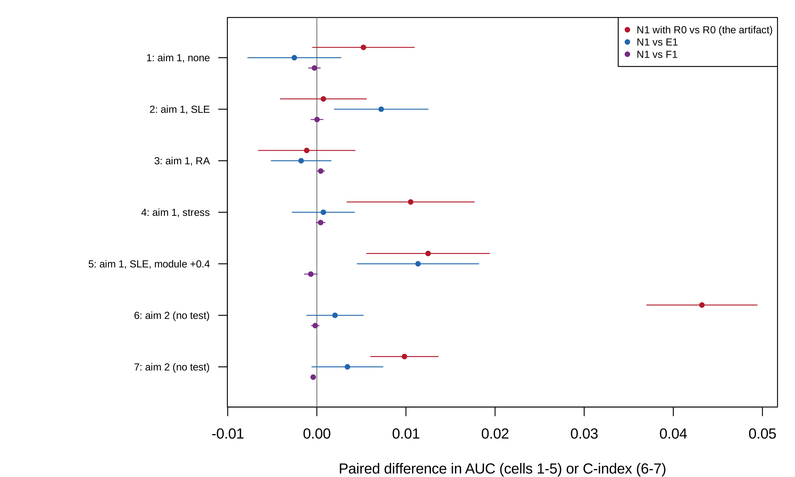

```{r}
#| label: setup
#| include: false

source("../templates/pilot-report/report-helpers.R")
devtools::load_all("..", quiet = TRUE)
s <- readRDS("results/cell_summaries.rds")
v <- readRDS("results/verdict.rds")
ka <- readRDS("results/known_answers.rds")
design <- readRDS("results/design.rds")
run <- readRDS("results/run_info.rds")
fs <- readRDS("../results/factor_shift.rds")
dat <- readRDS("../pilot/results/data_summary.rds")
v1 <- readRDS("../pilot/results/verdict.rds")
s1 <- readRDS("../pilot/results/cell_summaries.rds")
G <- function(cell, q) s$mean[s$cell == cell & s$quantity == q]
M <- function(cell, q) s$mcse[s$cell == cell & s$quantity == q]
gm <- function(cell, q, d = 3) sprintf("%s (MCSE %s)", fmt(G(cell, q), d), fmt(M(cell, q), 4))
cl <- v$clauses
status <- v$status
n_rep <- run$n_rep
outcome <- function(q, c) {
  o <- cl$outcome[cl$question == q & cl$clause == c]
  if (any(o == "fail")) "fail" else if (any(o == "close")) "close call" else "pass"
}
c1b <- cl[cl$question == 1 & cl$clause == "(b)", ]
c3a <- cl[cl$question == 3 & cl$clause == "(a)", ]
cell_lab <- function(cl) {
  d <- design[design$cell == cl, ]
  lv <- if (d$aim == 3) sprintf("%s levels (%d women) against %s levels (%d women)", d$levels, d$women, d$levels_b, d$women_b)
        else sprintf("%s levels, %d women", d$levels, d$women)
  extra <- c(if (d$module > 0) sprintf("module +%s%s", d$module, if (d$aim == 3) " in SLE pregnancy" else " in pregnancy"),
             if (d$activity == "ifn") "activity raises the IFN factor's spread",
             if (d$activity == "module") "activity raises the module's correlation")
  sprintf("cell %d (aim %d: %s%s)", cl, d$aim, lv, if (length(extra)) paste0("; ", paste(extra, collapse = "; ")) else "")
}
fsv <- function(d, sc, col) fs[[col]][fs$disease == d & fs$score == sc]
```

# Summary

**Scope.** This document reports the second pilot[^pilot] of the project, for revision 1 of the proposal (`proposal.md`, section 12), which restored the user's three aims: pregnancy stage, disease activity at each visit, and whether edges change differently in SLE than in RA across pregnancy. It covers the idea, how the pilot was run, what it found, the project spec, and the decisions made along the way. It was built from `project-spec.md`, `decisions.md`, the saved results in `pilot-b/results/`, the factor shift measured on GSE235508 (`results/factor_shift.rds`), and, read-only, the first pilot's results in `pilot/results/`; every number is computed from those files when the document renders.

**Status.** In `STATUS.md` the second pilot is marked `` `r status` ``[^pf]. Every clause the rule names as deciding passed: the fix, the equivalence of edges and their formula, and the removal of the activity artifact. Two clauses about size at the study's levels failed and two were close calls.

| Pilot question | Answer | Key evidence |
|---------|-------------|---------------------------------------------|
| 1. Does the fix work? | `r outcome(1, "(a)")`, `r outcome(1, "(b)")`, `r outcome(1, "(c)")` | Raw edges called `r gm(4, "paired_raw_factor")` of factor pairs changed at the stress level; partial edges gave `r fmt_range(c1b$value, 4)` across the five factor-only cells (nominal 0.05), and kept `r gm(5, "paired_par_module")` of a real module change against `r gm(5, "paired_raw_module")` for raw edges. |
| 2. Does it matter at the study's levels? | `r outcome(2, "(a)")`, `r outcome(2, "(b)")`, `r outcome(2, "(c)")` | False rewiring: `r gm(2, "paired_raw_factor")` at the SLE level, `r gm(3, "paired_raw_factor")` at the RA level; false SLE-against-RA difference `r gm(8, "between_raw_factor")`; a real SLE-only change found in `r gm(9, "between_par_module")` of module pairs by partial edges. |
| 3. Prediction | `r outcome(3, "(a)")`, `r outcome(3, "(b)")`, `r outcome(3, "(c)")` | N1 against F1 ranged over `r fmt_range(c3a$value, 4)` in cells 1 to 7; for activity, N1 against E1 was `r gm(6, "d1_N1_vs_E1", 4)` when only the IFN factor's spread tracked activity, and `r gm(7, "d1_N1_vs_E1", 4)` when the module's correlation did. |

**What needs your decision** (details in [Action items and limitations](#action-items-and-limitations)): the status call; whether the pregnancy work enters the one paper as its second application; the analysis of activity within woman at stage 3; and the open `[TO CONFIRM]` items in the spec (highlighted in yellow).

# The idea

## In plain language

LIONESS[^lioness] gives every blood sample a value for every pair of genes, called an edge. When the edges of the same women differ between pregnancy and the months after birth, the difference is read as the immune network "rewiring". But an edge is, almost exactly, a simple product of the sample's own two gene values, so anything that moves many genes together, such as the interferon[^ifn] response or the mix of white cells, changes the edges by its square. Suppose two genes that follow the white-cell mix are each 1 unit above average after birth and 1.5 units above in pregnancy: their product rises from 1 to 2.25, and the edge "rewires" with no change in how the genes work together.

The fix tested here removes the interferon score and the cell mix from each gene before the edge is built (a partial correlation[^partial]). The pilot simulates women followed through pregnancy, with interferon and cell-mix changes as large as those measured in the real study, and asks three things: whether the usual before-and-after test of edges calls false rewiring and whether the fix stops it; whether edges predict pregnancy stage or disease activity beyond simpler models; and whether a false difference between lupus and arthritis appears and disappears with the fix. No edge was computed on patient data.

## Potential impact

LIONESS builds one network per sample and has an R implementation [@kuijjer2019lioness; @kuijjer2019lionessr]; its authors propose sample networks for studying change across time. The first-order term of the edge is the influence function of the correlation [@devlin1975robust], the product term is the iENA edge [@yu2017iena], and a recent review relates sample edges to covariance products [@kuijjer2026challenges]. The study behind the data described pregnancy in SLE and RA by differential expression and deconvolution [@lien2024pregnancy]; no single-sample network analysis of pregnancy was found at stage 1.

The problem is the reading of a change in edges between time points, or between diseases, as rewiring, when the factors that move many genes at once change too. The pilot shows the size of it and a fix. At a large factor change, raw edges called `r gm(4, "paired_raw_factor")` of the pairs whose co-expression never changed "rewired"; the partial-correlation edges called `r gm(4, "paired_par_factor")`, the test's own level, and in every factor-only cell the fixed share stayed within `r fmt_range(c1b$value, 4)` (@tbl-shares). The fix kept a real change: `r gm(5, "paired_par_module")` of the module pairs against `r gm(5, "paired_raw_module")` for raw edges, and `r gm(9, "between_par_module")` for a real SLE-only change between diseases.

At the factor changes measured in GSE235508 the artifact is modest: none at the SLE level, `r gm(3, "paired_raw_factor")` at the RA level, and `r gm(8, "between_raw_factor")` for a false SLE-against-RA difference, all brought back to the nominal level by the fix (@fig-shares). In prediction, edges equalled their first-order formula for pregnancy stage and for activity (N1 against F1 within `r fmt_range(c3a$value, 4)`), and the base with the squared score removed the artifact from activity prediction. A user who reports rewiring over pregnancy, or a disease difference in rewiring, would apply the partial-correlation edges first; the impact for the paper is a fix that works at the stress level and at the real levels alike, with a real-data illustration whose effect is about twice the nominal rate in RA.

## Application: the study behind the data

### The study

The data come from a Norwegian longitudinal study of pregnancy in rheumatic disease [@lien2024pregnancy], https://doi.org/10.1136/ard-2023-224644, GEO series GSE235508[^geo]. Women with systemic lupus erythematosus (SLE)[^sle], rheumatoid arthritis (RA)[^ra], and healthy women gave whole-blood samples for RNA sequencing before pregnancy, in each trimester, and at 6 weeks, 6 months, and 12 months after birth, with disease activity recorded at each visit (DAS28[^das] in RA, LAI-P[^laip] in SLE). The paper reports that the interferon signature was augmented in SLE pregnancy and that the altered cell type composition strongly influences the profile. @tbl-data counts the women with samples in both periods, and @tbl-shift gives the size of the factor change measured in this project from the counts.

```{r}
#| label: tbl-data
#| tbl-cap: "GSE235508 by group, from `../pilot/results/data_summary.rds` (read-only). Usable pregnancies have at least one pregnant and one non-pregnant sample."

bg <- dat$by_group
lab <- c(HEALTHY = "Healthy", SLE = "SLE", SNRA = "Seronegative RA", SPRA = "Seropositive RA", `RA (SPRA and SNRA)` = "RA, both types")
knitr::kable(data.frame(Group = lab[bg$group], Samples = bg$samples, Pregnancies = bg$pregnancies,
                        `Usable pregnancies` = bg$usable_pregnancies, check.names = FALSE), row.names = FALSE)
```

```{r}
#| label: tbl-shift
#| tbl-cap: "The change in pregnancy of the IFN5 interferon score and of a composition proxy (the first principal component of the 2,000 most variable genes), in units of each disease's non-pregnant samples, from `../results/factor_shift.rds`. These set the SLE and RA levels of the pilot."

knitr::kable(data.frame(Disease = fs$disease, Score = fs$score, Shift = fmt(fs$shift, 2),
                        `Spread ratio` = fmt(fs$scale, 2), `Within-woman share of variance` = fmt(fs$icc, 2),
                        Women = fs$n_women, check.names = FALSE), row.names = FALSE)
```

### Why the share of pairs called changed

The quantity that decides the first and third aims is the share of gene pairs that a test calls changed: across pregnancy within the same women (aim 1), or differently in SLE than in RA (aim 3). With no change in co-expression the share should be 5%, the test's level; a higher share is false rewiring. The second aim is judged by the concordance index[^cindex] of predicted against observed activity, the continuous counterpart of the AUC[^auc].

### Did the original study compute it?

No. The original study used differential expression and cell-type deconvolution, and reported no expression pattern attributable to disease activity; it computed no co-expression or single-sample network and made no test of rewiring.

## In symbols

The standardized expression of gene $i$ in sample $q$ ($z_{qi}$), the reference correlation ($r$), the shared factors ($F_q$, $C_q$, with loadings $\lambda$), and the conditioning set ($S_q$, the IFN score and composition) determine the LIONESS edge ($e_q$), its first-order form, its mean given the factor, and the partial-correlation edge ($e^{\text{p}}_q$):

$$
\begin{aligned}
e_q &= N r - (N-1)\, r_{(-q)} = r + z_{qi} z_{qj} - \frac{r}{2}\left(z_{qi}^2 + z_{qj}^2\right) + O_p\left(N^{-1}\right), \\
\mathrm{E}\left[e_q \mid F_q\right] &= \text{const} + \left[\lambda_i \lambda_j - \frac{r}{2}\left(\lambda_i^2 + \lambda_j^2\right)\right] F_q^2 + O\left(N^{-1}\right), \\
e^{\text{p}}_q &= N \rho - (N-1)\, \rho_{(-q)}, \quad \rho = \mathrm{cor}\left(x_i - \hat x_i(S), \, x_j - \hat x_j(S)\right).
\end{aligned}
$$

| Symbol | Meaning |
|----|------------------------------|
| $z_{qi}$ | expression of gene $i$ in sample $q$, standardized by the reference |
| $r$, $r_{(-q)}$ | correlation of genes $i$ and $j$ in the reference, and without sample $q$ |
| $F_q$, $\lambda_i$ | shared factor in sample $q$ and gene $i$'s loading on it |
| $S_q$ | the conditioning set: the IFN score and composition |
| $\rho$, $e^{\text{p}}_q$ | partial correlation given $S$, and its LIONESS edge |

The target is the change in correlation between periods; the raw edge's change adds the bracket times the change in $\mathrm{E}[F^2]$. The partial edge removes $F$ from each gene first, so its change carries no $F^2$ term, up to the error with which the score measures $F$.

```{r}
#| label: fig-idea
#| fig-cap: "The idea, an illustration on made-up numbers (not pilot output): 40 simulated women at the stress level, no change in co-expression. Each line is one woman's mean edge for two IFN genes outside and in pregnancy; left, the raw LIONESS edge; right, the partial-correlation edge."
#| fig-width: 10
#| fig-height: 4.2

set.seed(21)
coh <- SimulateCohortB(40, FactorLevels("stress"))
ed <- CohortEdges(coh)
par(mfrow = c(1, 2), mar = c(4.2, 4.2, 2, 1))
for (k in c("raw", "partial")) {
  e <- ed[[k]][, 1]
  m1 <- tapply(e[coh$y == 1], coh$woman[coh$y == 1], mean)
  m0 <- tapply(e[coh$y == 0], coh$woman[coh$y == 0], mean)
  plot(NA, xlim = c(0.8, 2.2), ylim = range(c(m0, m1)), xaxt = "n", xlab = "",
       ylab = "Woman's mean edge, genes 6 and 7", main = if (k == "raw") "Raw LIONESS edge" else "Partial-correlation edge (fix)")
  axis(1, at = 1:2, labels = c("not pregnant", "pregnant"))
  segments(1, m0, 2, m1, col = adjustcolor(if (k == "raw") "#B2182B" else "#2166AC", 0.5))
}
```

```{r}
#| label: fig-data
#| fig-cap: "The real data (GSE235508, from `../results/factor_shift.rds`): the change in pregnancy of the IFN5 score and the composition proxy, within SLE and within RA. Bars are the shift in units of the non-pregnant standard deviation; the numbers above are the spread ratios."
#| fig-width: 8
#| fig-height: 3.8

m <- matrix(fs$shift, nrow = 2, dimnames = list(c("IFN5", "Composition proxy"), unique(fs$disease)))
par(mar = c(4, 4.2, 1, 1))
b <- barplot(m, beside = TRUE, col = c("#B2182B", "#2166AC"), ylim = c(-0.5, 0.7), ylab = "Shift in pregnancy (SD)",
             legend.text = rownames(m), args.legend = list(x = "topleft", bty = "n", cex = 0.8))
abline(h = 0, col = "grey50")
text(b, ifelse(m > 0, m, 0) + 0.06, sprintf("x%s", fmt(matrix(fs$scale, nrow = 2), 2)), cex = 0.8)
```

## Critiquing the model



| Feature of the model | Why it may not be realistic | What should be done to check it |
|-----------|----------------------------------------------|---------------------------------|
| Two shared factors with equal loadings (0.8 IFN, 0.6 composition) | Blood has several cell types and IFN subtypes, with different loadings per gene | Estimate the factors and loadings from GSE235508 and plant changes in real data (a plasmode) |
| Factor levels from one score each (IFN5, a principal component) | The principal component is a rough proxy for composition | Use marker-gene scores for neutrophils, lymphocytes, and monocytes |
| Composition observed without error | Composition is estimated, so the partial edge removes it only partly | Add measurement error to $C$ |
| Four samples per woman, two in each period | The study has up to seven uneven time points | Mirror each woman's real time points |
| Activity with a woman-level part, predicted across women | Activity differs between women more than within, so across-woman prediction is weak | Analyse activity within woman |
| Normal noise | Log counts have heavier tails | Resample residuals from the real data |

# Methods

## Design

The pilot simulates women followed through pregnancy in `r nrow(design)` cells, three aims. Each woman gives four samples. Fifty genes: genes 1 to 20 follow the IFN factor $F$ (the IFN score is the mean of genes 1 to 5), genes 21 to 30 form a co-expressed module, and genes 31 to 50 follow the composition factor $C$. Both factors may shift and spread in pregnancy, by the amounts measured in SLE or in RA (@tbl-shift), or by a large stress amount. In aim 1 and aim 3 cells, LIONESS edges (raw) and partial-correlation edges (the fix) are computed on each disease's samples, and each woman's change in edge between periods is tested. In aim 1 and aim 2 cells, six models predict pregnancy stage or activity with 5-fold cross-validation[^cv] by woman.

```{r}
#| label: fig-design
#| fig-cap: "The design at a glance. Each row is one part of the pilot, read from left to right: what is simulated, which factors are varied, what is estimated, what is measured, and how the result is shown. The shares are in @tbl-shares and @fig-shares, the prediction results in @tbl-models and @fig-models, the verdict in @tbl-verdict, and the known-answer checks in @tbl-known-answer."
#| fig-width: 11
#| fig-height: 5.6

design_diagram(
  input = "Simulated women, 4 samples each: IFN factor F (genes 1-20, score genes 1-5), module (21-30), composition C (31-50); levels from GSE235508",
  lanes = list(
    list(label = "Part A: pregnancy stage (aim 1)", fill = "#e8f0fa", sim = "F and C move as in SLE, RA, or a stress level; module change or none", vary = "Levels; module change", est = "Raw and partial edges; 6 models' AUC", meas = "Share of pairs called changed; N1 against E1 and F1", out = "Questions 1, 2(a), 3(a)"),
    list(label = "Part B: activity (aim 2)", fill = "#eaf5ea", sim = "Activity at each visit raises F's spread or the module's correlation", vary = "What activity changes", est = "6 models' concordance", meas = "N1 against E1 and F1", out = "Questions 3(a), 3(b), 3(c)"),
    list(label = "Part C: SLE against RA (aim 3)", fill = "#fdeceb", sim = "18 women at SLE levels, 27 at RA levels", vary = "Module change in SLE; stress", est = "Raw and partial edges", meas = "Share of pairs changed differently", out = "Questions 1(b), 2(b), 2(c)")),
  harness = list(text = "Known-answer checks: exact edge = leave-one-out LIONESS; partial correlation = inverse-covariance formula;\nconcordance = AUC for a binary outcome; the null cell gives shares near 0.05 and AUC near 0.5", out = "Known-answer table"))
```

Each figure and table in the Results traces back to one row of this diagram.

| Part | Cells | Main factors | Replicates |
|----|-------------------------|-------------------------|----------|
| A | 1 to 5 | levels none, SLE, RA, stress; module +0.4 | `r n_rep` per cell |
| B | 6 and 7 | activity linked to the IFN factor's spread or to the module | `r n_rep` per cell |
| C | 8 to 10 | SLE against RA; module +0.4 in SLE; stress | `r n_rep` per cell |

The six models are $R_0$ (composition and the residual IFN score), $R_1$ ($R_0$ with both squares), and elastic nets[^enet] with the $R_1$ terms unpenalized: E1 (the 45 non-score genes), F1 (E1 with the 990 first-order edges), N1 (E1 with the 990 LIONESS edges), and N1 with $R_0$ (the edges on $R_0$, to show the artifact). Pregnancy stage is scored by the AUC, activity by the concordance index, with the correlation, out-of-fold $R^2$, and root mean squared error reported.

## Known-answer checks



```{r}
#| label: tbl-known-answer
#| tbl-cap: "Known-answer checks, from `results/known_answers.rds`."

rows <- lapply(seq_len(nrow(ka)), function(i) {
  k <- ka[i, ]
  if (k$type == "identity") {
    tol <- if (grepl("First-order", k$check)) 0.05 else 1e-8
    harness_row(k$check, k$setting, fmt(k$known, 3), formatC(k$computed, format = "g", digits = 3),
                harness_reading_tol(k$computed, k$known, tol))
  } else {
    harness_row(k$check, k$setting, fmt(k$known, 3), sprintf("%s (MCSE %s)", fmt(k$computed, 4), fmt(k$mcse, 4)),
                harness_reading_mcse(k$computed, k$known, k$mcse))
  }
})
harness_table(rows)
```

`r harness_flag_summary((ka$computed - ka$known)[ka$type == "mcse"] / ka$mcse[ka$type == "mcse"])`

# Results

## How to read the outputs



This pilot reports shares of gene pairs called changed (a rate whose correct value with no change in co-expression is 0.05), the AUC, the concordance index, and paired differences between models. A paired difference is computed within each replicate and then averaged; its MCSE is the replicate standard deviation of the difference divided by the square root of the number of replicates.

## False rewiring and the fix

**Figure guide (parts A and C).** Each row is one cell; the left panel shows factor pairs (genes whose co-expression never changes), the right panel module pairs (genes whose co-expression changes in cells 5 and 9). Red circles are raw LIONESS edges, blue triangles partial-correlation edges; the dashed line is the 5% a correct test should give with no change. Look for: whether the red circles sit right of the line in the factor panel; whether the blue triangles sit on it; whether the blue triangles stay close to the red circles in the module panel where the change is real.

```{r}
#| label: fig-shares
#| fig-cap: "Second pilot result (parts A and C): share of gene pairs called changed, raw against partial-correlation edges, means over replicates, from `results/cell_summaries.rds`."
#| fig-width: 10
#| fig-height: 6.5


```

## Prediction

**Figure guide (parts A and B).** Each row is one prediction cell; the points are paired differences in AUC (cells 1 to 5) or concordance (cells 6 and 7) averaged over `r n_rep` replicates, with bars of two MCSE: N1 with $R_0$ against $R_0$ (the artifact), N1 against E1, N1 against F1. Look for: whether the purple points sit on the line in every row; where the red points sit away from it; whether the blue points move away from the line in cell 7.

```{r}
#| label: fig-models
#| fig-cap: "Second pilot result (parts A and B): paired model differences by cell, from `results/cell_summaries.rds`."
#| fig-width: 10
#| fig-height: 6


```

## Numbered findings

Each finding is a claim followed by the output behind it. Read the claim, open the output, and check that you can see the claim there before accepting it.

1. **Raw edges call false rewiring, in proportion to the factor change.** With no change in co-expression, the share of factor pairs called changed was `r gm(2, "paired_raw_factor")` at the SLE level, `r gm(3, "paired_raw_factor")` at the RA level, and `r gm(4, "paired_raw_factor")` at the stress level (@tbl-shares, red circles in @fig-shares).
2. **The fix brings the false rewiring back to the test's level.** Partial-correlation edges gave `r fmt_range(c1b$value, 4)` in every factor-only cell, within a disease and between diseases (@tbl-verdict, clause 1(b)).
3. **The fix keeps a real change.** With the module's correlation rising in pregnancy, partial edges called `r gm(5, "paired_par_module")` of module pairs changed, raw edges `r gm(5, "paired_raw_module")` (clause 1(c)).
4. **A false SLE-against-RA difference appears at the real levels and the fix removes it.** Raw edges called `r gm(8, "between_raw_factor")` of factor pairs differently changed, partial edges `r gm(8, "between_par_factor")`; a real SLE-only change was found in `r gm(9, "between_par_module")` of module pairs by partial edges, within 3 MCSE of the 0.15 threshold (clauses 2(b), 2(c)).
5. **Edges equal their formula in prediction.** N1 and F1 differed by `r fmt_range(c3a$value, 4)` in AUC or concordance across cells 1 to 7 (clause 3(a), purple points in @fig-models).
6. **The base with the squared score removes the activity artifact, but edges do not find activity-linked co-expression across women.** When activity raised only the IFN factor's spread, N1 with $R_0$ gained `r gm(6, "artifact_N1R0_vs_R0")` over $R_0$ in concordance and N1 added `r gm(6, "d1_N1_vs_E1", 4)` over E1; when activity raised the module's correlation, N1 added `r gm(7, "d1_N1_vs_E1", 4)`, below 0.03, and every model's concordance was below 0.5 there (@tbl-models; decisions log, D3).
7. **The known-answer checks hold.** Every identity agreed to better than $10^{-13}$, and in the null cell the shares sat at the test's level and the AUCs near 0.5 (@tbl-known-answer).

## Tables

**Table guide (shares).** One row per testing cell: the mean share of pairs called changed, with its MCSE, for raw and partial edges, factor and module pairs. The reference value is 0.05 wherever co-expression does not change.

```{r}
#| label: tbl-shares
#| tbl-cap: "Share of gene pairs called changed (MCSE), from `results/cell_summaries.rds`. Cells 1 to 5 use the paired test within a disease, cells 8 to 10 the test between diseases."

tc <- design$cell[design$aim != 2]
pre <- ifelse(tc %in% 8:10, "between", "paired")
knitr::kable(data.frame(Cell = sapply(tc, cell_lab),
  `Raw, factor` = mapply(function(c, p) gm(c, paste0(p, "_raw_factor")), tc, pre),
  `Fix, factor` = mapply(function(c, p) gm(c, paste0(p, "_par_factor")), tc, pre),
  `Raw, module` = mapply(function(c, p) gm(c, paste0(p, "_raw_module")), tc, pre),
  `Fix, module` = mapply(function(c, p) gm(c, paste0(p, "_par_module")), tc, pre), check.names = FALSE), row.names = FALSE)
```

**Table guide (prediction).** One row per prediction cell; the columns are the mean out-of-fold AUC (cells 1 to 5) or concordance index (cells 6 and 7) of each model. The reference value is 0.5 for no prediction.

```{r}
#| label: tbl-models
#| tbl-cap: "Mean out-of-fold AUC (cells 1 to 5) or concordance index (cells 6 and 7) by model, from `results/cell_summaries.rds`. The largest MCSE of any entry is given below the table."

models <- c("R0", "R1", "E1", "F1", "N1", "N1R0")
tab <- data.frame(Cell = sapply(1:7, cell_lab))
for (m in models) tab[[m]] <- fmt(sapply(1:7, G, q = m), 3)
names(tab) <- c("Cell", "R0", "R1", "E1 (genes)", "F1 (E1 + first-order edges)", "N1 (E1 + edges)", "N1 with R0")
knitr::kable(tab, row.names = FALSE)
```

The largest MCSE of an entry in the table is `r fmt(max(s$mcse[s$quantity %in% models & s$cell <= 7]), 4)`. In the activity cells, the out-of-fold $R^2$ of N1 was `r fmt(G(6, "r2_N1"), 3)` and `r fmt(G(7, "r2_N1"), 3)`, and its root mean squared error `r fmt(G(6, "rmse_N1"), 3)` and `r fmt(G(7, "rmse_N1"), 3)` (activity has unit variance).

**Table guide (the verdict).** One row per clause of the pre-registered rule, read by `pilot-b/verdict.R`. Check that each outcome follows from its value and threshold, and that the combination gives the status.

```{r}
#| label: tbl-verdict
#| tbl-cap: "The pass rule applied clause by clause, from `results/verdict.rds`."

vt <- cl
vt$value <- fmt(vt$value, 4)
vt$mcse <- fmt(vt$mcse, 4)
knitr::kable(vt[, c("question", "clause", "cell", "quantity", "value", "mcse", "threshold", "outcome")],
             col.names = c("Q", "Clause", "Cell", "Quantity", "Value", "MCSE", "Threshold", "Outcome"), row.names = FALSE)
```

**Table guide (numbers quoted in the spec).** Each row recomputes a number that section 3 of the spec quotes for the second pilot.

```{r}
#| label: tbl-spec-numbers
#| tbl-cap: "Numbers quoted in the spec's section 3 for the second pilot, recomputed from `results/cell_summaries.rds` and `results/verdict.rds`."

knitr::kable(data.frame(
  Quantity = c("1(a): raw share, factor pairs, cell 4", "1(b): range of partial shares, cells 2, 3, 4, 8, 10",
               "1(c): partial and raw module shares, cell 5", "2(a): raw share, factor pairs, cells 2 and 3",
               "2(b): raw between-disease share, factor pairs, cell 8", "2(c): partial between-disease share, module pairs, cell 9",
               "3(a): range of N1 - F1, cells 1 to 7", "3(b): C(N1) - C(E1), cell 6", "3(c): C(N1) - C(E1), cell 7", "Status"),
  Value = c(gm(4, "paired_raw_factor"), fmt_range(c1b$value, 4),
            paste(gm(5, "paired_par_module"), "and", gm(5, "paired_raw_module")),
            paste(gm(2, "paired_raw_factor"), "and", gm(3, "paired_raw_factor")),
            gm(8, "between_raw_factor"), gm(9, "between_par_module"), fmt_range(c3a$value, 4),
            gm(6, "d1_N1_vs_E1", 4), gm(7, "d1_N1_vs_E1", 4), status)), row.names = FALSE)
```

# The draft spec {#draft-spec}

This is `project-spec.md`, read from the file when the document renders. Anything the agent[^agent] left for the user to decide is highlighted in yellow and starts with "To confirm".

```{r}
#| label: spec
#| results: asis

cat(read_md_part("../project-spec.md", highlight_to_confirm = TRUE), "\n")
```

# Decisions log {#decisions-log}

This is the agent's `decisions.md` for the second pilot, read from the file when the document renders.

```{r}
#| label: decisions
#| results: asis

cat(read_md_part("decisions.md"), "\n")
```

# Action items and limitations {#action-items-and-limitations}

## Action items

1. **Decide the status.** The rule gives `piloted-close-call`; both readings are in the decisions log (D1). Every deciding clause passed; the failures concern the artifact's size at the study's levels (2(b)) and activity prediction across women (3(c)).
2. **Decide how the pregnancy work enters the one paper** as its second application (the user's decision of 2026-11-13: one paper), through a protocol amendment in the first project.
3. **At stage 3, analyse activity within woman** (decisions log, D3), and consider the strengtheners proposed on 2026-11-13: the dose-response check across SLE, RA, and healthy pregnancies, a plasmode on GSE235508, and a within-woman label permutation as a real-data negative control.
4. **Resolve the yellow `[TO CONFIRM]` items** in the spec, and verify the citations; @devlin1975robust still lacks its full text.

## Limitations

- Everything here is simulation; no edge was computed on GSE235508, only the factor shift.
- The composition level comes from a principal component, a rough proxy; composition is observed without error in the simulation.
- Two factors with equal loadings, normal noise, four samples per woman.
- Activity prediction across women is biased toward zero at this size (D3).



[^lioness]: LIONESS (Linear Interpolation to Obtain Network Estimates for Single Samples) builds a network from all samples and again without one sample, and scales the difference to give that sample's network.

[^ifn]: Interferons are signalling proteins of the immune system; many genes respond to them together, and their summed expression, the interferon score, is high in many patients with lupus.

[^geo]: The Gene Expression Omnibus (GEO) is the public archive of the US National Center for Biotechnology Information for gene expression data; a series (GSE) holds one study's samples.

[^sle]: Systemic lupus erythematosus is an autoimmune disease that can affect skin, joints, kidneys, and blood, and often flares in pregnancy.

[^ra]: Rheumatoid arthritis is an autoimmune disease of the joints; seropositive patients carry rheumatoid factor or anti-citrullinated protein antibodies, seronegative patients do not. It often improves in pregnancy.

[^auc]: The area under the ROC curve is the probability that a randomly chosen pregnant sample gets a higher score than a randomly chosen non-pregnant one; 0.5 is chance and 1 is perfect separation.

[^cv]: In cross-validation the data are split into folds, each model is fitted without one fold and scored on it, and the scores are pooled; here every sample of a woman is in the same fold, so a woman's own samples never help predict each other.

[^enet]: The elastic net is logistic regression with a penalty that shrinks coefficients and sets many to zero, so it can use more features than samples; glmnet is the R package that fits it.

[^partial]: A partial correlation is the correlation of two genes after the part of each that follows other variables (here the interferon score and the cell mix) has been removed by regression.

[^das]: DAS28 (Disease Activity Score in 28 joints) combines tender and swollen joint counts, a blood inflammation marker, and the patient's global assessment; above 5.1 is high activity, below 2.6 remission.

[^laip]: LAI-P is a lupus activity index adapted for pregnancy, which discounts features that pregnancy itself causes; 0 means no activity.

[^cindex]: The concordance index is the share of pairs of visits with different activity in which the visit with higher activity gets the higher prediction; 0.5 is chance and 1 is perfect, and for a yes-or-no outcome it equals the AUC.
