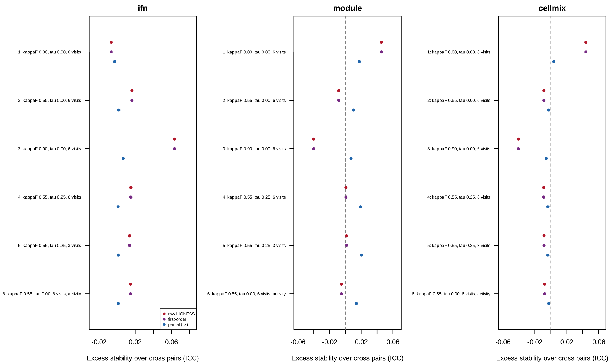
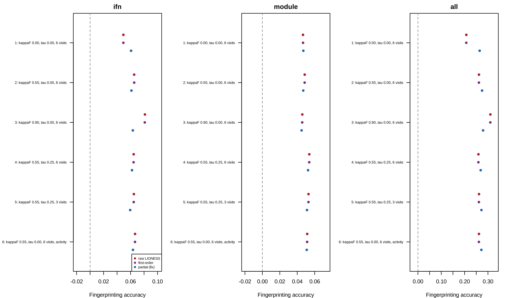

```{r}
#| label: setup
#| include: false

source("../templates/pilot-report/report-helpers.R")
devtools::load_all("..", quiet = TRUE)
s <- readRDS("results/cell_summaries.rds")
v <- readRDS("results/verdict.rds")
ka <- readRDS("results/known_answers.rds")
design <- readRDS("results/design.rds")
run <- readRDS("results/run_info.rds")
dat <- readRDS("results/data_summary.rds")
G <- function(cell, q) s$mean[s$cell == cell & s$quantity == q]
M <- function(cell, q) s$mcse[s$cell == cell & s$quantity == q]
gm <- function(cell, q, d = 3) sprintf("%s (MCSE %s)", fmt(G(cell, q), d), fmt(M(cell, q), 4))
cl <- v$clauses
status <- v$status
n_rep <- run$n_rep
outcome <- function(q, c) {
  o <- cl$outcome[cl$question == q & cl$clause == c]
  if (any(o == "fail")) "fail" else if (any(o == "close")) "close call" else "pass"
}
c1b <- cl[cl$question == 1 & cl$clause == "(b)", ]
c3a <- cl[cl$question == 3 & cl$clause == "(a)", ]
cell_lab <- function(cl) {
  d <- design[design$cell == cl, ]
  sprintf("cell %d (IFN stability %s, personal module %s, %d visits%s)", cl,
          fmt(d$kappa_f, 2), fmt(d$tau, 2), d$visits,
          if (d$gamma > 0) ", activity changes the module" else "")
}
```

# Summary

**Scope.** This document reports the pilot[^pilot] of the re-scoped project (`proposal.md`, final 2026-11-16): whether LIONESS personal networks are personal, that is, stable over repeated visits of the same person, able to identify her, and predictive of her next disease activity, and how much of each is the interferon level and the blood-cell mix. It was built from `project-spec.md`, `decisions.md`, and the saved results in `pilot-d/results/`; every number is computed from those files when the document renders.

**Status.** In `STATUS.md` the pilot is marked `` `r status` ``[^pf]. Every clause the rule names as deciding passed: edges equal their formula, the fix removes the interferon part of edge stability, and the fix keeps a real personal network. The interferon part was smaller than the thresholds, identification barely depended on it, and edges carried no signal of the next visit's activity.

| Pilot question | Answer | Key evidence |
|---------|-------------|---------------------------------------------|
| 1. Does the effect exist, and do edges equal their formula? | `r outcome(1, "(a)")` and `r outcome(1, "(b)")` | Excess stability of interferon pairs `r gm(3, "x_raw_ifn")` at very stable interferon; raw and first-order stability differed by `r fmt_range(c1b$value, 6)` across all cells and pair groups. |
| 2. Large enough at the measured interferon stability? | `r outcome(2, "(a)")` and `r outcome(2, "(b)")` | Excess `r gm(2, "x_raw_ifn")`; identification on interferon pairs fell by `r gm(2, "fpgap_ifn")` with the fix. |
| 3. Is there a fix, and do edges predict? | `r outcome(3, "(a)")`, `r outcome(3, "(b)")`, `r outcome(3, "(c)")` | Fixed excess `r fmt_range(c3a$value, 4)`; the fix kept the real module (`r gm(4, "keep_module", 4)`); edges over genes for next-visit activity `r gm(6, "d1_N1_vs_E1", 4)`. |

**What needs your decision** (details in [Action items and limitations](#action-items-and-limitations)): the status call, and whether the paper's message becomes the low reliability of single-sample edges (decisions log, D2 and D3) rather than an interferon-driven stability.

# The idea

## In plain language

LIONESS[^lioness] gives every blood sample a value for every pair of genes, an edge, and the set of edges is read as that person's own network. If it is truly hers, it should look much the same when her blood is drawn again three months later, and it should pick her out from other people. An edge is almost exactly the product of the person's two standardized gene levels, so anything stable about her, such as a steady interferon[^ifn] level or her own typical gene levels, makes her edges look stable, whether or not her genes work together in a personal way. Suppose a child's interferon genes always sit 1 unit above average: their product is about 1 at every visit, so the edge "repeats", although nothing about coordination is personal. This pilot simulates 131 children with six visits each, at the interferon stability measured in real children with lupus, and asks how stable edges are, how much of it is interferon, whether a corrected edge removes that part and keeps a real personal network, and whether edges predict the next visit's disease activity.

## Potential impact

LIONESS is used to give each person a network [@kuijjer2019lioness; @kuijjer2019lionessr], and its reproducibility has been checked across reference sets but not across repeated samples of the same person. Blood gene expression is known to be partly person-specific [@whitney2003individuality; @mishra2026temporal], the lupus interferon signature is stable within patients [@petri2019stability], and cell composition drives much bulk co-expression [@farahbod2020composition]; networks have been used to identify people from brain scans [@finn2015fingerprinting].

The pilot shows that single-sample edges are unreliable over visits: their stability ranged over `r fmt_range(s$mean[grepl("^icc_raw_", s$quantity)], 2)` (@tbl-icc), so one visit's network says little about the next. What stability they have is mostly the person's own gene levels; interferon pairs became about twice as stable when interferon was stable (`r fmt(G(1, "icc_raw_ifn"), 3)` to `r fmt(G(2, "icc_raw_ifn"), 3)`), but the pre-registered excess over cross pairs was only `r gm(2, "x_raw_ifn")`. The first-order formula reproduces every edge's stability exactly, and the corrected edges remove the interferon part while keeping a real personal module (@fig-stability). For a user, the message is that a personal network is a poor biomarker on its own, and that its apparent personality is largely what the gene levels already carry.

## Application: the study behind the data

### The study

The data come from a longitudinal study of children with systemic lupus erythematosus[^sle] [@banchereau2016personalized], https://doi.org/10.1016/j.cell.2016.03.008, GEO series GSE65391[^geo]: whole-blood transcriptomes at repeated visits, with disease activity (SLEDAI) and measured blood-cell counts at every visit, and healthy children for comparison. The study reported a prevalent interferon signature, a plasmablast signature tracking activity, and neutrophil enrichment toward active nephritis. @tbl-data gives the sizes and the within-child stability measured in this project.

```{r}
#| label: tbl-data
#| tbl-cap: "GSE65391, from `results/data_summary.rds` (`pilot-d/describe_data.R`): sizes and within-child stability (intraclass correlation) among children with two or more visits."

cnt <- dat$counts
knitr::kable(data.frame(
  Quantity = c("Lupus visits", "Children with lupus", "Children with two or more visits",
               "Their visits", "Healthy samples", "IFN5 score stability", "Neutrophil % stability",
               "Lymphocyte % stability", "SLEDAI stability", "Median days between visits"),
  Value = c(cnt[c("sle_visits", "sle_children", "children_multi", "visits_multi", "healthy_samples")],
            fmt(dat$icc, 2), fmt(dat$gap_days["Median"], 0))), row.names = FALSE)
```

### Why the stability of edges

The quantity is the intraclass correlation of each edge over a person's visits: the share of its variation that is between people rather than within a person over time. A personal network needs a high value; a value that comes from interferon or from the person's gene levels is not network information.

### Did the original study compute it?

No. The original study analysed gene modules with mixed models and stratified patients; it built no single-sample networks and measured no stability of edges.

## In symbols

The person's IFN factor ($F_{wv}$ at visit $v$ of person $w$, with within-person intraclass correlation $\kappa$), the standardized expression ($z$), and the reference correlation ($r$) determine the edge and the stability its factor part inherits:

$$
\begin{aligned}
e_{wv} &= r + z_{wvi} z_{wvj} - \frac{r}{2}\left(z_{wvi}^2 + z_{wvj}^2\right) + O_p\left(N^{-1}\right), \\
\mathrm{E}\left[e_{wv} \mid F_{wv}\right] &= \text{const} + \left[\lambda_i \lambda_j - \frac{r}{2}\left(\lambda_i^2 + \lambda_j^2\right)\right] F_{wv}^2, \\
\mathrm{ICC}\left(F^2\right) &= \kappa^2 .
\end{aligned}
$$

| Symbol | Meaning |
|----|------------------------------|
| $F_{wv}$, $\kappa$ | IFN factor of person $w$ at visit $v$; its within-person intraclass correlation |
| $z_{wvi}$ | expression of gene $i$, standardized by the reference |
| $e_{wv}$ | LIONESS edge of the pair $(i, j)$ for that sample |
| $\mathrm{ICC}$ | intraclass correlation over visits |

The target is the stability of a person's own co-expression; the computable quantity, the stability of her edges, adds the factor part (stable to $\kappa^2$ times its share of the edge's variance) and the part from her stable gene levels.

```{r}
#| label: fig-idea
#| fig-cap: "The idea, an illustration on made-up numbers (not pilot output): 131 simulated people, six visits each, very stable IFN and no personal network. Each line is one person's edge for two IFN genes across visits; left raw, right after the fix."
#| fig-width: 10
#| fig-height: 4

set.seed(21)
coh <- SimulateRepeatedCohort(131, 6, kappa_f = 0.9)
g <- coh$x[, 6:50]
sc <- rowMeans(StandardizeN(coh$x[, 1:5])$z)
ed <- list(raw = LionessEdges(g)[, 1], partial = LionessPartialEdges(g, cbind(sc, coh$comp))[, 1])
par(mfrow = c(1, 2), mar = c(4.2, 4.2, 2, 1))
for (k in names(ed)) {
  m <- matrix(ed[[k]], nrow = 6)
  matplot(1:6, m[, 1:30], type = "l", lty = 1, col = adjustcolor("grey30", 0.4), xlab = "Visit",
          ylab = "Edge, genes 6 and 7", main = if (k == "raw") "Raw LIONESS" else "Partial (fix)")
}
```

```{r}
#| label: fig-data
#| fig-cap: "The real data (GSE65391, from `results/data_summary.rds`): the IFN5 score over visits for 20 children with the most visits."
#| fig-width: 9
#| fig-height: 3.8

d <- dat$samples
top <- names(sort(table(d$subject), decreasing = TRUE))[1:20]
par(mar = c(4.2, 4.2, 1, 1))
plot(NA, xlim = range(d$cumulative_time[d$subject %in% top], na.rm = TRUE), ylim = range(d$ifn),
     xlab = "Days since first visit", ylab = "IFN5 score")
for (k in top) { z <- d[d$subject == k, ]; z <- z[order(z$cumulative_time), ]
  lines(z$cumulative_time, z$ifn, col = adjustcolor("#B2182B", 0.5)) }
```

## Critiquing the model



| Feature of the model | Why it may not be realistic | What should be done to check it |
|-----------|----------------------------------------------|---------------------------------|
| One IFN factor, stability $\kappa_F$ the same for everyone | Some children change IFN a lot, others not at all | Let $\kappa_F$ vary by person, from the data |
| Person gene levels of variance 0.5, independent across genes | Real person-level differences are correlated across genes | Estimate them from GSE65391 |
| Six equally spaced visits | Real visits are irregular, two to 22 per child | Mirror each child's visits |
| A personal module of spread 0.25 | The size of real personal co-expression is unknown | Vary it; estimate from data |
| Activity linked to one module through a smooth curve | Real flares may change many genes abruptly | Simulate flares as rare large changes |
| Normal noise | Array data have heavier tails | Resample residuals from the data |

# Methods

## Design

The pilot simulates 131 people with repeated visits in `r nrow(design)` cells. Fifty genes: genes 1 to 20 follow the IFN factor (score: genes 1 to 5), genes 31 to 50 follow an observed cell-mix factor, and genes 21 to 30 form a module whose correlation may be personal or change with activity. Every gene carries the person's own level. Edges are computed on all samples; each edge's intraclass correlation over visits and fingerprinting accuracy are measured for raw, first-order, and partial-correlation edges; in three cells, six models predict the next visit's activity with folds by person[^cv].

```{r}
#| label: fig-design
#| fig-cap: "The design at a glance. Each row is one part of the pilot. Stability is in @tbl-icc and @fig-stability, identification in @tbl-fp and @fig-fp, prediction in @tbl-pred, the verdict in @tbl-verdict, and the known-answer checks in @tbl-known-answer."
#| fig-width: 11
#| fig-height: 5.6

design_diagram(
  input = "131 simulated people, 3 or 6 visits: IFN factor (genes 1-20), personal or activity-linked module (21-30), observed cell mix (31-50), person gene levels",
  lanes = list(
    list(label = "Part A: stability", fill = "#e8f0fa", sim = "IFN stable to 0, 0.55, or 0.9; module personal or not", vary = "IFN stability; module; visits", est = "Raw, first-order, partial edges", meas = "Intraclass correlation by pair group; excess over cross pairs", out = "Questions 1, 2(a), 3(a), 3(b)"),
    list(label = "Part B: identification", fill = "#eaf5ea", sim = "Visit 2 against visit 1", vary = "As part A", est = "Same edges", meas = "Share of people identified", out = "Question 2(b)"),
    list(label = "Part C: prediction", fill = "#fdeceb", sim = "Activity unrelated, or changing the module", vary = "Activity link", est = "R0, R1, E1, F1, N1", meas = "Concordance of next-visit activity", out = "Question 3(c)")),
  harness = list(text = "Known-answer checks: exact edge = leave-one-out LIONESS; partial correlation = inverse-covariance formula;\nICC = analysis of variance; ICC of a squared factor = kappa squared; identical visits identified", out = "Known-answer table"))
```

| Part | Cells | Main factors | Replicates |
|----|-------------------------|-------------------------|----------|
| A, B | 1 to 6 | IFN stability 0, 0.55, 0.9; module 0 or 0.25; 6 or 3 visits | `r n_rep` per cell |
| C | 1, 2, 6 | activity unrelated or changing the module | `r n_rep` per cell |

The edge types are raw LIONESS edges, first-order edges (the one-line formula), and partial-correlation LIONESS edges given the IFN score and the observed cell mix (the fix). The prediction models are those of the first project, fitted by elastic net[^enet] and scored by the concordance index[^cindex].

## Known-answer checks



```{r}
#| label: tbl-known-answer
#| tbl-cap: "Known-answer checks, from `results/known_answers.rds`."

rows <- lapply(seq_len(nrow(ka)), function(i) {
  k <- ka[i, ]
  if (k$type == "identity") {
    tol <- if (grepl("First-order|squared factor|chance", k$check)) 0.05 else 1e-8
    harness_row(k$check, k$setting, fmt(k$known, 3), formatC(k$computed, format = "g", digits = 3),
                harness_reading_tol(k$computed, k$known, tol))
  } else {
    harness_row(k$check, k$setting, fmt(k$known, 3), sprintf("%s (MCSE %s)", fmt(k$computed, 4), fmt(k$mcse, 4)),
                harness_reading_mcse(k$computed, k$known, k$mcse))
  }
})
harness_table(rows)
```

`r harness_flag_summary((ka$computed - ka$known)[ka$type == "mcse"] / ka$mcse[ka$type == "mcse"])`

# Results

## How to read the outputs



This pilot reports intraclass correlations (0 when an edge changes completely between visits, 1 when it never changes), their excess over cross pairs, the share of people identified (chance is 1 in 131), and concordance (0.5 is chance).

## Stability

**Figure guide (part A).** Each panel is one pair group; each row one cell. Red points are raw edges, purple first-order edges, blue the fix; the value is the excess stability over cross pairs, and the dashed line is no excess. Look for: whether red and purple points coincide everywhere; whether the red IFN points move right as IFN stability rises (cells 1, 2, 3) and the blue ones stay at the line; whether the blue module points move right in cells 4 and 5.

```{r}
#| label: fig-stability
#| fig-cap: "Pilot result (part A): excess stability over cross pairs by cell and pair group, means over replicates, from `results/cell_summaries.rds`."
#| fig-width: 11
#| fig-height: 6


```

## Identification

**Figure guide (part B).** As above, with the share of people identified from one other visit. Look for: how far above chance (under 0.01) the points sit, and whether the fix changes them.

```{r}
#| label: fig-fp
#| fig-cap: "Pilot result (part B): fingerprinting accuracy by cell and pair group, from `results/cell_summaries.rds`."
#| fig-width: 11
#| fig-height: 6


```

## Numbered findings

Each finding is a claim followed by the output behind it. Read the claim, open the output, and check that you can see the claim there before accepting it.

1. **Edges equal their formula in stability.** Raw and first-order edges differed by `r fmt_range(c1b$value, 6)` in intraclass correlation across all cells and groups (@tbl-verdict).
2. **Single-sample edges are unreliable over visits.** Every group's raw intraclass correlation lay between `r fmt_range(s$mean[grepl("^icc_raw_", s$quantity)], 3)` (@tbl-icc).
3. **Stable interferon makes interferon edges more stable, but cross pairs too.** Interferon pairs went from `r fmt(G(1, "icc_raw_ifn"), 3)` (no stable IFN) to `r fmt(G(2, "icc_raw_ifn"), 3)` (measured) and `r fmt(G(3, "icc_raw_ifn"), 3)` (very stable); cross pairs from `r fmt(G(1, "icc_raw_cross"), 3)` to `r fmt(G(2, "icc_raw_cross"), 3)` and `r fmt(G(3, "icc_raw_cross"), 3)`, so the pre-registered excess was `r gm(2, "x_raw_ifn")` and `r gm(3, "x_raw_ifn")` (clauses 1(a), 2(a) fail).
4. **The fix removes the interferon part and keeps a real personal module.** Fixed excess `r fmt_range(c3a$value, 4)`; in `r cell_lab(4)` the fixed module excess was `r gm(4, "x_partial_module")` against `r gm(4, "x_raw_module")` raw (clauses 3(a), 3(b)).
5. **Identification comes mostly from the person's gene levels.** On all pairs, `r gm(2, "fp_raw_all")` of people were identified raw and `r gm(2, "fp_partial_all")` after the fix; on interferon pairs the fix changed it by `r gm(2, "fpgap_ifn")` (@tbl-fp; clause 2(b) fail).
6. **Edges do not predict the next visit's activity.** Concordances sat near `r fmt(G(2, "E1"), 2)` and edges added `r gm(6, "d1_N1_vs_E1", 4)` over genes even when activity changed the module (@tbl-pred).
7. **The known-answer checks hold** (@tbl-known-answer).

## Tables

**Table guide (stability).** Mean intraclass correlation by cell, edge type, and pair group; compare the IFN column with the cross column within a row.

```{r}
#| label: tbl-icc
#| tbl-cap: "Mean intraclass correlation of edges over visits, from `results/cell_summaries.rds`."

mk <- function(t) sapply(design$cell, function(c) paste(sapply(c("ifn", "cross", "module", "cellmix"),
  function(gp) fmt(G(c, sprintf("icc_%s_%s", t, gp)), 3)), collapse = " / "))
knitr::kable(data.frame(Cell = sapply(design$cell, cell_lab), `Raw (IFN / cross / module / cell mix)` = mk("raw"),
  `Fix (IFN / cross / module / cell mix)` = mk("partial"), check.names = FALSE), row.names = FALSE)
```

**Table guide (identification).** Share of people identified, raw and fixed, on IFN pairs and on all pairs.

```{r}
#| label: tbl-fp
#| tbl-cap: "Fingerprinting accuracy (MCSE), from `results/cell_summaries.rds`."

knitr::kable(data.frame(Cell = sapply(design$cell, cell_lab),
  `Raw, IFN` = sapply(design$cell, gm, q = "fp_raw_ifn"), `Fix, IFN` = sapply(design$cell, gm, q = "fp_partial_ifn"),
  `Raw, all` = sapply(design$cell, gm, q = "fp_raw_all"), `Fix, all` = sapply(design$cell, gm, q = "fp_partial_all"),
  check.names = FALSE), row.names = FALSE)
```

**Table guide (prediction).** Concordance of each model for the next visit's activity, in the three prediction cells.

```{r}
#| label: tbl-pred
#| tbl-cap: "Concordance of next-visit activity predictions, from `results/cell_summaries.rds`."

pc <- c(1, 2, 6); mods <- c("R0", "R1", "E1", "F1", "N1")
tab <- data.frame(Cell = sapply(pc, cell_lab))
for (m in mods) tab[[m]] <- fmt(sapply(pc, G, q = m), 3)
knitr::kable(tab, row.names = FALSE)
```

**Table guide (the verdict).** One row per clause, read by `pilot-d/verdict.R`; clause 1(b) is shown as its range.

```{r}
#| label: tbl-verdict
#| tbl-cap: "The pass rule applied clause by clause, from `results/verdict.rds` (clause 1(b) summarized over its 24 rows)."

vt <- cl[!(cl$question == 1 & cl$clause == "(b)"), ]
vt <- rbind(data.frame(question = 1, clause = "(b)", cell = "1 to 6", quantity = "ICC raw - ICC F1, every group",
                       value = max(abs(c1b$value)), mcse = max(c1b$mcse), threshold = "|D| <= 0.02",
                       outcome = if (all(c1b$outcome == "pass")) "pass" else "fail"), vt)
vt$value <- fmt(as.numeric(vt$value), 4); vt$mcse <- fmt(as.numeric(vt$mcse), 4)
knitr::kable(vt[, c("question", "clause", "cell", "quantity", "value", "mcse", "threshold", "outcome")],
             col.names = c("Q", "Clause", "Cell", "Quantity", "Value", "MCSE", "Threshold", "Outcome"), row.names = FALSE)
```

**Table guide (numbers quoted in the spec).** Each row recomputes a number quoted in section 3 of the spec.

```{r}
#| label: tbl-spec-numbers
#| tbl-cap: "Numbers quoted in the spec's section 3, recomputed from `results/cell_summaries.rds` and `results/verdict.rds`."

knitr::kable(data.frame(
  Quantity = c("1(a): X raw (IFN), cell 3", "1(b): largest |ICC raw - ICC F1|", "2(a): X raw (IFN), cell 2",
               "2(b): P raw - P fix (IFN), cell 2", "3(a): X fix (IFN), cells 2 and 3",
               "3(b): fix keeps module, cell 4", "3(c): C(N1) - C(E1), cell 6", "Status"),
  Value = c(gm(3, "x_raw_ifn"), fmt(max(abs(c1b$value)), 6), gm(2, "x_raw_ifn"), gm(2, "fpgap_ifn"),
            fmt_range(c3a$value, 4), gm(4, "keep_module", 4), gm(6, "d1_N1_vs_E1", 4), status)), row.names = FALSE)
```

# The draft spec {#draft-spec}

This is `project-spec.md`, read from the file when the document renders. Anything the agent[^agent] left for the user to decide is highlighted in yellow and starts with "To confirm".

```{r}
#| label: spec
#| results: asis

cat(read_md_part("../project-spec.md", highlight_to_confirm = TRUE), "\n")
```

# Decisions log {#decisions-log}

This is the agent's `decisions.md` for the pilot, read from the file when the document renders.

```{r}
#| label: decisions
#| results: asis

cat(read_md_part("decisions.md"), "\n")
```

# Action items and limitations {#action-items-and-limitations}

## Action items

1. **Decide the status.** The rule gives `piloted-close-call`; both readings are in the decisions log (D1).
2. **Decide the paper's message.** The pilot points to the low reliability of single-sample edges, and to the person's gene levels as the source of what stability they have (D2, D3), more than to an interferon-driven stability.
3. **Confirm the re-scope with the supervisor** (the yellow item in the spec and proposal section 9).
4. **Verify the citations**; @devlin1975robust lacks its full text.

## Limitations

- Everything here is simulation; no edge of GSE65391 was computed.
- The thresholds of clauses 1(a) and 2(a) were set from a sketch that ignored the noise share of the edge (D2).
- The cross pairs carry part of the interferon effect, so the pre-registered excess understates it (D2).
- One reference choice, equal visits, normal noise.



[^lioness]: LIONESS (Linear Interpolation to Obtain Network Estimates for Single Samples) builds a network from all samples and again without one sample, and scales the difference to give that sample's network.

[^ifn]: Interferons are signalling proteins of the immune system; many genes respond to them together, and their summed expression, the interferon score, is high in many patients with lupus.

[^geo]: The Gene Expression Omnibus (GEO) is the public archive of the US National Center for Biotechnology Information for gene expression data; a series (GSE) holds one study's samples.

[^sle]: Systemic lupus erythematosus is an autoimmune disease that can affect skin, joints, kidneys, and blood, and often flares in pregnancy.

[^cv]: In cross-validation the data are split into folds, each model is fitted without one fold and scored on it, and the scores are pooled; here every sample of a woman is in the same fold, so a woman's own samples never help predict each other.

[^enet]: The elastic net is logistic regression with a penalty that shrinks coefficients and sets many to zero, so it can use more features than samples; glmnet is the R package that fits it.

[^cindex]: The concordance index is the share of pairs of visits with different activity in which the visit with higher activity gets the higher prediction; 0.5 is chance and 1 is perfect, and for a yes-or-no outcome it equals the AUC.

