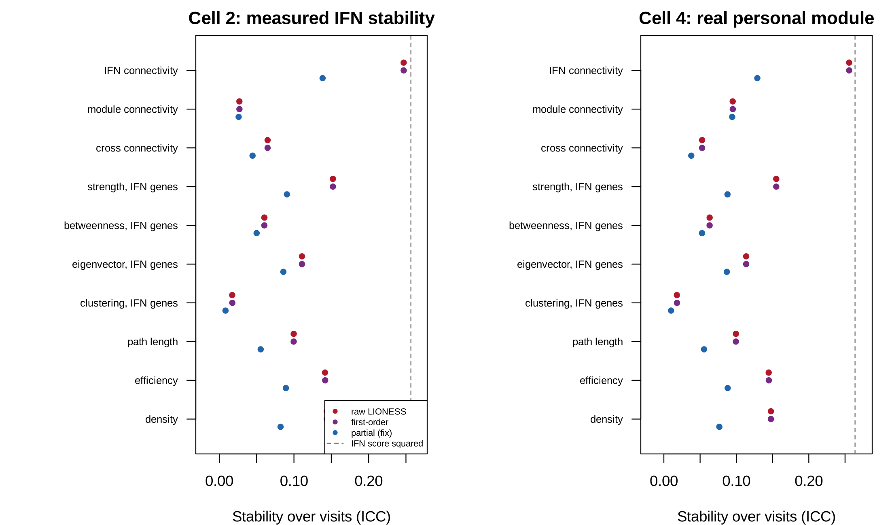

```{r}
#| label: setup
#| include: false

source("../templates/pilot-report/report-helpers.R")
devtools::load_all("..", quiet = TRUE)
s <- readRDS("results/cell_summaries.rds")
v <- readRDS("results/verdict.rds")
ka <- readRDS("results/known_answers.rds")
design <- readRDS("results/design.rds")
run <- readRDS("results/run_info.rds")
dat <- readRDS("../pilot-d/results/data_summary.rds")
G <- function(cell, q) s$mean[s$cell == cell & s$quantity == q]
M <- function(cell, q) s$mcse[s$cell == cell & s$quantity == q]
gm <- function(cell, q, d = 3) sprintf("%s (MCSE %s)", fmt(G(cell, q), d), fmt(M(cell, q), 4))
cl <- v$clauses
status <- v$status
n_rep <- run$n_rep
outcome <- function(q, c) {
  o <- cl$outcome[cl$question == q & cl$clause == c]
  if (any(o == "fail")) "fail" else if (any(o == "close")) "close call" else "pass"
}
c1a <- cl[cl$question == 1 & cl$clause == "(a)", ]
c1b <- cl[cl$question == 1 & cl$clause == "(b)", ]
c3a <- cl[cl$question == 3 & cl$clause == "(a)", ]
cell_lab <- function(cl) {
  d <- design[design$cell == cl, ]
  sprintf("cell %d (IFN stability %s, personal module %s)", cl, fmt(d$kappa_f, 2), fmt(d$tau, 2))
}
```

# Summary

**Scope.** This document reports the pilot[^pilot] of proposal revision 1 (`proposal.md`, section 12): network metrics built from LIONESS personal networks (connectivity, strength, betweenness, eigenvector centrality, clustering, path length, efficiency, density, hub overlap), their stability over repeated visits, and whether the correction separates real structure from expression. It was built from `project-spec.md`, `decisions.md`, the saved results in `pilot-e/results/`, and, read-only, the GSE65391 description in `pilot-d/results/`; every number is computed from those files when the document renders.

**Status.** In `STATUS.md` the pilot is marked `` `r status` ``[^pf]. The closed form and the equivalence of edges and their formula held for every metric, and a module's connectivity was its squared expression score; but the correction, which conditions on a five-gene interferon score, left the interferon set's connectivity more stable than the cross connectivity, a deciding clause.

| Pilot question | Answer | Key evidence |
|---------|-------------|---------------------------------------------|
| 1. Do the closed forms hold? | `r outcome(1, "(a)")` and `r outcome(1, "(b)")` | Correlation of IFN connectivity with the squared IFN score `r fmt_range(c1a$value, 3)` across cells; raw against first-order stability differed by at most `r fmt(max(abs(c1b$value)), 5)` over `r nrow(c1b)` metric-cell pairs. |
| 2. More stable than edges, and the score's stability? | `r outcome(2, "(a)")` and `r outcome(2, "(b)")` | IFN connectivity over IFN edges `r gm(2, "agg_ifn")`; over the squared IFN score `r gm(2, "expl_ifn", 4)`. |
| 3. Does the correction separate real structure? | `r outcome(3, "(a)")` and `r outcome(3, "(b)")` | Corrected IFN connectivity over cross `r fmt_range(c3a$value, 3)` (target within 0.05 of 0); corrected module connectivity over cross `r gm(4, "fix_module")`. |

**What needs your decision** (details in [Action items and limitations](#action-items-and-limitations)): the status; whether to re-pilot with a correction that uses each module's own score; and how the paper uses the finding that module connectivity is its squared expression score.

# The idea

## In plain language

A single LIONESS[^lioness] edge between two genes is noisy from one blood sample to the next, so the supervisor suggested looking at summaries of each person's network instead: how strongly a group of genes is connected, how central a gene is, how far apart genes are. Summaries average many edges and should be steadier. But each edge is almost exactly the product of the person's two gene levels, so the average edge inside a group of genes is almost exactly the square of the group's average level. If the interferon[^ifn] genes sit 1 unit above average in a child, their connectivity is about 1; at 2 units it is about 4. This pilot simulates 131 children with six visits each and asks how stable each summary is, whether that stability is just the stability of the gene group's squared level, and whether a corrected network removes the interferon part and keeps a real personal network.

## Potential impact

LIONESS is used to build a network for each person [@kuijjer2019lioness; @kuijjer2019lionessr]; per-person network summaries such as weighted degree have been used as biomarkers, and the test-retest reliability of graph metrics is well studied for brain networks [@finn2015fingerprinting]. Blood expression is partly person-specific [@whitney2003individuality; @mishra2026temporal], the lupus interferon signature is stable within patients [@petri2019stability], and cell composition drives much bulk co-expression [@farahbod2020composition].

The pilot shows that a module's connectivity is, in practice, its squared expression score: the correlation was `r fmt_range(c1a$value, 3)` in every cell, and the connectivity's stability (`r fmt(G(2, "icc_raw_conn_ifn"), 3)`) matched that of the squared score (`r fmt(G(2, "icc_score2"), 3)`) at the measured interferon stability (@tbl-metrics). Summaries were steadier than single edges, but because they track expression. Averaging did make a real personal module visible (`r fmt(G(4, "icc_raw_conn_module"), 3)` against `r fmt(G(2, "icc_raw_conn_module"), 3)`), which single edges hardly showed. A five-gene interferon score was not enough to correct connectivity (@fig-metrics). For users, the message is that a network summary should first be compared with the gene set's own expression score.

## Application: the study behind the data

### The study

The data proposed for the application come from a longitudinal study of children with systemic lupus erythematosus[^sle] [@banchereau2016personalized], https://doi.org/10.1016/j.cell.2016.03.008, GEO series GSE65391[^geo], with repeated blood samples and disease activity at every visit. @tbl-data gives the sizes and stabilities measured in this project, which set the simulation's levels.

```{r}
#| label: tbl-data
#| tbl-cap: "GSE65391, from `../pilot-d/results/data_summary.rds` (read-only): sizes and within-child stability among children with two or more visits."

cnt <- dat$counts
knitr::kable(data.frame(
  Quantity = c("Children with two or more visits", "Their visits", "IFN5 score stability",
               "Neutrophil % stability", "Lymphocyte % stability", "SLEDAI stability"),
  Value = c(cnt[c("children_multi", "visits_multi")], fmt(dat$icc, 2))), row.names = FALSE)
```

### Why the stability of network metrics

The quantity is each metric's intraclass correlation over a person's visits. A metric is a candidate personal biomarker only if it is stable and carries more than the gene set's own expression score.

### Did the original study compute it?

No. The original study analysed expression modules; it built no single-sample networks and computed no network metrics.

## In symbols

The mean standardized expression of a gene set $S$ of size $m$ in sample $q$ ($\bar z_{qS}$) and its edges ($e_{qij}$) give the set's connectivity ($C_{qS}$):

$$
\begin{aligned}
C_{qS} &= \binom{m}{2}^{-1} \sum_{i < j \in S} e_{qij}, \\
C_{qS} &\approx \bar r_S + \frac{m}{m - 1}\, \bar z_{qS}^{\,2} - \frac{1}{m (m - 1)} \sum_{i \in S} z_{qi}^2 - \frac{\bar r_S}{m} \sum_{i \in S} z_{qi}^2 .
\end{aligned}
$$

| Symbol | Meaning |
|----|------------------------------|
| $S$, $m$ | a gene set and its size |
| $\bar z_{qS}$ | mean standardized expression of the set in sample $q$ |
| $C_{qS}$ | mean LIONESS edge within the set (connectivity) |
| $\bar r_S$ | mean reference correlation within the set |

Line 2 averages the first-order edge over the pairs and uses $\sum_{i<j} z_i z_j = \tfrac{1}{2}[(\sum z_i)^2 - \sum z_i^2]$. The leading varying term is the squared set score; the other terms are small for a set of 15 genes.

```{r}
#| label: fig-idea
#| fig-cap: "The idea, an illustration on made-up numbers (not pilot output): 200 simulated samples; each point is one sample's IFN-set connectivity against its squared IFN-set score."
#| fig-width: 6
#| fig-height: 4.5

set.seed(21)
coh <- SimulateRepeatedCohort(100, 2, kappa_f = 0.55)
g <- coh$x[, 6:50]
e <- LionessEdges(g)
conn <- apply(e, 1, function(r) NetworkMetrics(r, 45, NodeSetsE())$global[["conn_ifn"]])
score <- rowMeans(StandardizeN(g[, 1:15])$z)
par(mar = c(4.2, 4.2, 1, 1))
plot(score^2, conn, pch = 19, cex = 0.6, col = "#2166AC", xlab = "Squared IFN-set score", ylab = "IFN-set connectivity")
```

```{r}
#| label: fig-data
#| fig-cap: "The real data (GSE65391, from `../pilot-d/results/data_summary.rds`): the squared IFN5 score over visits for 20 children with the most visits."
#| fig-width: 9
#| fig-height: 3.8

d <- dat$samples
top <- names(sort(table(d$subject), decreasing = TRUE))[1:20]
par(mar = c(4.2, 4.2, 1, 1))
plot(NA, xlim = range(d$cumulative_time[d$subject %in% top], na.rm = TRUE), ylim = range(d$ifn^2),
     xlab = "Days since first visit", ylab = "Squared IFN5 score")
for (k in top) { z <- d[d$subject == k, ]; z <- z[order(z$cumulative_time), ]
  lines(z$cumulative_time, z$ifn^2, col = adjustcolor("#B2182B", 0.5)) }
```

## Critiquing the model



| Feature of the model | Why it may not be realistic | What should be done to check it |
|-----------|----------------------------------------------|---------------------------------|
| The correction conditions on a five-gene score | A short score measures the factor with error and carries person-specific levels | Use each set's own leave-one-gene-out score |
| One threshold (absolute edge above 1) for the unweighted graph | Density and clustering depend on the threshold | Vary it, or use proportional thresholds |
| Distance as the inverse absolute edge | Path metrics depend on the transform | Compare with $1 - \lvert e\rvert$ |
| 45 genes | Real networks are larger; path metrics change with size | Repeat with hundreds of genes |
| Person gene levels independent across genes | Real person-level differences are correlated | Estimate from GSE65391 |
| Six equal visits | Real visits are irregular | Mirror each child's visits |

# Methods

## Design

The pilot simulates 131 people with six visits each in `r nrow(design)` cells, as in pilot-d: an IFN factor on genes 1 to 20 with stability 0, 0.55, or 0.9, an observed cell-mix factor on genes 31 to 50, person gene levels, and a module of genes 21 to 30 that is personal in one cell. For every sample and edge type (raw LIONESS, first-order, partial-correlation given the IFN score of genes 1 to 5 and the cell mix), the network metrics of section 3 of the pre-registration are computed over genes 6 to 50, and each metric's intraclass correlation over visits is estimated.

```{r}
#| label: fig-design
#| fig-cap: "The design at a glance. Stability by metric is in @tbl-metrics and @fig-metrics, the verdict in @tbl-verdict, the known-answer checks in @tbl-known-answer."
#| fig-width: 11
#| fig-height: 5

design_diagram(
  input = "131 simulated people, 6 visits: IFN factor (genes 1-20), module (21-30), observed cell mix (31-50), person gene levels",
  lanes = list(
    list(label = "Part A: closed form", fill = "#e8f0fa", sim = "IFN stability 0, 0.55, 0.9", vary = "IFN stability", est = "IFN-set connectivity, squared IFN-set score", meas = "Correlation over samples", out = "Question 1(a)"),
    list(label = "Part B: stability", fill = "#eaf5ea", sim = "As part A, and a personal module", vary = "IFN stability; module", est = "19 metrics, three edge types", meas = "Intraclass correlation over visits", out = "Questions 1(b), 2, 3")),
  harness = list(text = "Known-answer checks: path length, efficiency, density, betweenness, strength on a three-node graph;\nconnectivity against its definition; earlier edge and ICC checks", out = "Known-answer table"))
```

| Part | Cells | Main factors | Replicates |
|----|-------------------------|-------------------------|----------|
| A, B | 1 to 4 | IFN stability 0, 0.55, 0.9; personal module 0 or 0.25 | `r n_rep` per cell |

## Known-answer checks



```{r}
#| label: tbl-known-answer
#| tbl-cap: "Known-answer checks, from `results/known_answers.rds`."

rows <- lapply(seq_len(nrow(ka)), function(i) {
  k <- ka[i, ]
  if (k$type == "identity") {
    tol <- if (grepl("First-order|squared factor|chance", k$check)) 0.05 else 1e-8
    harness_row(k$check, k$setting, fmt(k$known, 3), formatC(k$computed, format = "g", digits = 3),
                harness_reading_tol(k$computed, k$known, tol))
  } else {
    harness_row(k$check, k$setting, fmt(k$known, 3), sprintf("%s (MCSE %s)", fmt(k$computed, 4), fmt(k$mcse, 4)),
                harness_reading_mcse(k$computed, k$known, k$mcse))
  }
})
harness_table(rows)
```

`r harness_flag_summary((ka$computed - ka$known)[ka$type == "mcse"] / ka$mcse[ka$type == "mcse"])`

# Results

## How to read the outputs



This pilot reports intraclass correlations (0 when a metric changes completely between visits, 1 when it never changes) and correlations over samples.

## Stability by metric

**Figure guide (part B).** Two panels, the measured interferon stability (cell 2) and the real personal module (cell 4). Each row is a metric; red points raw edges, purple first-order edges, blue the correction; the dashed line is the stability of the squared IFN score. Look for: whether red and purple coincide; whether the IFN connectivity sits on the dashed line; how far blue points move left; whether module connectivity moves right in cell 4.

```{r}
#| label: fig-metrics
#| fig-cap: "Pilot result (part B): stability over visits by metric and edge type, from `results/cell_summaries.rds`."
#| fig-width: 11
#| fig-height: 6


```

## Numbered findings

Each finding is a claim followed by the output behind it. Read the claim, open the output, and check that you can see the claim there before accepting it.

1. **A module's connectivity is its squared expression score.** The correlation over samples was `r fmt_range(c1a$value, 3)` in every cell (@tbl-verdict, clause 1(a)), and the connectivity's stability matched the squared score's within `r gm(2, "expl_ifn", 4)` (clause 2(b)).
2. **Edges and their formula give the same stability for every metric.** The largest difference over `r nrow(c1b)` metric-cell pairs was `r fmt(max(abs(c1b$value)), 5)` (clause 1(b)).
3. **Summaries are steadier than single edges.** IFN connectivity was more stable than IFN edges by `r gm(2, "agg_ifn")` (clause 2(a)).
4. **The five-gene correction does not correct connectivity.** The corrected IFN connectivity stayed more stable than the corrected cross connectivity by `r fmt_range(c3a$value, 3)` (clause 3(a) fail); without any stable interferon it was `r fmt(G(1, "icc_partial_conn_ifn"), 3)` against `r fmt(G(1, "icc_raw_conn_ifn"), 3)` raw (decisions log, D2).
5. **The correction does steady the summing metrics.** Density went from `r fmt(G(2, "icc_raw_density"), 3)` raw to `r fmt(G(2, "icc_partial_density"), 3)` corrected, near the null cell's `r fmt(G(1, "icc_raw_density"), 3)`; path length from `r fmt(G(2, "icc_raw_pathlen"), 3)` to `r fmt(G(2, "icc_partial_pathlen"), 3)` (@tbl-metrics).
6. **Averaging reveals a real personal module.** Module connectivity's stability was `r fmt(G(4, "icc_partial_conn_module"), 3)` with the personal module against `r fmt(G(2, "icc_partial_conn_module"), 3)` without (clause 3(b), a close call).
7. **Betweenness, clustering, and hubs are barely stable.** Their intraclass correlations stayed under about `r fmt(max(G(3, "icc_raw_betweenness_ifn"), G(3, "icc_raw_clustering_ifn")), 2)`, hub overlap under `r fmt(max(sapply(1:4, G, q = "hub_raw")), 2)` (@tbl-metrics).
8. **The known-answer checks hold** (@tbl-known-answer).

## Tables

**Table guide (stability).** Mean intraclass correlation over visits for each metric, raw against corrected, in each cell.

```{r}
#| label: tbl-metrics
#| tbl-cap: "Stability over visits (intraclass correlation) by metric, raw / corrected, from `results/cell_summaries.rds`."

mets <- c(conn_ifn = "IFN connectivity", conn_cross = "cross connectivity", conn_module = "module connectivity",
          strength_ifn = "strength, IFN genes", betweenness_ifn = "betweenness, IFN genes",
          eigen_ifn = "eigenvector, IFN genes", clustering_ifn = "clustering, IFN genes",
          pathlen = "path length", efficiency = "efficiency", density = "density")
tab <- data.frame(Metric = mets)
for (c in design$cell) tab[[sprintf("Cell %d", c)]] <- sapply(names(mets), function(k)
  sprintf("%s / %s", fmt(G(c, paste0("icc_raw_", k)), 3), fmt(G(c, paste0("icc_partial_", k)), 3)))
tab <- rbind(tab, data.frame(Metric = "squared IFN score", setNames(as.list(sapply(design$cell, function(c) fmt(G(c, "icc_score2"), 3))), sprintf("Cell %d", design$cell)), check.names = FALSE))
knitr::kable(tab, row.names = FALSE)
```

**Table guide (the verdict).** One row per clause; clause 1(b) summarized over its rows.

```{r}
#| label: tbl-verdict
#| tbl-cap: "The pass rule applied clause by clause, from `results/verdict.rds`."

vt <- cl[!(cl$question == 1 & cl$clause == "(b)"), ]
vt <- rbind(vt[vt$question == 1, ], data.frame(question = 1, clause = "(b)", cell = "1 to 4",
  quantity = "ICC raw - ICC F1, every metric", value = max(abs(c1b$value)), mcse = max(c1b$mcse),
  threshold = "|D| <= 0.02", outcome = if (all(c1b$outcome == "pass")) "pass" else "fail"), vt[vt$question != 1, ])
vt$value <- fmt(as.numeric(vt$value), 4); vt$mcse <- fmt(as.numeric(vt$mcse), 4)
knitr::kable(vt[, c("question", "clause", "cell", "quantity", "value", "mcse", "threshold", "outcome")],
             col.names = c("Q", "Clause", "Cell", "Quantity", "Value", "MCSE", "Threshold", "Outcome"), row.names = FALSE)
```

**Table guide (numbers quoted in the spec).**

```{r}
#| label: tbl-spec-numbers
#| tbl-cap: "Numbers quoted in the spec's section 3 for pilot-e, recomputed from the result files."

knitr::kable(data.frame(
  Quantity = c("1(a): correlation with squared score, range", "1(b): largest |ICC raw - ICC F1|",
               "2(a): IFN connectivity over IFN edges, cell 2", "2(b): over squared score, cell 2",
               "3(a): corrected IFN over cross, cells 2 and 3", "3(b): corrected module over cross, cell 4", "Status"),
  Value = c(fmt_range(c1a$value, 3), fmt(max(abs(c1b$value)), 5), gm(2, "agg_ifn"), gm(2, "expl_ifn", 4),
            fmt_range(c3a$value, 3), gm(4, "fix_module"), status)), row.names = FALSE)
```

# The draft spec {#draft-spec}

This is `project-spec.md`, read from the file when the document renders. Anything the agent[^agent] left for the user to decide is highlighted in yellow and starts with "To confirm".

```{r}
#| label: spec
#| results: asis

cat(read_md_part("../project-spec.md", highlight_to_confirm = TRUE), "\n")
```

# Decisions log {#decisions-log}

This is the agent's `decisions.md` for pilot-e, read from the file when the document renders.

```{r}
#| label: decisions
#| results: asis

cat(read_md_part("decisions.md"), "\n")
```

# Action items and limitations {#action-items-and-limitations}

## Action items

1. **Decide the status.** The rule gives `piloted-fail`, from the correction of connectivity (decisions log, D1 and D2).
2. **Decide whether to re-pilot** with a correction that uses each gene set's own score (D2), pre-registered before the run.
3. **Decide how the paper uses the closed form** that a module's connectivity is its squared expression score, which held in every cell.

## Limitations

- Everything here is simulation; no metric was computed on GSE65391.
- One threshold and one distance transform; 45 genes.
- No prediction of the next visit's activity.



[^lioness]: LIONESS (Linear Interpolation to Obtain Network Estimates for Single Samples) builds a network from all samples and again without one sample, and scales the difference to give that sample's network.

[^ifn]: Interferons are signalling proteins of the immune system; many genes respond to them together, and their summed expression, the interferon score, is high in many patients with lupus.

[^geo]: The Gene Expression Omnibus (GEO) is the public archive of the US National Center for Biotechnology Information for gene expression data; a series (GSE) holds one study's samples.

[^sle]: Systemic lupus erythematosus is an autoimmune disease that can affect skin, joints, kidneys, and blood, and often flares in pregnancy.

[^cv]: In cross-validation the data are split into folds, each model is fitted without one fold and scored on it, and the scores are pooled; here every sample of a woman is in the same fold, so a woman's own samples never help predict each other.

[^enet]: The elastic net is logistic regression with a penalty that shrinks coefficients and sets many to zero, so it can use more features than samples; glmnet is the R package that fits it.

[^cindex]: The concordance index is the share of pairs of visits with different activity in which the visit with higher activity gets the higher prediction; 0.5 is chance and 1 is perfect, and for a yes-or-no outcome it equals the AUC.

