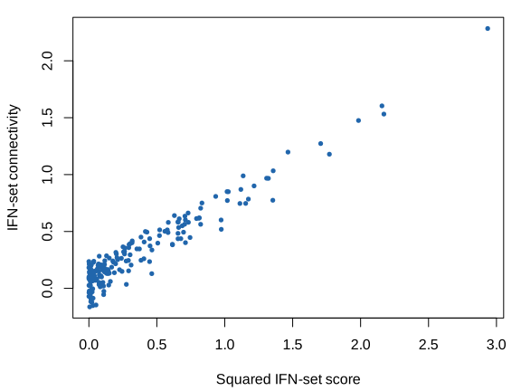
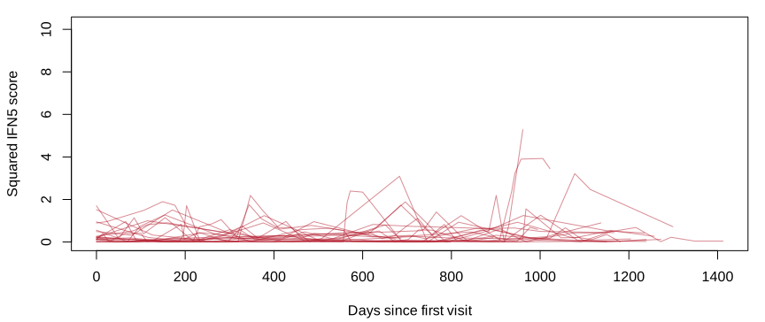
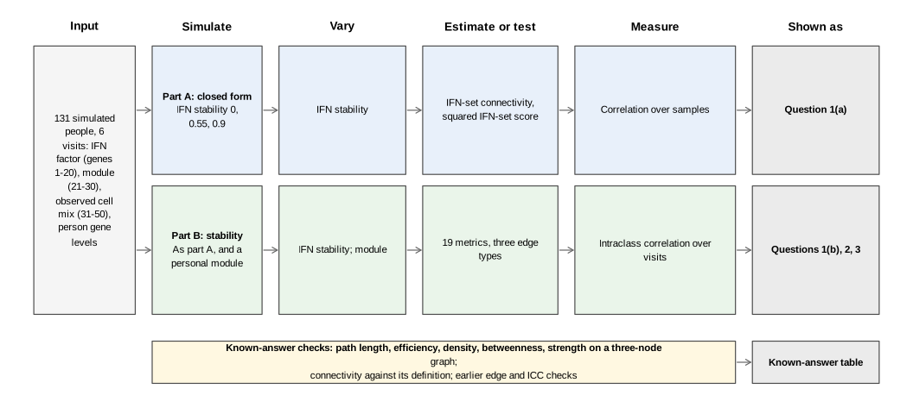
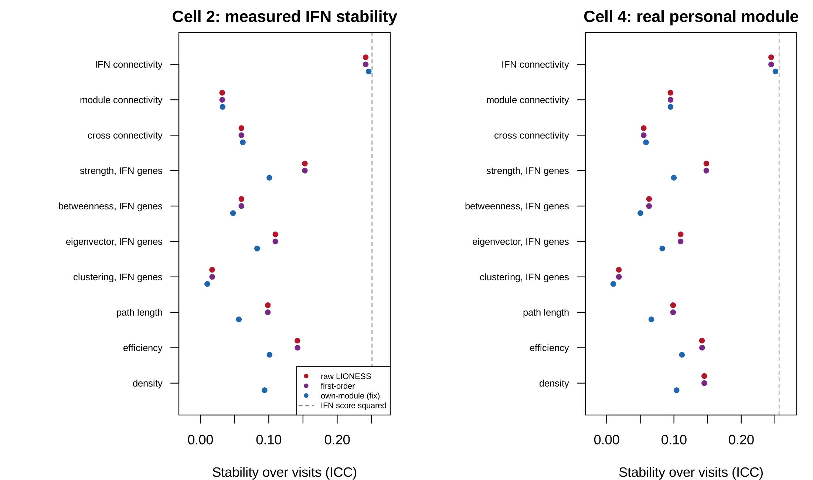

# Pilot report: the own-module correction of network metrics

2026-11-16

# Summary

**Scope.** This document reports the pilot[^1] of proposal revision 2
(`proposal.md`, section 13): the same network metrics as the previous
pilot (pilot-e), with a correction that regresses each gene on the mean
of the other genes of its own set and on the measured cell mix, in place
of the five-gene interferon score. It was built from `project-spec.md`,
`decisions.md`, the saved results in `pilot-f/results/`, and, read-only,
`pilot-e/results/` and the GSE65391 description in `pilot-d/results/`;
every number is computed from those files when the document renders.

**Status.** In `STATUS.md` the pilot is marked `piloted-fail`[^2]. The
closed form and the equivalence held again; the own-module correction
left the interferon set’s connectivity exactly as stable as the raw one,
because a set’s connectivity is its squared expression score up to a
scale that the correction cannot change (decisions log, D2).

| Pilot question | Answer | Key evidence |
|----|----|----|
| 1\. Do the closed forms hold? | pass and pass | Correlation of IFN connectivity with the squared IFN score 0.965 to 0.966 across cells; raw against first-order stability differed by at most 0.00043 over 76 metric-cell pairs. |
| 2\. More stable than edges, and the score’s stability? | pass and pass | IFN connectivity over IFN edges 0.100 (MCSE 0.0046); over the squared IFN score -0.0093 (MCSE 0.0011). |
| 3\. Does the correction separate real structure? | fail and fail | Corrected IFN connectivity over cross 0.184 to 0.521 (target within 0.05 of 0); corrected module connectivity over cross 0.036 (MCSE 0.0042). |

**What needs your decision** (details in [Action items and
limitations](#action-items-and-limitations)): the status, and whether
the paper reports the finding that a gene set’s LIONESS connectivity is
its squared expression score and cannot be corrected into a separate
network quantity.

# The idea

## In plain language

A single LIONESS[^3] edge between two genes is noisy from one blood
sample to the next, so the supervisor suggested looking at summaries of
each person’s network instead: how strongly a group of genes is
connected, how central a gene is, how far apart genes are. Summaries
average many edges and should be steadier. But each edge is almost
exactly the product of the person’s two gene levels, so the average edge
inside a group of genes is almost exactly the square of the group’s
average level. If the interferon[^4] genes sit 1 unit above average in a
child, their connectivity is about 1; at 2 units it is about 4. This
pilot simulates 131 children with six visits each and asks how stable
each summary is, whether that stability is just the stability of the
gene group’s squared level, and whether a corrected network removes the
interferon part and keeps a real personal network.

## Potential impact

LIONESS is used to build a network for each person (M. L. Kuijjer et al.
2019; Marieke L. Kuijjer et al. 2019); per-person network summaries such
as weighted degree have been used as biomarkers, and the test-retest
reliability of graph metrics is well studied for brain networks (Finn et
al. 2015). Blood expression is partly person-specific (Whitney et al.
2003; Mishra et al. 2026), the lupus interferon signature is stable
within patients (Petri et al. 2019), and cell composition drives much
bulk co-expression (Farahbod and Pavlidis 2020).

The pilot shows that a module’s connectivity is, in practice, its
squared expression score: the correlation was 0.965 to 0.966 in every
cell, and the connectivity’s stability (0.242) matched that of the
squared score (0.251) at the measured interferon stability
(<a href="#tbl-metrics" class="quarto-xref">Table 3</a>). Summaries were
steadier than single edges, but because they track expression. Averaging
did make a real personal module visible (0.095 against 0.032), which
single edges hardly showed. Neither a five-gene interferon score
(pilot-e) nor an adjustment by the set’s own genes corrected
connectivity (<a href="#fig-metrics" class="quarto-xref">Figure 4</a>;
decisions log, D2). For users, the message is that a network summary
should first be compared with the gene set’s own expression score.

## Application: the study behind the data

### The study

The data proposed for the application come from a longitudinal study of
children with systemic lupus erythematosus[^5] (Banchereau et al. 2016),
https://doi.org/10.1016/j.cell.2016.03.008, GEO series GSE65391[^6],
with repeated blood samples and disease activity at every visit.
<a href="#tbl-data" class="quarto-xref">Table 1</a> gives the sizes and
stabilities measured in this project, which set the simulation’s levels.

Table 1: GSE65391, from `../pilot-d/results/data_summary.rds`
(read-only): sizes and within-child stability among children with two or
more visits.

| Quantity                         | Value |
|:---------------------------------|:------|
| Children with two or more visits | 131   |
| Their visits                     | 897   |
| IFN5 score stability             | 0.55  |
| Neutrophil % stability           | 0.41  |
| Lymphocyte % stability           | 0.48  |
| SLEDAI stability                 | 0.39  |

### Why the stability of network metrics

The quantity is each metric’s intraclass correlation over a person’s
visits. A metric is a candidate personal biomarker only if it is stable
and carries more than the gene set’s own expression score.

### Did the original study compute it?

No. The original study analysed expression modules; it built no
single-sample networks and computed no network metrics.

## In symbols

The mean standardized expression of a gene set $S$ of size $m$ in sample
$q$ ($\bar z_{qS}$) and its edges ($e_{qij}$) give the set’s
connectivity ($C_{qS}$):

$$
\begin{aligned}
C_{qS} &= \binom{m}{2}^{-1} \sum_{i < j \in S} e_{qij}, \\
C_{qS} &\approx \bar r_S + \frac{m}{m - 1}\, \bar z_{qS}^{\,2} - \frac{1}{m (m - 1)} \sum_{i \in S} z_{qi}^2 - \frac{\bar r_S}{m} \sum_{i \in S} z_{qi}^2 .
\end{aligned}
$$

| Symbol        | Meaning                                               |
|---------------|-------------------------------------------------------|
| $S$, $m$      | a gene set and its size                               |
| $\bar z_{qS}$ | mean standardized expression of the set in sample $q$ |
| $C_{qS}$      | mean LIONESS edge within the set (connectivity)       |
| $\bar r_S$    | mean reference correlation within the set             |

Line 2 averages the first-order edge over the pairs and uses
$\sum_{i<j} z_i z_j = \tfrac{1}{2}[(\sum z_i)^2 - \sum z_i^2]$. The
leading varying term is the squared set score; the other terms are small
for a set of 15 genes.

Figure 1: The idea, an illustration on made-up numbers (not pilot
output): 200 simulated samples; each point is one sample’s IFN-set
connectivity against its squared IFN-set score.

Figure 2: The real data (GSE65391, from
`../pilot-d/results/data_summary.rds`): the squared IFN5 score over
visits for 20 children with the most visits.

## Critiquing the model

Any model is a simplification, and the useful question is not whether it
is true but where it bends and whether the bend matters for the question
being asked. The model above was chosen so that the problem could be
written as a formula and checked by simulation, and each simplification
that made that possible is a place where real data may behave
differently. The table lists the main ones. Work through it one row at a
time. The first column names the feature and the symbols in the
equations that carry it, so find them there first. Then decide in your
own words how the feature could fail for real data before reading the
second column, and finally read the third column for what should be done
to check it. Several of these checks are natural first tasks for the
project. Which of them the pilot examined, and which it left open, is
for you to find when you read the Methods and Results that follow.

| Feature of the model | Why it may not be realistic | What should be done to check it |
|----|----|----|
| The correction uses the set’s own genes | A set’s connectivity is its squared score up to scale, which no within-set adjustment changes | Correct from outside the set (other samples of the person, or an external reference) |
| One threshold (absolute edge above 1) for the unweighted graph | Density and clustering depend on the threshold | Vary it, or use proportional thresholds |
| Distance as the inverse absolute edge | Path metrics depend on the transform | Compare with $1 - \lvert e\rvert$ |
| 45 genes | Real networks are larger; path metrics change with size | Repeat with hundreds of genes |
| Person gene levels independent across genes | Real person-level differences are correlated | Estimate from GSE65391 |
| Six equal visits | Real visits are irregular | Mirror each child’s visits |

# Methods

## Design

The pilot simulates 131 people with six visits each in 4 cells, as in
pilot-d: an IFN factor on genes 1 to 20 with stability 0, 0.55, or 0.9,
an observed cell-mix factor on genes 31 to 50, person gene levels, and a
module of genes 21 to 30 that is personal in one cell. For every sample
and edge type (raw LIONESS, first-order, partial-correlation given the
IFN score of genes 1 to 5 and the cell mix), the network metrics of
section 3 of the pre-registration are computed over genes 6 to 50, and
each metric’s intraclass correlation over visits is estimated.

Figure 3: The design at a glance. Stability by metric is in
<a href="#tbl-metrics" class="quarto-xref">Table 3</a> and
<a href="#fig-metrics" class="quarto-xref">Figure 4</a>, the verdict in
<a href="#tbl-verdict" class="quarto-xref">Table 4</a>, the known-answer
checks in <a href="#tbl-known-answer" class="quarto-xref">Table 2</a>.

| Part | Cells | Main factors | Replicates |
|----|----|----|----|
| A, B | 1 to 4 | IFN stability 0, 0.55, 0.9; personal module 0 or 0.25 | 120 per cell |

## Known-answer checks

Known-answer checks come before any result, because every later number
is only as good as the simulation that produced it. Each check sets up a
case where the correct answer is known from theory, runs the simulation
code on it, and compares the two. Agreement says nothing about the
scientific question or about real data. It says that the code does what
the model says. Disagreement means stopping to look for a bug before
reading anything else, and the same checks apply to any code you write
for the project.

Read each row of the table in four steps: the setting that was
simulated, the known answer for that setting, what the simulation gave,
and whether the gap between the two is small compared with the Monte
Carlo standard error (MCSE). The MCSE is how much a simulated result
moves from run to run because only a finite number of replicates was
used. A gap within about two MCSE is noise, and a gap of several MCSE is
a problem.

Table 2: Known-answer checks, from `results/known_answers.rds`.

| Check | Setting | Known answer | Simulation gave | How to read it |
|----|----|----|----|----|
| Exact LIONESS Pearson edge equals leave-one-out LIONESS | N = 12, 6 genes, one outlier; largest absolute difference | 0.000 | 8.88e-15 | 8.882e-15 from the known value, against a tolerance of 1e-08, so the check passes. |
| Exact add-one edge equals (N + 1) r(+q) - N r | reference N = 12, 5 new samples; largest absolute difference | 0.000 | 5.33e-15 | 5.329e-15 from the known value, against a tolerance of 1e-08, so the check passes. |
| Exact LIONESS Pearson edge equals leave-one-out LIONESS | N = 60, 6 genes, one outlier; largest absolute difference | 0.000 | 1.42e-14 | 1.421e-14 from the known value, against a tolerance of 1e-08, so the check passes. |
| Exact add-one edge equals (N + 1) r(+q) - N r | reference N = 60, 5 new samples; largest absolute difference | 0.000 | 1.07e-14 | 1.066e-14 from the known value, against a tolerance of 1e-08, so the check passes. |
| First-order edge approaches the exact edge as N grows | N = 4000, r = 0.5; largest absolute difference | 0.000 | 0.0123 | 0.01235 from the known value, against a tolerance of 0.05, so the check passes. |
| AUC of perfectly separated scores | 5 against 5 | 1.000 | 1 | 0 from the known value, against a tolerance of 1e-08, so the check passes. |
| AUC of tied scores | all scores equal | 0.500 | 0.5 | 0 from the known value, against a tolerance of 1e-08, so the check passes. |
| Folds keep each woman’s samples together | 20 women, 4 samples each; women split across folds | 0.000 | 0 | 0 from the known value, against a tolerance of 1e-08, so the check passes. |
| Partial correlation equals the inverse-covariance formula | 30 samples, 4 genes, 2 conditioning variables; largest difference | 0.000 | 2.07e-16 | 2.073e-16 from the known value, against a tolerance of 1e-08, so the check passes. |
| Partial-correlation edges with no conditioning equal Pearson edges | 30 samples, 4 genes; largest difference | 0.000 | 5.33e-15 | 5.329e-15 from the known value, against a tolerance of 1e-08, so the check passes. |
| Concordance of a perfect prediction | 10 distinct outcomes | 1.000 | 1 | 0 from the known value, against a tolerance of 1e-08, so the check passes. |
| Concordance of a constant prediction | 10 distinct outcomes | 0.500 | 0.5 | 0 from the known value, against a tolerance of 1e-08, so the check passes. |
| Concordance equals the AUC for a binary outcome | 5 against 5 | 0.000 | 0 | 0 from the known value, against a tolerance of 1e-08, so the check passes. |
| Intraclass correlation equals the analysis-of-variance formula | 30 people, 4 visits; absolute difference | 0.000 | 5.55e-17 | 5.551e-17 from the known value, against a tolerance of 1e-08, so the check passes. |
| Intraclass correlation of a squared factor equals kappa squared | kappa 0.6, 20,000 people, 2 visits; absolute difference | 0.000 | 0.0108 | 0.01076 from the known value, against a tolerance of 0.05, so the check passes. |
| Fingerprinting of identical visits | 50 people, 40 edges | 1.000 | 1 | 0 from the known value, against a tolerance of 1e-08, so the check passes. |
| Fingerprinting of independent visits is near chance | 200 people, 100 edges; accuracy minus 1/200 | 0.000 | 0 | 0 from the known value, against a tolerance of 0.05, so the check passes. |
| Average shortest path length | three nodes, distances 1, 1, 2 | 1.333 | 1.33 | 0 from the known value, against a tolerance of 1e-08, so the check passes. |
| Global efficiency | three nodes, distances 1, 1, 2 | 0.833 | 0.833 | 0 from the known value, against a tolerance of 1e-08, so the check passes. |
| Density above the threshold | two of three links above 0.9 | 0.667 | 0.667 | 0 from the known value, against a tolerance of 1e-08, so the check passes. |
| Betweenness of the middle node | path graph of three nodes | 1.000 | 1 | 0 from the known value, against a tolerance of 1e-08, so the check passes. |
| Strength is the signed sum of edges | node 1: 1 + 0.4 | 1.400 | 1.4 | 0 from the known value, against a tolerance of 1e-08, so the check passes. |
| Connectivity is the mean edge within the set | 4 nodes, set 1 to 3 | 0.090 | 0.0901 | 0 from the known value, against a tolerance of 1e-08, so the check passes. |
| IFN connectivity stability over cross in the null cell | cell 1, 120 replicates | 0.000 | -0.0040 (MCSE 0.0029) | 1.4 MCSE from the known value, so the gap is noise. |

0 of 1 rows with a standard error are more than 2 MCSE from the known
value.

# Results

## How to read the outputs

Each output traces back to a row of the design diagram (the captions
name the part where one applies). Read each in the same four steps.
First, find its row in the diagram, which says what was simulated and
what was varied. Second, work out what one point or one table entry is,
usually one combination of the varied factors, averaged over replicates.
Third, identify the reference value that would hold if nothing were
wrong, shown as a dashed or grey line wherever possible. Fourth, look
for where the results leave that reference, and for which settings they
do. The outputs report three kinds of quantity.

- **Bias** is the average of an estimate minus its true value. When the
  truth is no difference, any average difference from 0 is a spurious
  difference created by the problem under study.
- **Level** is how often a test rejects when there is truly nothing to
  find. A correct test at 0.05 rejects 5% of the time, so a rate above
  0.05 means too many false alarms.
- **Power** is how often a test rejects when there is a real effect.
  More is better, but only when the level is not inflated, because a
  test that rejects too often also looks powerful.

All rates and averages come from simulation, so each carries Monte Carlo
error. That is why the figures show bars or a grey band, and why small
differences should not be over-read.

This pilot reports intraclass correlations (0 when a metric changes
completely between visits, 1 when it never changes) and correlations
over samples.

## Stability by metric

**Figure guide (part B).** Two panels, the measured interferon stability
(cell 2) and the real personal module (cell 4). Each row is a metric;
red points raw edges, purple first-order edges, blue the correction; the
dashed line is the stability of the squared IFN score. Look for: whether
red and purple coincide; whether the IFN connectivity sits on the dashed
line; how far blue points move left; whether module connectivity moves
right in cell 4.

Figure 4: Pilot result (part B): stability over visits by metric and
edge type, from `results/cell_summaries.rds`.

## Numbered findings

Each finding is a claim followed by the output behind it. Read the
claim, open the output, and check that you can see the claim there
before accepting it.

1.  **A module’s connectivity is its squared expression score.** The
    correlation over samples was 0.965 to 0.966 in every cell
    (<a href="#tbl-verdict" class="quarto-xref">Table 4</a>, clause
    1(a)), and the connectivity’s stability matched the squared score’s
    within -0.0093 (MCSE 0.0011) (clause 2(b)).
2.  **Edges and their formula give the same stability for every
    metric.** The largest difference over 76 metric-cell pairs was
    0.00043 (clause 1(b)).
3.  **Summaries are steadier than single edges.** IFN connectivity was
    more stable than IFN edges by 0.100 (MCSE 0.0046) (clause 2(a)).
4.  **The own-module correction leaves connectivity unchanged.** The
    corrected IFN connectivity’s stability was 0.246 against 0.242 raw
    at the measured level and 0.619 against 0.621 when interferon was
    very stable; its excess over cross was 0.184 to 0.521 (clause 3(a)
    fail). With the five-gene score (pilot-e) it was 0.138 (decisions
    log, D2).
5.  **The correction does steady the metrics that are not one set’s
    mean.** Density went from 0.146 raw to 0.094 corrected, near the
    null cell’s 0.076; path length from 0.099 to 0.056
    (<a href="#tbl-metrics" class="quarto-xref">Table 3</a>).
6.  **A real personal module shows only through its expression.** Module
    connectivity’s stability was 0.095 with the personal module against
    0.032 without, the same raw and corrected; its excess over cross was
    0.036 (MCSE 0.0042) (clause 3(b) fail).
7.  **Betweenness, clustering, and hubs are barely stable.** Their
    intraclass correlations stayed under about 0.08, hub overlap under
    0.03 (<a href="#tbl-metrics" class="quarto-xref">Table 3</a>).
8.  **The known-answer checks hold**
    (<a href="#tbl-known-answer" class="quarto-xref">Table 2</a>).

## Tables

**Table guide (stability).** Mean intraclass correlation over visits for
each metric, raw against corrected, in each cell.

Table 3: Stability over visits (intraclass correlation) by metric, raw /
corrected, from `results/cell_summaries.rds`.

| Metric | Cell 1 | Cell 2 | Cell 3 | Cell 4 |
|:---|:---|:---|:---|:---|
| IFN connectivity | 0.004 / 0.004 | 0.242 / 0.246 | 0.621 / 0.619 | 0.245 / 0.251 |
| cross connectivity | 0.008 / 0.009 | 0.060 / 0.062 | 0.094 / 0.097 | 0.055 / 0.058 |
| module connectivity | 0.030 / 0.031 | 0.032 / 0.032 | 0.028 / 0.028 | 0.095 / 0.095 |
| strength, IFN genes | 0.063 / 0.089 | 0.153 / 0.101 | 0.244 / 0.111 | 0.148 / 0.100 |
| betweenness, IFN genes | 0.040 / 0.049 | 0.060 / 0.048 | 0.081 / 0.053 | 0.063 / 0.050 |
| eigenvector, IFN genes | 0.048 / 0.082 | 0.110 / 0.083 | 0.165 / 0.085 | 0.110 / 0.083 |
| clustering, IFN genes | 0.007 / 0.009 | 0.017 / 0.010 | 0.034 / 0.009 | 0.018 / 0.010 |
| path length | 0.067 / 0.057 | 0.099 / 0.056 | 0.159 / 0.056 | 0.099 / 0.066 |
| efficiency | 0.083 / 0.100 | 0.142 / 0.101 | 0.243 / 0.099 | 0.142 / 0.112 |
| density | 0.076 / 0.095 | 0.146 / 0.094 | 0.264 / 0.094 | 0.145 / 0.104 |
| squared IFN score | -0.004 | 0.251 | 0.660 | 0.256 |

**Table guide (the verdict).** One row per clause; clause 1(b)
summarized over its rows.

Table 4: The pass rule applied clause by clause, from
`results/verdict.rds`.

| Q | Clause | Cell | Quantity | Value | MCSE | Threshold | Outcome |
|---:|:---|:---|:---|:---|:---|:---|:---|
| 1 | \(a\) | 1 | cor(IFN connectivity, IFN score^2) | 0.9661 | 0.0003 | \>= 0.9 | pass |
| 1 | \(a\) | 2 | cor(IFN connectivity, IFN score^2) | 0.9651 | 0.0003 | \>= 0.9 | pass |
| 1 | \(a\) | 3 | cor(IFN connectivity, IFN score^2) | 0.9652 | 0.0005 | \>= 0.9 | pass |
| 1 | \(a\) | 4 | cor(IFN connectivity, IFN score^2) | 0.9655 | 0.0003 | \>= 0.9 | pass |
| 1 | \(b\) | 1 to 4 | ICC raw - ICC F1, every metric | 0.0004 | 0.0001 | \|D\| \<= 0.02 | pass |
| 2 | \(a\) | 2 | ICC IFN connectivity - ICC IFN edges (raw) | 0.1002 | 0.0046 | \>= 0.05 | pass |
| 2 | \(b\) | 2 | ICC IFN connectivity (raw) - ICC IFN score^2 | -0.0093 | 0.0011 | \|D\| \<= 0.0500 | pass |
| 3 | \(a\) | 2 | ICC own-module IFN connectivity - ICC own-module cross | 0.1841 | 0.0063 | \|D\| \<= 0.0500 | fail |
| 3 | \(a\) | 3 | ICC own-module IFN connectivity - ICC own-module cross | 0.5214 | 0.0073 | \|D\| \<= 0.0500 | fail |
| 3 | \(b\) | 4 | ICC own-module module connectivity - ICC own-module cross | 0.0364 | 0.0042 | \>= 0.05 | fail |

**Table guide (numbers quoted in the spec).**

Table 5: Numbers quoted in the spec’s section 3 for pilot-f, recomputed
from the result files.

| Quantity                                      | Value                 |
|:----------------------------------------------|:----------------------|
| 1(a): correlation with squared score, range   | 0.965 to 0.966        |
| 1(b): largest \|ICC raw - ICC F1\|            | 0.00043               |
| 2(a): IFN connectivity over IFN edges, cell 2 | 0.100 (MCSE 0.0046)   |
| 2(b): over squared score, cell 2              | -0.0093 (MCSE 0.0011) |
| 3(a): corrected IFN over cross, cells 2 and 3 | 0.184 to 0.521        |
| 3(b): corrected module over cross, cell 4     | 0.036 (MCSE 0.0042)   |
| Status                                        | piloted-fail          |

# The draft spec

This is `project-spec.md`, read from the file when the document renders.
Anything the agent[^7] left for the user to decide is highlighted in
yellow and starts with “To confirm”.

|  |  |
|----|----|
| Proposal | `proposal.md`, final 2026-11-16 (re-scope) |
| Authors | as in `DESCRIPTION`, set by `tools/authors.R` before the final render |
| Written | 2026-11-16 |
| Status | draft; section 3 completed after the verdict. The pregnancy spec is the record in git (`git show c677b11:project-spec.md`) |

## 1. Question and why it matters

**Question (one sentence):** Over repeated blood samples of the same
patient, how stable are her LIONESS edges, can they identify her, and do
they predict her next disease activity, beyond her interferon level, her
measured blood-cell counts, her gene levels, and the edges’ own
first-order formula?

**Why it matters:** A personal network is a biomarker only if it is
reproducible and carries something the cheap measures do not. If its
stability is the person’s stable interferon level and her own gene
levels, a user would measure those directly; if a corrected network
keeps a stable personal part, that part is the candidate biomarker.

## 2. Mechanism we suspect

A LIONESS edge equals, to first order,
$r + z_{qi} z_{qj} - \tfrac{r}{2}(z_{qi}^2 + z_{qj}^2)$, so it carries
the square of any factor that moves both genes. For a factor with
within-person intraclass correlation $\kappa$, the intraclass
correlation of $F^2$ is $\kappa^2$ (proposal section 4), so edges of
genes sharing a stable factor look personal with no personal
co-expression; a factor that changes between visits adds within-person
noise. Each person’s own stable gene levels enter the product term too,
so every edge is partly person-specific through levels alone. The gap is
zero for a factor with $\kappa = 0$ (the null cell) and grows with
$\kappa$. If the mechanism is wrong, partial-correlation edges would
keep the factor-driven stability, or edges and their formula would
differ.

## 3. Pilot

**Code:** `pilot-d/pilot.R` (`Rscript pilot-d/pilot.R --reps <n>`), then
`Rscript pilot-d/verdict.R`; data description
`Rscript pilot-d/describe_data.R`.

**Pass rule:** `pilot-d/preregistration.md`, section 2.

**Verdict file:** `pilot-d/results/verdict.rds`, after the run.

**Plot:** `pilot-d/results/stability.png`.

**Status:** `piloted-close-call` (2026-11-16), 200 replicates per cell,
6 cells, three cores, 2,714 seconds; verdict file
`pilot-d/results/verdict.rds`. Numbers rounded from
`pilot-d/results/cell_summaries.rds`.

1.  Does the effect exist? Edges equal their formula in stability
    (largest difference under 0.0001; 1(b) pass). Stable interferon
    raised the interferon pairs’ stability (from about 0.07 to 0.14 at
    the measured level, 0.22 when very stable), but cross pairs rose
    too, and the pre-registered excess was 0.064 at the stress level,
    below 0.15 (1(a) fail).
2.  Large enough at the measured level? No: excess 0.016 (2(a) fail);
    the fix changed identification on interferon pairs by 0.004 (2(b)
    fail).
3.  Is there a fix? Yes: the fixed excess was 0.002 to 0.007 (3(a)
    pass), and the fix kept a real personal module (3(b) pass). Edges
    did not predict the next visit’s activity (concordance near 0.48;
    3(c) fail in cell 6). Single-sample edges were unreliable over
    visits (intraclass correlation 0.07 to 0.22).

**Pilot-e (network metrics, proposal section 12):** `piloted-fail`
(2026-11-16), 120 replicates per cell, 4 cells, 3,442 seconds; verdict
file `pilot-e/results/verdict.rds`; numbers rounded from
`pilot-e/results/cell_summaries.rds`.

1.  Closed forms: a module’s connectivity correlated about 0.97 with its
    squared expression score in every cell; raw and first-order edges
    gave the same stability for all 19 metrics (largest difference under
    0.0004).
2.  Stability: IFN connectivity was more stable than IFN edges by about
    0.10, and as stable as the squared IFN score (difference about
    -0.01).
3.  Correction: with the five-gene score, the corrected IFN connectivity
    stayed more stable than the cross connectivity by about 0.09 and
    0.15 (fail); the corrected module connectivity exceeded the cross by
    about 0.056 with a real personal module (close call).

**Pilot-f (own-module correction, proposal section 13):** `piloted-fail`
(2026-11-16), 120 replicates per cell, 4 cells, 3,136 seconds; verdict
file `pilot-f/results/verdict.rds`. Clauses 1 and 2 passed as in
pilot-e. The own-module correction left the IFN set’s connectivity as
stable as raw (about 0.25 at the measured level, 0.62 when interferon
was very stable; 3(a) fail), and the personal module’s excess was about
0.036 (3(b) fail): a set’s connectivity is its squared expression score
up to scale, which no within-set adjustment changes
(`pilot-f/decisions.md`, D2).

## 4. ADEMP skeleton

**Aims.** (1) How much of the stability of LIONESS edges over repeated
samples comes from a stable shared factor? (2) Does a person’s network
identify her, and is that identification the factor? (3) Do
partial-correlation edges remove the factor’s part and keep a real
personal network? (4) Do edges predict the next visit’s activity beyond
the genes, and do they equal their formula throughout?

**Data-generating mechanisms.**

- Factors varied: the IFN factor’s within-person intraclass correlation
  $\kappa_F$ (0, 0.55 as measured, 0.9); a real personal module ($\tau$
  0 or 0.25); visits per person (6, the GSE65391 median, or 3); whether
  activity changes the module.
- Factors fixed, and why: 131 people (the GSE65391 children with two or
  more visits); 50 genes and the loadings of the first project; the
  cell-mix factor’s intraclass correlation 0.45 (measured 0.41 and 0.48)
  and activity’s 0.39; person-specific gene levels of variance 0.5
  (people differ in level); normal noise.
- A cell where the answer is known: the null cell, with no stable factor
  and no personal module.

**Estimands.** The intraclass correlation of each edge over visits; the
excess of the factor pairs’ intraclass correlation over that of cross
pairs (one factor gene, one module gene), which share the person-level
gene effects but not the squared factor; fingerprinting accuracy; the
concordance of next-visit activity predictions.

**Methods compared.** Raw LIONESS edges, first-order edges,
partial-correlation LIONESS edges given the IFN score and the observed
cell-mix factor; for prediction, $R_0$, $R_1$, E1, F1, N1 as in the
first project, Gaussian elastic net, folds by person.

**Performance measures.** Mean intraclass correlation by pair group;
fingerprinting accuracy; concordance; each with its MCSE.

**Replicates and Monte Carlo SE target.** 200 per cell if the time box
allows; the MCSE of a mean intraclass correlation over 105 pairs is then
well under 0.01.

## 5. Application

**Dataset:** GSE65391 (Banchereau et al. (2016)), GEO; the series matrix
and the GPL10558 table in `data/raw/`, fetched by
`analysis/00_download.R`, not committed.

**Comparison:** within each of the 131 children with two or more visits;
897 visits; the authors’ training (91 children) and test (40) split as a
second check.

**What to show:** how much of a child’s network stability and
identifiability is her interferon level, her cell mix, and her gene
levels, and whether corrected networks predict her next disease
activity.

## 6. Target journal

**Target journal:** BMC Bioinformatics

**Fallback:** Statistical Applications in Genetics and Molecular Biology

**The target’s word limit and AI policy:** **To
confirm:** copied from the journal profile at stage 3

## 7. Milestones

| Stage | Ends with | Due |
|----|----|----|
| 2\. Pilot | `pilot-d/pilot-report.html`, the verdict file, `pilot-d/decisions.md` | 2026-11-16 |
| 3\. Manuscript, design stop | `protocol.md` from the approved design | **To confirm:** date |
| 3\. Manuscript, first draft | `manuscript/manuscript.html` in draft mode | **To confirm:** date |
| Submission | the final render and the checker in final mode | **To confirm:** date |

## 8. Out of scope

- SLE against RA (the user’s decision, 2026-11-16).
- Lupus against healthy as a classification (too easy, the supervisor).
- Other single-sample methods; drug effects; ancestry and sex
  differences; subtypes (each set aside in `log/01-idea-review.md`,
  D-R3).
- Merging GSE65391 with any other study.

## 9. Reading

1.  1.  After reading, a reader can answer: what reproducibility of
        LIONESS networks did the authors test, and against what?
2.  2.  After reading, a reader can answer: which lupus gene signature
        is most stable within patients, and does its change track
        disease activity?
3.  3.  After reading, a reader can answer: how is fingerprinting
        accuracy defined, and what made individuals identifiable?

# Decisions log

This is the agent’s `decisions.md` for pilot-f, read from the file when
the document renders.

## D0. The literature pass

As pilot-e. Nothing read since.

## D1. The status call: `piloted-fail`

Clause 3(a) failed in both cells and clause 3(b) failed
(`pilot-f/results/verdict.rds`): with the own-module correction, the
interferon set’s connectivity stayed exactly as stable as with raw
edges, and the personal module’s connectivity exceeded the cross
connectivity by less than 0.05. Clauses 1(a), 1(b), 2(a), and 2(b)
passed again, with pilot-e’s values: a module’s connectivity correlated
about 0.97 with its squared expression score; raw and first-order edges
gave the same stability for all 19 metrics; connectivity was steadier
than single edges and as steady as the squared score. There is no
reading under which the rule passes.

## D2. Why: a set’s connectivity cannot be corrected from within the set

The own-module correction regresses each gene on the mean of the other
genes of its set. The mean of those residuals over the set is then a
fixed multiple of the set’s original mean standardized expression (each
gene’s standardized value enters $m - 1$ of the leave-one-out means, so
their average is the set mean), and LIONESS standardizes the residuals
again. Connectivity is, to first order, the squared set mean of
standardized expression plus small terms (pilot-e report, “In symbols”),
so it is unchanged up to scale, and an intraclass correlation does not
depend on scale. The interferon set’s connectivity stability was about
0.24 raw and 0.25 corrected at the measured level, and 0.62 for both
when interferon was very stable (`cell_summaries.rds`). The correction
did steady the metrics that do not reduce to one set’s mean (density,
path length, strength, and the cell-mix set, whose correction includes
the measured cell mix).

This is a result, not a defect of the code: within-set adjustment cannot
separate a set’s connectivity from its expression score, and an external
score (pilot-e) leaves the score’s measurement error. Together, pilots e
and f say that a gene set’s LIONESS connectivity is its squared
expression score, and that no linear adjustment recovers a separate
“network” part from it. The derivation above is the agent’s sketch; its
numerical check is the equality of raw and corrected stabilities across
the four cells.

## D3. The personal module

A real personal module raised module connectivity’s stability from about
0.03 to 0.095 for raw and corrected edges alike; the excess over cross
pairs was about 0.036, below 0.05 (3(b) fail). The module’s connectivity
is again its squared module score, whose stability rises when the
module’s correlation is personal; the metric sees the personal module
only through the module’s expression.

## D4. The run

120 replicates per cell (amendment before the run), 3,136 seconds on
three workers, one pass.

## D5. What was not done

As pilot-e; and no correction from outside both the set and the score
(for example a held-out score from other samples of the same person),
which would need its own design.

# Action items and limitations

## Action items

1.  **Decide the status.** The rule gives `piloted-fail` (decisions log,
    D1).
2.  **Decide the paper’s message.** Pilots e and f together show that a
    gene set’s LIONESS connectivity is its squared expression score,
    that summaries gain stability only through expression, and that no
    linear adjustment separates a network part (D2).

## Limitations

- Everything here is simulation; no metric was computed on GSE65391.
- One threshold and one distance transform; 45 genes.
- No prediction of the next visit’s activity.

Banchereau, R., S. Hong, B. Cantarel, et al. 2016. “Personalized
Immunomonitoring Uncovers Molecular Networks That Stratify Lupus
Patients.” *Cell* 165 (3): 551-65.
<https://doi.org/10.1016/j.cell.2016.03.008>.

Farahbod, M., and P. Pavlidis. 2020. “Untangling the Effects of Cellular
Composition on Coexpression Analysis.” *Genome Research* 30 (6): 849-59.
<https://doi.org/10.1101/gr.256735.119>.

Finn, E. S., X. Shen, D. Scheinost, et al. 2015. “Functional Connectome
Fingerprinting: Identifying Individuals Using Patterns of Brain
Connectivity.” *Nature Neuroscience* 18 (11): 1664-71.
<https://doi.org/10.1038/nn.4135>.

Kuijjer, M. L., M. G. Tung, G. Yuan, J. Quackenbush, and K. Glass. 2019.
“Estimating Sample-Specific Regulatory Networks.” *iScience* 14: 226-40.
<https://doi.org/10.1016/j.isci.2019.03.021>.

Kuijjer, Marieke L., Ping-Han Hsieh, John Quackenbush, and Kimberly
Glass. 2019. “lionessR: Single Sample
Network Inference in R.” *BMC Cancer* 19 (1): 1003.
<https://doi.org/10.1186/s12885-019-6235-7>.

Mishra, N., F. Kimmig, D. Vandeputte, et al. 2026. “Large-Scale Analysis
of Temporal Gene Expression Variation in Peripheral Blood.” *Nature
Communications* 17 (1): 6992.
<https://doi.org/10.1038/s41467-026-73218-6>.

Petri, M., W. Fu, A. Ranger, et al. 2019. “Association Between Changes
in Gene Signatures Expression and Disease Activity Among Patients with
Systemic Lupus Erythematosus.” *BMC Medical Genomics* 12 (1): 4.
<https://doi.org/10.1186/s12920-018-0468-1>.

Whitney, A. R., M. Diehn, S. J. Popper, et al. 2003. “Individuality and
Variation in Gene Expression Patterns in Human Blood.” *Proceedings of
the National Academy of Sciences of the United States of America* 100
(4): 1896-901. <https://doi.org/10.1073/pnas.252784499>.

[^1]: A pilot is a quick, small first run of the proposal’s simulation,
    done before the project goes further, to check that the idea is
    worth the time. It asks three questions: does the effect exist, is
    it large enough at realistic sample sizes, and is there an obvious
    fix or diagnostic? The proposal (`proposal.md`) holds the pilot plan
    and its pass criteria.

[^2]: `piloted-pass` means all three pilot questions got a clear yes.
    `piloted-fail` means at least one clearly did not, so the project
    should not go on as proposed. `piloted-close-call` means at least
    one answer could be read either way, so the call is stated both
    ways: the reading that passes and the reading that fails.

[^3]: LIONESS (Linear Interpolation to Obtain Network Estimates for
    Single Samples) builds a network from all samples and again without
    one sample, and scales the difference to give that sample’s network.

[^4]: Interferons are signalling proteins of the immune system; many
    genes respond to them together, and their summed expression, the
    interferon score, is high in many patients with lupus.

[^5]: Systemic lupus erythematosus is an autoimmune disease that can
    affect skin, joints, kidneys, and blood, and often flares in
    pregnancy.

[^6]: The Gene Expression Omnibus (GEO) is the public archive of the US
    National Center for Biotechnology Information for gene expression
    data; a series (GSE) holds one study’s samples.

[^7]: The AI agent that ran the pilot, wrote the files this document is
    built from, and kept a log of its decisions.
