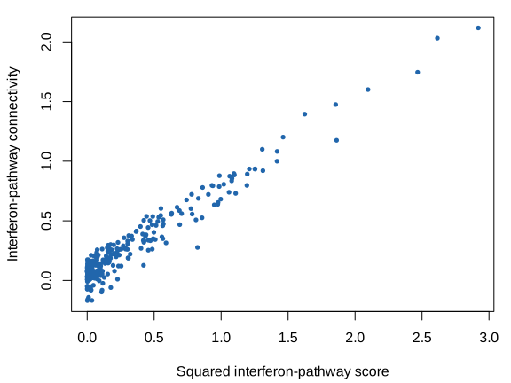
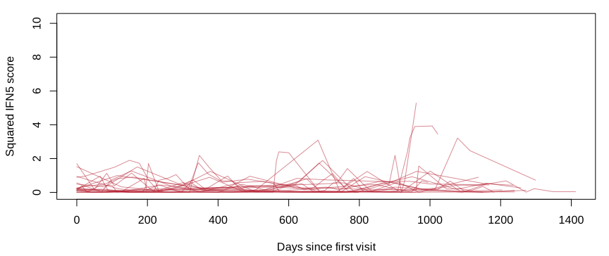
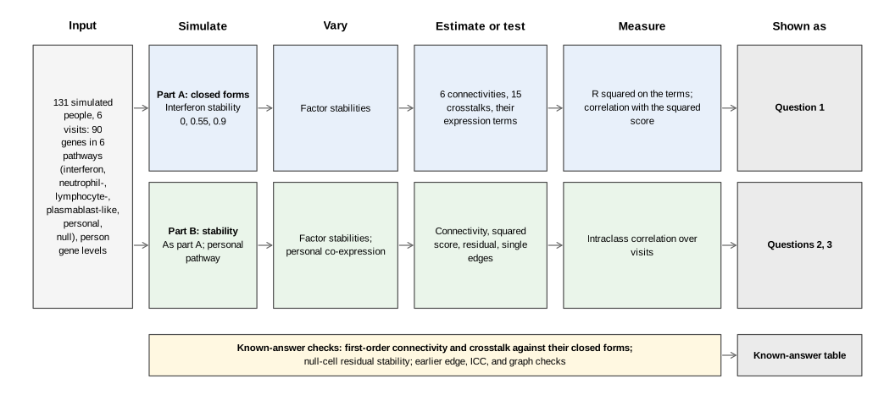
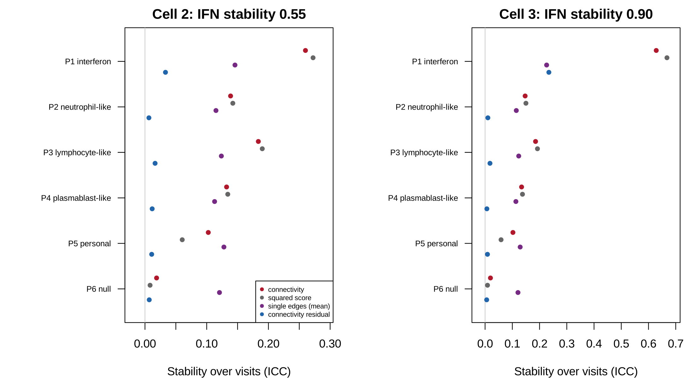

# Pilot report: LIONESS in a pathway approach

2026-11-16

# Summary

**Scope.** This document reports the pilot[^1] of proposal revision 3
(`proposal.md`, section 14): LIONESS in a pathway approach, as the
supervisor asked. Each sample’s network is summarized by pathway: the
mean edge within each of six gene pathways (connectivity) and between
each pair of pathways (crosstalk). It was built from `project-spec.md`,
`decisions.md`, the saved results in `pilot-g/results/`, the agent’s
check after the run in `log/02-pilot-g-check/`, and, read-only, the
GSE65391 description in `pilot-d/results/`. Every number is computed
from those files when the document renders.

**Status.** In `STATUS.md` the pilot is marked `piloted-fail`[^2]. One
deciding clause failed in one cell. In the cell where interferon is very
stable, the interferon pathway’s connectivity kept some stability after
its first-order expression terms. That remainder is 2.5e-06 of the
variance or less, and it is the next-order expression term (decisions
log, D2). Every other clause passed.

| Pilot question | Answer | Key evidence |
|----|----|----|
| 1\. Do the closed forms hold? | pass, pass, pass | Smallest $R^2$ of connectivity and crosstalk on their terms 1.00000; IFN connectivity against its squared score 0.965 to 0.966. |
| 2\. Steadier than edges, and only as steady as the score? | pass and pass | IFN connectivity against the squared score -0.0123 (MCSE 0.0009); against single IFN edges 0.114 (MCSE 0.0038). |
| 3\. Anything beyond expression? | fail and pass | Residual stability under 0.05 in 17 of 18 checks; 0.234 for the IFN pathway in cell 3. Personal over null pathway 0.084 (MCSE 0.0028). |

**What needs your decision** (details in [Action items and
limitations](#action-items-and-limitations)): the status, and whether
the paper’s pathway section states the result as “pathway connectivity
and crosstalk are functions of the pathway’s own expression”.

# The idea

## In plain language

A single LIONESS[^3] edge between two genes is noisy from one blood
sample to the next. The supervisor suggested working with pathways
instead: groups of genes with a known joint function, such as the
interferon[^4] response. For each person and visit, one number says how
connected a pathway’s genes are (connectivity), and one says how
connected two pathways are with each other (crosstalk). Pathway
summaries average many edges, so they should be steadier, and they are
easier to read biologically.

Each LIONESS edge is almost exactly a product of the sample’s two gene
levels. So the average edge inside a pathway is almost exactly the
square of the pathway’s average level, and the average edge between two
pathways is almost exactly the product of their two levels. This pilot
simulates 131 children with six visits each and six pathways, one of
them with real personal co-expression. It asks three things: whether
pathway connectivity and crosstalk are fixed functions of expression,
how stable they are over visits, and whether anything network-specific
is left over.

## Potential impact

LIONESS is used to build a network for each person (M. L. Kuijjer et al.
2019; Marieke L. Kuijjer et al. 2019). Summaries of single-sample
networks by gene set are common, and blood gene modules are the usual
way to read lupus expression (Banchereau et al. 2016). Blood expression
is partly person-specific (Whitney et al. 2003; Mishra et al. 2026), the
lupus interferon signature is stable within patients (Petri et al.
2019), and cell composition drives much bulk co-expression (Farahbod and
Pavlidis 2020).

The pilot shows that pathway summaries of LIONESS networks are
expression summaries. Connectivity and crosstalk were linear in their
expression terms in every cell, with $R^2$ of at least 1.00000.
Interferon connectivity was as stable as the squared interferon score
(0.260 against 0.272,
<a href="#tbl-pathways" class="quarto-xref">Table 3</a>). It was
steadier than single interferon edges (0.146). A pathway with real
personal co-expression was steadier than a null pathway, but only
through its expression terms. For users: before reading a pathway’s
LIONESS connectivity as network biology, compare it with the pathway’s
own expression score.

## Application: the study behind the data

### The study

The data proposed for the application come from a longitudinal study of
children with systemic lupus erythematosus[^5] (Banchereau et al. 2016),
https://doi.org/10.1016/j.cell.2016.03.008, GEO series GSE65391[^6]. It
has repeated blood samples and disease activity at every visit.
<a href="#tbl-data" class="quarto-xref">Table 1</a> gives the sizes and
stabilities measured in this project, which set the simulation’s levels.

Table 1: GSE65391, from `../pilot-d/results/data_summary.rds`
(read-only): sizes and within-child stability among children with two or
more visits.

| Quantity                         | Value |
|:---------------------------------|:------|
| Children with two or more visits | 131   |
| Their visits                     | 897   |
| IFN5 score stability             | 0.55  |
| Neutrophil % stability           | 0.41  |
| Lymphocyte % stability           | 0.48  |
| SLEDAI stability                 | 0.39  |

### Why pathway connectivity and crosstalk

The quantities are each pathway’s connectivity and each pair’s
crosstalk, and their intraclass correlation over a child’s visits. A
pathway summary is a candidate network biomarker only if it carries more
than the pathway’s own expression.

### Did the original study compute it?

No. The original study analysed expression modules; it built no
single-sample networks.

## In symbols

For a pathway $A$ of $m_A$ genes, sample $q$’s standardized expression
$z_{qi}$ gives $S_A = \sum_{i \in A} z_{qi}$ and
$Q_A = \sum_{i \in A} z_{qi}^2$. With
$R_i^B = \sum_{j \in B, j \ne i} r_{ij}$ the summed reference
correlation of gene $i$ with set $B$, and $C_A = m_A (m_A - 1)/2$, the
first-order connectivity $W_{qA}$ and crosstalk $X_{qAB}$ are

$$
\begin{aligned}
W_{qA} &= \bar r_A + \frac{S_A^2 - Q_A}{2 C_A} - \frac{1}{2 C_A} \sum_{i \in A} R_i^A z_{qi}^2, \\
X_{qAB} &= \bar r_{AB} + \frac{S_A S_B}{m_A m_B} - \frac{1}{2 m_A m_B} \Big( \sum_{i \in A} R_i^B z_{qi}^2 + \sum_{j \in B} R_j^A z_{qj}^2 \Big).
\end{aligned}
$$

| Symbol | Meaning |
|----|----|
| $A$, $B$, $m_A$ | pathways and the size of $A$ |
| $S_A$, $Q_A$ | sum and sum of squares of the pathway’s standardized expression in the sample |
| $R_i^B$ | summed reference correlation of gene $i$ with the genes of $B$ |
| $\bar r_A$, $\bar r_{AB}$ | mean reference correlation within $A$ and between $A$ and $B$ |
| $W_{qA}$, $X_{qAB}$ | connectivity and crosstalk of sample $q$ |

Line 1 averages the first-order edge
$r_{ij} + z_{qi} z_{qj} - \tfrac{r_{ij}}{2}(z_{qi}^2 + z_{qj}^2)$ over
the pairs of $A$ and uses $\sum_{i<j} z_i z_j = \tfrac12 (S_A^2 - Q_A)$.
Line 2 does the same over the pairs between $A$ and $B$. Both are linear
in three expression terms, so a regression on them leaves only what the
first order misses.

Figure 1: The idea, an illustration on made-up numbers (not pilot
output): 262 simulated samples; each point is one sample’s
interferon-pathway connectivity against its squared pathway score.

Figure 2: The real data (GSE65391, from
`../pilot-d/results/data_summary.rds`): the squared IFN5 score over
visits for 20 children with the most visits.

## Critiquing the model

Any model is a simplification, and the useful question is not whether it
is true but where it bends and whether the bend matters for the question
being asked. The model above was chosen so that the problem could be
written as a formula and checked by simulation, and each simplification
that made that possible is a place where real data may behave
differently. The table lists the main ones. Work through it one row at a
time. The first column names the feature and the symbols in the
equations that carry it, so find them there first. Then decide in your
own words how the feature could fail for real data before reading the
second column, and finally read the third column for what should be done
to check it. Several of these checks are natural first tasks for the
project. Which of them the pilot examined, and which it left open, is
for you to find when you read the Methods and Results that follow.

| Feature of the model | Why it may not be realistic | What should be done to check it |
|----|----|----|
| Six disjoint pathways of 15 genes | Real gene sets overlap and differ in size | Use BloodGen3 or Hallmark sets at stage 3, overlaps included |
| One factor per pathway, independent factors | Real cell types and interferon are correlated | Estimate the factor correlations from GSE65391 |
| The terms stop at first order | The exact edge carries higher powers of expression | Add second- and fourth-order terms (decisions log, D2) |
| Person gene levels independent across genes | Real person-level differences are correlated | Estimate from GSE65391 |
| Six equal visits | Real visits are irregular | Mirror each child’s visits |

# Methods

## Design

The pilot simulates 131 people with six visits each in 3 cells
(pre-registration, section 3). Ninety genes form six pathways of 15.
Pathways 1 to 4 each load on their own factor: interferon (loading 0.8),
neutrophil-like, lymphocyte-like and plasmablast-like (0.6 each).
Pathway 5 has noise correlation that differs between people (personal
co-expression); pathway 6 has a fixed noise correlation (null). Every
gene carries the person’s own level. Cell 1 sets every factor’s
within-person stability to 0 and pathway 5 to not personal. Cell 2 uses
the measured stabilities, with interferon 0.55. Cell 3 is cell 2 with
interferon at 0.9.

For every sample, LIONESS edges over the 90 genes give 6 connectivities
and 15 crosstalks. Each is regressed over samples on its three
expression terms. The pilot then estimates the intraclass correlation
over visits of each connectivity, of its squared pathway score, of its
residual, and of the pathway’s single edges.

Figure 3: The design at a glance. Stability by pathway is in
<a href="#tbl-pathways" class="quarto-xref">Table 3</a> and
<a href="#fig-pathways" class="quarto-xref">Figure 4</a>, the verdict in
<a href="#tbl-verdict" class="quarto-xref">Table 4</a>, the known-answer
checks in <a href="#tbl-known-answer" class="quarto-xref">Table 2</a>.

| Part | Cells | Main factors | Replicates |
|----|----|----|----|
| A, B | 1 to 3 | interferon stability 0, 0.55, 0.9; other factors 0 or measured; personal pathway off or on | 200 per cell |

## Known-answer checks

Known-answer checks come before any result, because every later number
is only as good as the simulation that produced it. Each check sets up a
case where the correct answer is known from theory, runs the simulation
code on it, and compares the two. Agreement says nothing about the
scientific question or about real data. It says that the code does what
the model says. Disagreement means stopping to look for a bug before
reading anything else, and the same checks apply to any code you write
for the project.

Read each row of the table in four steps: the setting that was
simulated, the known answer for that setting, what the simulation gave,
and whether the gap between the two is small compared with the Monte
Carlo standard error (MCSE). The MCSE is how much a simulated result
moves from run to run because only a finite number of replicates was
used. A gap within about two MCSE is noise, and a gap of several MCSE is
a problem.

Table 2: Known-answer checks, from `results/known_answers.rds`.

| Check | Setting | Known answer | Simulation gave | How to read it |
|----|----|----|----|----|
| Exact LIONESS Pearson edge equals leave-one-out LIONESS | N = 12, 6 genes, one outlier; largest absolute difference | 0.000 | 8.88e-15 | 8.882e-15 from the known value, against a tolerance of 1e-08, so the check passes. |
| Exact add-one edge equals (N + 1) r(+q) - N r | reference N = 12, 5 new samples; largest absolute difference | 0.000 | 5.33e-15 | 5.329e-15 from the known value, against a tolerance of 1e-08, so the check passes. |
| Exact LIONESS Pearson edge equals leave-one-out LIONESS | N = 60, 6 genes, one outlier; largest absolute difference | 0.000 | 1.42e-14 | 1.421e-14 from the known value, against a tolerance of 1e-08, so the check passes. |
| Exact add-one edge equals (N + 1) r(+q) - N r | reference N = 60, 5 new samples; largest absolute difference | 0.000 | 1.07e-14 | 1.066e-14 from the known value, against a tolerance of 1e-08, so the check passes. |
| First-order edge approaches the exact edge as N grows | N = 4000, r = 0.5; largest absolute difference | 0.000 | 0.0123 | 0.01235 from the known value, against a tolerance of 0.05, so the check passes. |
| AUC of perfectly separated scores | 5 against 5 | 1.000 | 1 | 0 from the known value, against a tolerance of 1e-08, so the check passes. |
| AUC of tied scores | all scores equal | 0.500 | 0.5 | 0 from the known value, against a tolerance of 1e-08, so the check passes. |
| Folds keep each woman’s samples together | 20 women, 4 samples each; women split across folds | 0.000 | 0 | 0 from the known value, against a tolerance of 1e-08, so the check passes. |
| Partial correlation equals the inverse-covariance formula | 30 samples, 4 genes, 2 conditioning variables; largest difference | 0.000 | 2.07e-16 | 2.073e-16 from the known value, against a tolerance of 1e-08, so the check passes. |
| Partial-correlation edges with no conditioning equal Pearson edges | 30 samples, 4 genes; largest difference | 0.000 | 5.33e-15 | 5.329e-15 from the known value, against a tolerance of 1e-08, so the check passes. |
| Concordance of a perfect prediction | 10 distinct outcomes | 1.000 | 1 | 0 from the known value, against a tolerance of 1e-08, so the check passes. |
| Concordance of a constant prediction | 10 distinct outcomes | 0.500 | 0.5 | 0 from the known value, against a tolerance of 1e-08, so the check passes. |
| Concordance equals the AUC for a binary outcome | 5 against 5 | 0.000 | 0 | 0 from the known value, against a tolerance of 1e-08, so the check passes. |
| Intraclass correlation equals the analysis-of-variance formula | 30 people, 4 visits; absolute difference | 0.000 | 5.55e-17 | 5.551e-17 from the known value, against a tolerance of 1e-08, so the check passes. |
| Intraclass correlation of a squared factor equals kappa squared | kappa 0.6, 20,000 people, 2 visits; absolute difference | 0.000 | 0.0108 | 0.01076 from the known value, against a tolerance of 0.05, so the check passes. |
| Fingerprinting of identical visits | 50 people, 40 edges | 1.000 | 1 | 0 from the known value, against a tolerance of 1e-08, so the check passes. |
| Fingerprinting of independent visits is near chance | 200 people, 100 edges; accuracy minus 1/200 | 0.000 | 0 | 0 from the known value, against a tolerance of 0.05, so the check passes. |
| Average shortest path length | three nodes, distances 1, 1, 2 | 1.333 | 1.33 | 0 from the known value, against a tolerance of 1e-08, so the check passes. |
| Global efficiency | three nodes, distances 1, 1, 2 | 0.833 | 0.833 | 0 from the known value, against a tolerance of 1e-08, so the check passes. |
| Density above the threshold | two of three links above 0.9 | 0.667 | 0.667 | 0 from the known value, against a tolerance of 1e-08, so the check passes. |
| Betweenness of the middle node | path graph of three nodes | 1.000 | 1 | 0 from the known value, against a tolerance of 1e-08, so the check passes. |
| Strength is the signed sum of edges | node 1: 1 + 0.4 | 1.400 | 1.4 | 0 from the known value, against a tolerance of 1e-08, so the check passes. |
| Connectivity is the mean edge within the set | 4 nodes, set 1 to 3 | 0.090 | 0.0901 | 0 from the known value, against a tolerance of 1e-08, so the check passes. |
| First-order connectivity equals its closed form | 9 genes, sets of 4 and 5; largest absolute difference | 0.000 | 8.88e-16 | 8.882e-16 from the known value, against a tolerance of 1e-08, so the check passes. |
| First-order crosstalk equals its closed form | 9 genes, sets of 4 and 5; largest absolute difference | 0.000 | 4.44e-16 | 4.441e-16 from the known value, against a tolerance of 1e-08, so the check passes. |
| Residual connectivity stability, ifn pathway, null cell | cell 1, 200 replicates | 0.000 | 0.0023 (MCSE 0.0017) | 1.4 MCSE from the known value, so the gap is noise. |
| Residual connectivity stability, neut pathway, null cell | cell 1, 200 replicates | 0.000 | 0.0013 (MCSE 0.0017) | 0.8 MCSE from the known value, so the gap is noise. |
| Residual connectivity stability, lymph pathway, null cell | cell 1, 200 replicates | 0.000 | 0.0018 (MCSE 0.0015) | 1.2 MCSE from the known value, so the gap is noise. |
| Residual connectivity stability, pb pathway, null cell | cell 1, 200 replicates | 0.000 | 0.0027 (MCSE 0.0016) | 1.7 MCSE from the known value, so the gap is noise. |
| Residual connectivity stability, personal pathway, null cell | cell 1, 200 replicates | 0.000 | 0.0062 (MCSE 0.0017) | 3.7 MCSE from the known value, so the gap is too large: look for a bug. |
| Residual connectivity stability, null pathway, null cell | cell 1, 200 replicates | 0.000 | 0.0060 (MCSE 0.0017) | 3.4 MCSE from the known value, so the gap is too large: look for a bug. |

2 of 6 rows with a standard error are more than 2 MCSE from the known
value.

The null cell’s residual stabilities sit slightly above 0. Each person’s
own gene levels are stable in every cell, and their higher powers enter
the residual (decisions log, D3).

# Results

## How to read the outputs

Each output traces back to a row of the design diagram (the captions
name the part where one applies). Read each in the same four steps.
First, find its row in the diagram, which says what was simulated and
what was varied. Second, work out what one point or one table entry is,
usually one combination of the varied factors, averaged over replicates.
Third, identify the reference value that would hold if nothing were
wrong, shown as a dashed or grey line wherever possible. Fourth, look
for where the results leave that reference, and for which settings they
do. The outputs report three kinds of quantity.

- **Bias** is the average of an estimate minus its true value. When the
  truth is no difference, any average difference from 0 is a spurious
  difference created by the problem under study.
- **Level** is how often a test rejects when there is truly nothing to
  find. A correct test at 0.05 rejects 5% of the time, so a rate above
  0.05 means too many false alarms.
- **Power** is how often a test rejects when there is a real effect.
  More is better, but only when the level is not inflated, because a
  test that rejects too often also looks powerful.

All rates and averages come from simulation, so each carries Monte Carlo
error. That is why the figures show bars or a grey band, and why small
differences should not be over-read.

This pilot reports $R^2$ values, correlations over samples, and
intraclass correlations (0 when a quantity changes completely between
visits, 1 when it never changes).

## Stability by pathway

**Figure guide (part B).** Two panels: the measured interferon stability
(cell 2) and very stable interferon (cell 3). Each row is a pathway. Red
points are connectivity, grey the squared pathway score, purple the mean
of the pathway’s single edges, blue the residual of connectivity after
its terms. Look for three things: whether red sits on grey, whether red
lies right of purple, and whether blue sits at 0.

Figure 4: Pilot result (part B): stability over visits by pathway, from
`results/cell_summaries.rds`.

## Numbered findings

Each finding is a claim followed by the output behind it. Read the
claim, open the output, and check that you can see the claim there
before accepting it.

1.  **Pathway connectivity and crosstalk are linear in their expression
    terms.** The smallest $R^2$ over the 6 pathways was 1.00000 to
    1.00000 across cells, and over the 15 pairs 1.00000 to 1.00000
    (<a href="#tbl-verdict" class="quarto-xref">Table 4</a>, clauses
    1(a) and 1(b)). The share left over was at most 2.5e-06 of the
    variance. First-order edges gave $R^2$ of 1 (1.00000000).
2.  **Connectivity is the squared pathway score.** The correlation for
    the interferon pathway was 0.965 to 0.966 in every cell (clause
    1(c), <a href="#fig-idea" class="quarto-xref">Figure 1</a>).
3.  **Pathway connectivity is as stable as the squared score, at every
    pathway.** At the measured level the difference was -0.0123 (MCSE
    0.0009) for interferon (clause 2(a)). It was 0.139 against 0.142 for
    the neutrophil-like pathway and 0.184 against 0.190 for the
    lymphocyte-like
    (<a href="#tbl-pathways" class="quarto-xref">Table 3</a>).
4.  **Pathways are steadier than single edges.** Interferon connectivity
    was steadier than the pathway’s single edges by 0.114 (MCSE 0.0038)
    (clause 2(b)).
5.  **The residual after the terms is stable only at the stress level,
    and it is expression.** Its stability stayed under 0.05 in 17 of 18
    pathway-cell checks. For interferon in cell 3 it was 0.234 (MCSE
    0.0085) (clause 3(a) fail). In five replicates of that cell the
    stability was 0.18; it fell to 0.009 when fourth-order terms of the
    pathway’s own expression were added (`log/02-pilot-g-check/`,
    decisions log D2; a check after the run).
6.  **Personal co-expression shows through expression.** The personal
    pathway’s connectivity was steadier than the null pathway’s by 0.084
    (MCSE 0.0028) (clause 3(b)), but its residual was 0.011. Its squared
    score rose too: 0.060 against 0.008.
7.  **The known-answer checks hold**
    (<a href="#tbl-known-answer" class="quarto-xref">Table 2</a>).

## Tables

**Table guide (stability by pathway).** Mean intraclass correlation over
visits in cells 2 and 3, for connectivity, the squared pathway score,
the residual, and the single edges.

Table 3: Stability over visits (intraclass correlation) by pathway, from
`results/cell_summaries.rds`. Each cell of the table: cell 2 / cell 3.

| Pathway             | Connectivity  | Squared score | Residual      | Single edges  |
|:--------------------|:--------------|:--------------|:--------------|:--------------|
| P1 interferon       | 0.260 / 0.628 | 0.272 / 0.668 | 0.033 / 0.234 | 0.146 / 0.226 |
| P2 neutrophil-like  | 0.139 / 0.147 | 0.142 / 0.150 | 0.006 / 0.010 | 0.115 / 0.115 |
| P3 lymphocyte-like  | 0.184 / 0.185 | 0.190 / 0.192 | 0.016 / 0.018 | 0.124 / 0.124 |
| P4 plasmablast-like | 0.132 / 0.134 | 0.134 / 0.137 | 0.012 / 0.007 | 0.113 / 0.113 |
| P5 personal         | 0.103 / 0.102 | 0.060 / 0.059 | 0.011 / 0.009 | 0.128 / 0.129 |
| P6 null             | 0.019 / 0.020 | 0.008 / 0.009 | 0.007 / 0.006 | 0.121 / 0.121 |

**Table guide (the verdict).** One row per clause and cell; clause 3(a)
has one row per pathway and cell.

Table 4: The pass rule applied clause by clause, from
`results/verdict.rds`.

| Q | Clause | Cell | Quantity | Value | MCSE | Threshold | Outcome |
|---:|:---|---:|:---|:---|:---|:---|:---|
| 1 | \(a\) | 1 | smallest R^2, connectivity on its terms | 1.00000 | 8.6e-08 | \>= 0.99 | pass |
| 1 | \(b\) | 1 | smallest R^2, crosstalk on its terms | 1.00000 | 4e-08 | \>= 0.99 | pass |
| 1 | \(c\) | 1 | cor(IFN connectivity, IFN score^2) | 0.96609 | 0.00025 | \>= 0.9 | pass |
| 1 | \(a\) | 2 | smallest R^2, connectivity on its terms | 1.00000 | 1.4e-07 | \>= 0.99 | pass |
| 1 | \(b\) | 2 | smallest R^2, crosstalk on its terms | 1.00000 | 3.7e-08 | \>= 0.99 | pass |
| 1 | \(c\) | 2 | cor(IFN connectivity, IFN score^2) | 0.96589 | 0.00027 | \>= 0.9 | pass |
| 1 | \(a\) | 3 | smallest R^2, connectivity on its terms | 1.00000 | 9e-08 | \>= 0.99 | pass |
| 1 | \(b\) | 3 | smallest R^2, crosstalk on its terms | 1.00000 | 3.1e-08 | \>= 0.99 | pass |
| 1 | \(c\) | 3 | cor(IFN connectivity, IFN score^2) | 0.96472 | 0.00035 | \>= 0.9 | pass |
| 2 | \(a\) | 2 | ICC IFN connectivity - ICC IFN score^2 | -0.01233 | 0.00092 | \|D\| \<= 0.0500 | pass |
| 2 | \(b\) | 2 | ICC IFN connectivity - mean ICC IFN edges | 0.11418 | 0.0038 | \>= 0.05 | pass |
| 3 | \(a\) | 1 | ICC residual connectivity, ifn | 0.00235 | 0.0017 | \|v\| \<= 0.0500 | pass |
| 3 | \(a\) | 1 | ICC residual connectivity, neut | 0.00131 | 0.0017 | \|v\| \<= 0.0500 | pass |
| 3 | \(a\) | 1 | ICC residual connectivity, lymph | 0.00180 | 0.0015 | \|v\| \<= 0.0500 | pass |
| 3 | \(a\) | 1 | ICC residual connectivity, pb | 0.00274 | 0.0016 | \|v\| \<= 0.0500 | pass |
| 3 | \(a\) | 1 | ICC residual connectivity, personal | 0.00621 | 0.0017 | \|v\| \<= 0.0500 | pass |
| 3 | \(a\) | 1 | ICC residual connectivity, null | 0.00597 | 0.0017 | \|v\| \<= 0.0500 | pass |
| 3 | \(a\) | 2 | ICC residual connectivity, ifn | 0.03321 | 0.0033 | \|v\| \<= 0.0500 | pass |
| 3 | \(a\) | 2 | ICC residual connectivity, neut | 0.00638 | 0.0022 | \|v\| \<= 0.0500 | pass |
| 3 | \(a\) | 2 | ICC residual connectivity, lymph | 0.01639 | 0.0025 | \|v\| \<= 0.0500 | pass |
| 3 | \(a\) | 2 | ICC residual connectivity, pb | 0.01167 | 0.0023 | \|v\| \<= 0.0500 | pass |
| 3 | \(a\) | 2 | ICC residual connectivity, personal | 0.01087 | 0.0017 | \|v\| \<= 0.0500 | pass |
| 3 | \(a\) | 2 | ICC residual connectivity, null | 0.00691 | 0.0017 | \|v\| \<= 0.0500 | pass |
| 3 | \(a\) | 3 | ICC residual connectivity, ifn | 0.23422 | 0.0085 | \|v\| \<= 0.0500 | fail |
| 3 | \(a\) | 3 | ICC residual connectivity, neut | 0.01025 | 0.002 | \|v\| \<= 0.0500 | pass |
| 3 | \(a\) | 3 | ICC residual connectivity, lymph | 0.01797 | 0.0024 | \|v\| \<= 0.0500 | pass |
| 3 | \(a\) | 3 | ICC residual connectivity, pb | 0.00658 | 0.0021 | \|v\| \<= 0.0500 | pass |
| 3 | \(a\) | 3 | ICC residual connectivity, personal | 0.00876 | 0.0019 | \|v\| \<= 0.0500 | pass |
| 3 | \(a\) | 3 | ICC residual connectivity, null | 0.00584 | 0.0016 | \|v\| \<= 0.0500 | pass |
| 3 | \(b\) | 2 | ICC personal connectivity - ICC null connectivity | 0.08377 | 0.0028 | \>= 0.05 | pass |

**Table guide (numbers quoted in the spec).**

Table 5: Numbers quoted in the spec’s section 3 for pilot-g, recomputed
from the result files.

| Quantity | Value |
|:---|:---|
| 1(a), 1(b): smallest R^2 | 1.00000 |
| 1(c): IFN connectivity against squared score, range | 0.965 to 0.966 |
| 2(a): IFN connectivity against squared score, cell 2 | -0.0123 (MCSE 0.0009) |
| 2(b): against single edges, cell 2 | 0.114 (MCSE 0.0038) |
| 3(a): residual checks passed | 17 of 18 |
| 3(a): IFN residual, cell 3 | 0.234 (MCSE 0.0085) |
| 3(b): personal over null, cell 2 | 0.084 (MCSE 0.0028) |
| Check after the run: residual stability with fourth-order terms | 0.009 |
| Status | piloted-fail |

# The draft spec

This is `project-spec.md`, read from the file when the document renders.
Anything the agent[^7] left for the user to decide is highlighted in
yellow and starts with “To confirm”.

|  |  |
|----|----|
| Proposal | `proposal.md`, final 2026-11-16 (re-scope) |
| Authors | as in `DESCRIPTION`, set by `tools/authors.R` before the final render |
| Written | 2026-11-16 |
| Status | draft; section 3 completed after the verdict. The pregnancy spec is the record in git (`git show c677b11:project-spec.md`) |

## 1. Question and why it matters

**Question (one sentence):** Over repeated blood samples of the same
patient, how stable are her LIONESS edges, can they identify her, and do
they predict her next disease activity, beyond her interferon level, her
measured blood-cell counts, her gene levels, and the edges’ own
first-order formula?

**Why it matters:** A personal network is a biomarker only if it is
reproducible and carries something the cheap measures do not. If its
stability is the person’s stable interferon level and her own gene
levels, a user would measure those directly; if a corrected network
keeps a stable personal part, that part is the candidate biomarker.

## 2. Mechanism we suspect

A LIONESS edge equals, to first order,
$r + z_{qi} z_{qj} - \tfrac{r}{2}(z_{qi}^2 + z_{qj}^2)$, so it carries
the square of any factor that moves both genes. For a factor with
within-person intraclass correlation $\kappa$, the intraclass
correlation of $F^2$ is $\kappa^2$ (proposal section 4), so edges of
genes sharing a stable factor look personal with no personal
co-expression; a factor that changes between visits adds within-person
noise. Each person’s own stable gene levels enter the product term too,
so every edge is partly person-specific through levels alone. The gap is
zero for a factor with $\kappa = 0$ (the null cell) and grows with
$\kappa$. If the mechanism is wrong, partial-correlation edges would
keep the factor-driven stability, or edges and their formula would
differ.

## 3. Pilot

**Code:** `pilot-d/pilot.R` (`Rscript pilot-d/pilot.R --reps <n>`), then
`Rscript pilot-d/verdict.R`; data description
`Rscript pilot-d/describe_data.R`.

**Pass rule:** `pilot-d/preregistration.md`, section 2.

**Verdict file:** `pilot-d/results/verdict.rds`, after the run.

**Plot:** `pilot-d/results/stability.png`.

**Status:** `piloted-close-call` (2026-11-16), 200 replicates per cell,
6 cells, three cores, 2,714 seconds; verdict file
`pilot-d/results/verdict.rds`. Numbers rounded from
`pilot-d/results/cell_summaries.rds`.

1.  Does the effect exist? Edges equal their formula in stability
    (largest difference under 0.0001; 1(b) pass). Stable interferon
    raised the interferon pairs’ stability (from about 0.07 to 0.14 at
    the measured level, 0.22 when very stable), but cross pairs rose
    too, and the pre-registered excess was 0.064 at the stress level,
    below 0.15 (1(a) fail).
2.  Large enough at the measured level? No: excess 0.016 (2(a) fail);
    the fix changed identification on interferon pairs by 0.004 (2(b)
    fail).
3.  Is there a fix? Yes: the fixed excess was 0.002 to 0.007 (3(a)
    pass), and the fix kept a real personal module (3(b) pass). Edges
    did not predict the next visit’s activity (concordance near 0.48;
    3(c) fail in cell 6). Single-sample edges were unreliable over
    visits (intraclass correlation 0.07 to 0.22).

**Pilot-e (network metrics, proposal section 12):** `piloted-fail`
(2026-11-16), 120 replicates per cell, 4 cells, 3,442 seconds; verdict
file `pilot-e/results/verdict.rds`; numbers rounded from
`pilot-e/results/cell_summaries.rds`.

1.  Closed forms: a module’s connectivity correlated about 0.97 with its
    squared expression score in every cell; raw and first-order edges
    gave the same stability for all 19 metrics (largest difference under
    0.0004).
2.  Stability: IFN connectivity was more stable than IFN edges by about
    0.10, and as stable as the squared IFN score (difference about
    -0.01).
3.  Correction: with the five-gene score, the corrected IFN connectivity
    stayed more stable than the cross connectivity by about 0.09 and
    0.15 (fail); the corrected module connectivity exceeded the cross by
    about 0.056 with a real personal module (close call).

**Pilot-f (own-module correction, proposal section 13):** `piloted-fail`
(2026-11-16), 120 replicates per cell, 4 cells, 3,136 seconds; verdict
file `pilot-f/results/verdict.rds`. Clauses 1 and 2 passed as in
pilot-e. The own-module correction left the IFN set’s connectivity as
stable as raw (about 0.25 at the measured level, 0.62 when interferon
was very stable; 3(a) fail), and the personal module’s excess was about
0.036 (3(b) fail): a set’s connectivity is its squared expression score
up to scale, which no within-set adjustment changes
(`pilot-f/decisions.md`, D2).

**Pilot-g (pathway approach, proposal section 14):** `piloted-fail`
(2026-11-16), 200 replicates per cell, 3 cells, 98 seconds; verdict file
`pilot-g/results/verdict.rds`; numbers rounded from
`pilot-g/results/cell_summaries.rds`.

1.  Closed forms: every pathway’s connectivity and every pair’s
    crosstalk were linear in their expression terms ($R^2$ above 0.99999
    in every cell); interferon connectivity correlated 0.965 with the
    squared pathway score.
2.  Stability: at the measured level, interferon connectivity was as
    stable as the squared score (difference -0.012) and steadier than
    its single edges by 0.114.
3.  Anything beyond expression: the residual after the terms had
    stability under 0.05 in 17 of 18 pathway-cell checks; it failed for
    the interferon pathway when interferon was very stable (0.23). A
    check after the run found that the residual is the next-order
    expression term: about 2 parts per million of the variance, and its
    stability falls to 0.009 with fourth-order terms
    (`pilot-g/decisions.md`, D2). The personal pathway was steadier than
    the null pathway (0.084), through its expression terms.

## 4. ADEMP skeleton

**Aims.** (1) How much of the stability of LIONESS edges over repeated
samples comes from a stable shared factor? (2) Does a person’s network
identify her, and is that identification the factor? (3) Do
partial-correlation edges remove the factor’s part and keep a real
personal network? (4) Do edges predict the next visit’s activity beyond
the genes, and do they equal their formula throughout?

**Data-generating mechanisms.**

- Factors varied: the IFN factor’s within-person intraclass correlation
  $\kappa_F$ (0, 0.55 as measured, 0.9); a real personal module ($\tau$
  0 or 0.25); visits per person (6, the GSE65391 median, or 3); whether
  activity changes the module.
- Factors fixed, and why: 131 people (the GSE65391 children with two or
  more visits); 50 genes and the loadings of the first project; the
  cell-mix factor’s intraclass correlation 0.45 (measured 0.41 and 0.48)
  and activity’s 0.39; person-specific gene levels of variance 0.5
  (people differ in level); normal noise.
- A cell where the answer is known: the null cell, with no stable factor
  and no personal module.

**Estimands.** The intraclass correlation of each edge over visits; the
excess of the factor pairs’ intraclass correlation over that of cross
pairs (one factor gene, one module gene), which share the person-level
gene effects but not the squared factor; fingerprinting accuracy; the
concordance of next-visit activity predictions.

**Methods compared.** Raw LIONESS edges, first-order edges,
partial-correlation LIONESS edges given the IFN score and the observed
cell-mix factor; for prediction, $R_0$, $R_1$, E1, F1, N1 as in the
first project, Gaussian elastic net, folds by person.

**Performance measures.** Mean intraclass correlation by pair group;
fingerprinting accuracy; concordance; each with its MCSE.

**Replicates and Monte Carlo SE target.** 200 per cell if the time box
allows; the MCSE of a mean intraclass correlation over 105 pairs is then
well under 0.01.

## 5. Application

**Dataset:** GSE65391 (Banchereau et al. (2016)), GEO; the series matrix
and the GPL10558 table in `data/raw/`, fetched by
`analysis/00_download.R`, not committed.

**Comparison:** within each of the 131 children with two or more visits;
897 visits; the authors’ training (91 children) and test (40) split as a
second check.

**What to show:** how much of a child’s network stability and
identifiability is her interferon level, her cell mix, and her gene
levels, and whether corrected networks predict her next disease
activity.

## 6. Target journal

**Target journal:** BMC Bioinformatics

**Fallback:** Statistical Applications in Genetics and Molecular Biology

**The target’s word limit and AI policy:** **To
confirm:** copied from the journal profile at stage 3

## 7. Milestones

| Stage | Ends with | Due |
|----|----|----|
| 2\. Pilot | `pilot-d/pilot-report.html`, the verdict file, `pilot-d/decisions.md` | 2026-11-16 |
| 3\. Manuscript, design stop | `protocol.md` from the approved design | **To confirm:** date |
| 3\. Manuscript, first draft | `manuscript/manuscript.html` in draft mode | **To confirm:** date |
| Submission | the final render and the checker in final mode | **To confirm:** date |

## 8. Out of scope

- SLE against RA (the user’s decision, 2026-11-16).
- Lupus against healthy as a classification (too easy, the supervisor).
- Other single-sample methods; drug effects; ancestry and sex
  differences; subtypes (each set aside in `log/01-idea-review.md`,
  D-R3).
- Merging GSE65391 with any other study.

## 9. Reading

1.  1.  After reading, a reader can answer: what reproducibility of
        LIONESS networks did the authors test, and against what?
2.  2.  After reading, a reader can answer: which lupus gene signature
        is most stable within patients, and does its change track
        disease activity?
3.  3.  After reading, a reader can answer: how is fingerprinting
        accuracy defined, and what made individuals identifiable?

# Decisions log

This is the agent’s `decisions.md` for pilot-g, read from the file when
the document renders.

## D0. The literature pass

As pilot-e. Nothing read since. The gene-set collections for the
application (BloodGen3, MSigDB Hallmark, Reactome) and the eigengene
literature (Horvath and Dong 2008) are still to be opened at stage 3; no
claim here rests on them.

## D1. The status call: `piloted-fail`

One deciding clause failed in one cell: clause 3(a) in cell 3, where
interferon is very stable (0.9). There, the residual of the interferon
pathway’s connectivity, after its three expression terms, had stability
0.23 against the bound of 0.05 (`pilot-g/results/verdict.rds`). The
other 17 residual checks passed, including all six pathways at the
measured interferon stability (cell 2, largest 0.033) and the null cell.
Every other clause passed:

- 1(a) and 1(b): every pathway’s connectivity and every pair’s crosstalk
  were linear in their expression terms, with $R^2$ above 0.99999 in
  every cell (the share left over was about 2 parts per million).
- 1(c): interferon connectivity correlated 0.965 with the squared
  pathway score in every cell.
- 2(a): at the measured level, interferon connectivity was as stable as
  the squared score (difference -0.012).
- 2(b): it was more stable than the pathway’s single edges by 0.114.
- 3(b): the personal pathway’s connectivity was more stable than the
  null pathway’s by 0.084.

Under the combination rule a failed 3(a) is a fail, so the status is
`piloted-fail`. There is no reading of the rule under which it passes.

## D2. Why the one clause failed: the residual is the next-order expression term

After the run, not pre-registered, the agent checked five replicates of
cell 3 (`log/02-pilot-g-check/residual_order.R` and its output). The
residual is about $2 \times 10^{-6}$ of connectivity’s variance. Its
stability, 0.18 on average in those replicates, fell to 0.009 when
fourth-order terms of the pathway’s own standardized expression were
added to the regression ($S^4$, $S^2 Q$, $Q^2$, and $\sum z^4$). The
section 14.1 closed form is the first-order expansion of the edge. The
exact LIONESS edge also carries higher powers of the sample’s own
expression, and when the factor is very stable those powers are stable
too.

So the failed clause does not show a network part beyond expression. It
shows that the pre-registered terms stop at the first order, and that a
stability measure can pick up a remainder of negligible size. The size
is no guide: the intraclass correlation does not depend on scale, so a
remainder of 2 parts per million can still be stable. The pre-registered
rule did not foresee this. The agent’s reading in section 5 expected the
personal pathway to be the only risk.

The check was run after the result was known. It is a reading, not a
rescue: the status stays `piloted-fail`. It makes a testable claim for
stage 3’s protocol: connectivity is a function of the pathway’s own
expression to every order, and its residual on second- and fourth-order
terms has stability near 0 at any factor stability.

## D3. What the pathway view adds

- **Pathway metrics are expression.** Connectivity was the squared
  pathway score (correlation 0.965), and its stability matched the
  score’s in every pathway at the measured level (for example
  neutrophil-like 0.139 against 0.142, lymphocyte-like 0.184 against
  0.190). Crosstalk was linear in the product of the two pathway scores
  and their weighted squares.
- **Averaging over a pathway steadies the network.** Single interferon
  edges had stability 0.146; the pathway’s connectivity, 0.260.
- **Personal co-expression enters through expression.** The personal
  pathway’s connectivity was steadier than the null pathway’s (0.103
  against 0.019), but its residual on the terms was not (0.011). Its
  squared score was also steadier (0.060 against 0.008). A person whose
  genes co-vary more has a more variable pathway score, so the squared
  score carries the personal correlation. The network quantity sees the
  personal co-expression only through the expression terms.
- The null cell’s residual stabilities were small but above 0 (0.001 to
  0.006, about 1 to 3.5 MCSE). The person’s own gene levels are stable
  in every cell, and their higher powers enter the remainder as in D2.

## D4. The run

200 replicates per cell (the amendment before the run), 98 seconds on
three workers, one pass.

## D5. What was not done

- Prediction of next-visit activity from pathway metrics
  (pre-registration, section 3).
- Real gene sets.
- Any edge on GSE65391.
- A pathway approach with partial correlations or with an external
  correction. Pilots e and f showed that within-set adjustment cannot
  change connectivity (pilot-f, D2).

# Action items and limitations

## Action items

1.  **Decide the status.** The rule gives `piloted-fail`, on one clause
    in one cell (decisions log, D1). The cause found after the run is a
    higher-order expression term, not a network part (D2).
2.  **Decide the pathway section’s message.** Across pilots e, f, and g:
    a pathway’s LIONESS connectivity is its squared expression score;
    crosstalk is the product of two pathway scores; a pathway is
    steadier than its single edges only through expression; and personal
    co-expression shows through expression too (D3).

## Limitations

- Everything here is simulation; no edge was computed on GSE65391.
- Simulated pathways, not real gene sets.
- No prediction of the next visit’s activity.

Banchereau, R., S. Hong, B. Cantarel, et al. 2016. “Personalized
Immunomonitoring Uncovers Molecular Networks That Stratify Lupus
Patients.” *Cell* 165 (3): 551-65.
<https://doi.org/10.1016/j.cell.2016.03.008>.

Farahbod, M., and P. Pavlidis. 2020. “Untangling the Effects of Cellular
Composition on Coexpression Analysis.” *Genome Research* 30 (6): 849-59.
<https://doi.org/10.1101/gr.256735.119>.

Kuijjer, M. L., M. G. Tung, G. Yuan, J. Quackenbush, and K. Glass. 2019.
“Estimating Sample-Specific Regulatory Networks.” *iScience* 14: 226-40.
<https://doi.org/10.1016/j.isci.2019.03.021>.

Kuijjer, Marieke L., Ping-Han Hsieh, John Quackenbush, and Kimberly
Glass. 2019. “lionessR: Single Sample
Network Inference in R.” *BMC Cancer* 19 (1): 1003.
<https://doi.org/10.1186/s12885-019-6235-7>.

Mishra, N., F. Kimmig, D. Vandeputte, et al. 2026. “Large-Scale Analysis
of Temporal Gene Expression Variation in Peripheral Blood.” *Nature
Communications* 17 (1): 6992.
<https://doi.org/10.1038/s41467-026-73218-6>.

Petri, M., W. Fu, A. Ranger, et al. 2019. “Association Between Changes
in Gene Signatures Expression and Disease Activity Among Patients with
Systemic Lupus Erythematosus.” *BMC Medical Genomics* 12 (1): 4.
<https://doi.org/10.1186/s12920-018-0468-1>.

Whitney, A. R., M. Diehn, S. J. Popper, et al. 2003. “Individuality and
Variation in Gene Expression Patterns in Human Blood.” *Proceedings of
the National Academy of Sciences of the United States of America* 100
(4): 1896-901. <https://doi.org/10.1073/pnas.252784499>.

[^1]: A pilot is a quick, small first run of the proposal’s simulation,
    done before the project goes further, to check that the idea is
    worth the time. It asks three questions: does the effect exist, is
    it large enough at realistic sample sizes, and is there an obvious
    fix or diagnostic? The proposal (`proposal.md`) holds the pilot plan
    and its pass criteria.

[^2]: `piloted-pass` means all three pilot questions got a clear yes.
    `piloted-fail` means at least one clearly did not, so the project
    should not go on as proposed. `piloted-close-call` means at least
    one answer could be read either way, so the call is stated both
    ways: the reading that passes and the reading that fails.

[^3]: LIONESS (Linear Interpolation to Obtain Network Estimates for
    Single Samples) builds a network from all samples and again without
    one sample, and scales the difference to give that sample’s network.

[^4]: Interferons are signalling proteins of the immune system; many
    genes respond to them together, and their summed expression, the
    interferon score, is high in many patients with lupus.

[^5]: Systemic lupus erythematosus is an autoimmune disease that can
    affect skin, joints, kidneys, and blood.

[^6]: The Gene Expression Omnibus (GEO) is the public archive of the US
    National Center for Biotechnology Information for gene expression
    data; a series (GSE) holds one study’s samples.

[^7]: The AI agent that ran the pilot, wrote the files this document is
    built from, and kept a log of its decisions.
