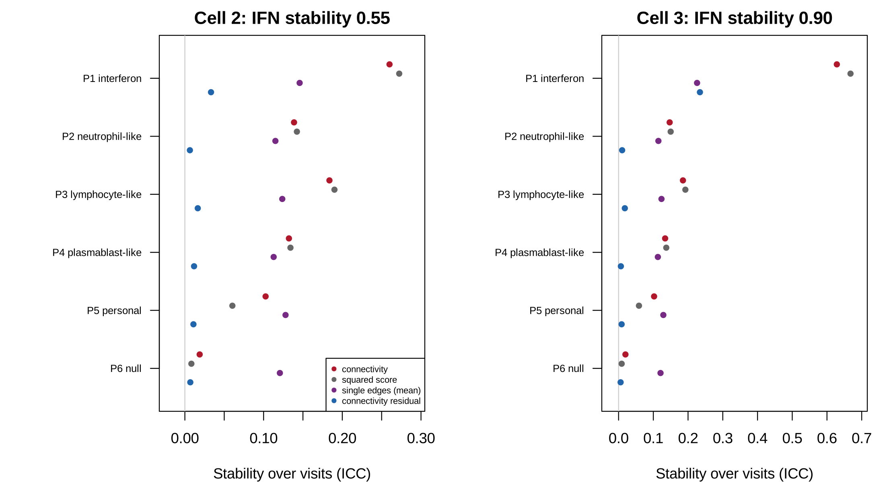

```{r}
#| label: setup
#| include: false

source("../templates/pilot-report/report-helpers.R")
devtools::load_all("..", quiet = TRUE)
s <- readRDS("results/cell_summaries.rds")
v <- readRDS("results/verdict.rds")
ka <- readRDS("results/known_answers.rds")
design <- readRDS("results/design.rds")
run <- readRDS("results/run_info.rds")
dat <- readRDS("../pilot-d/results/data_summary.rds")
G <- function(cell, q) s$mean[s$cell == cell & s$quantity == q]
M <- function(cell, q) s$mcse[s$cell == cell & s$quantity == q]
gm <- function(cell, q, d = 3) sprintf("%s (MCSE %s)", fmt(G(cell, q), d), fmt(M(cell, q), 4))
cl <- v$clauses
status <- v$status
n_rep <- run$n_rep
outcome <- function(q, c) {
  o <- cl$outcome[cl$question == q & cl$clause == c]
  if (any(o == "fail")) "fail" else if (any(o == "close")) "close call" else "pass"
}
c1a <- cl[cl$question == 1 & cl$clause == "(a)", ]
c1b <- cl[cl$question == 1 & cl$clause == "(b)", ]
c1c <- cl[cl$question == 1 & cl$clause == "(c)", ]
c3a <- cl[cl$question == 3 & cl$clause == "(a)", ]
c3a_fail <- c3a[c3a$outcome != "pass", ]
reps <- readRDS("results/replicates.rds")
r2_cols <- grep("^r2_", names(reps), value = TRUE)
max_share <- max(1 - colMeans(reps[, r2_cols]))
chk <- utils::read.table("../log/02-pilot-g-check/residual_order.txt", skip = 1,
                         nrows = 5, header = FALSE)
chk_icc <- mean(chk[[4]])
chk_icc4 <- mean(chk[[6]])
pw_lab <- c(ifn = "P1 interferon", neut = "P2 neutrophil-like", lymph = "P3 lymphocyte-like",
            pb = "P4 plasmablast-like", personal = "P5 personal", null = "P6 null")
```

# Summary

**Scope.** This document reports the pilot[^pilot] of proposal revision 3 (`proposal.md`, section 14): LIONESS in a pathway approach, as the supervisor asked. Each sample's network is summarized by pathway: the mean edge within each of six gene pathways (connectivity) and between each pair of pathways (crosstalk). It was built from `project-spec.md`, `decisions.md`, the saved results in `pilot-g/results/`, the agent's check after the run in `log/02-pilot-g-check/`, and, read-only, the GSE65391 description in `pilot-d/results/`. Every number is computed from those files when the document renders.

**Status.** In `STATUS.md` the pilot is marked `` `r status` ``[^pf]. One deciding clause failed in one cell. In the cell where interferon is very stable, the interferon pathway's connectivity kept some stability after its first-order expression terms. That remainder is `r formatC(max_share, format = "e", digits = 1)` of the variance or less, and it is the next-order expression term (decisions log, D2). Every other clause passed.

| Pilot question | Answer | Key evidence |
|---------|-------------|---------------------------------------------|
| 1. Do the closed forms hold? | `r outcome(1, "(a)")`, `r outcome(1, "(b)")`, `r outcome(1, "(c)")` | Smallest $R^2$ of connectivity and crosstalk on their terms `r fmt(min(c1a$value, c1b$value), 5)`; IFN connectivity against its squared score `r fmt_range(c1c$value, 3)`. |
| 2. Steadier than edges, and only as steady as the score? | `r outcome(2, "(a)")` and `r outcome(2, "(b)")` | IFN connectivity against the squared score `r gm(2, "expl_ifn", 4)`; against single IFN edges `r gm(2, "agg_ifn")`. |
| 3. Anything beyond expression? | `r outcome(3, "(a)")` and `r outcome(3, "(b)")` | Residual stability under 0.05 in `r sum(c3a$outcome == "pass")` of `r nrow(c3a)` checks; `r fmt(c3a_fail$value, 3)` for the IFN pathway in cell 3. Personal over null pathway `r gm(2, "personal_vs_null")`. |

**What needs your decision** (details in [Action items and limitations](#action-items-and-limitations)): the status, and whether the paper's pathway section states the result as "pathway connectivity and crosstalk are functions of the pathway's own expression".

# The idea

## In plain language

A single LIONESS[^lioness] edge between two genes is noisy from one blood sample to the next. The supervisor suggested working with pathways instead: groups of genes with a known joint function, such as the interferon[^ifn] response. For each person and visit, one number says how connected a pathway's genes are (connectivity), and one says how connected two pathways are with each other (crosstalk). Pathway summaries average many edges, so they should be steadier, and they are easier to read biologically.

Each LIONESS edge is almost exactly a product of the sample's two gene levels. So the average edge inside a pathway is almost exactly the square of the pathway's average level, and the average edge between two pathways is almost exactly the product of their two levels. This pilot simulates 131 children with six visits each and six pathways, one of them with real personal co-expression. It asks three things: whether pathway connectivity and crosstalk are fixed functions of expression, how stable they are over visits, and whether anything network-specific is left over.

## Potential impact

LIONESS is used to build a network for each person [@kuijjer2019lioness; @kuijjer2019lionessr]. Summaries of single-sample networks by gene set are common, and blood gene modules are the usual way to read lupus expression [@banchereau2016personalized]. Blood expression is partly person-specific [@whitney2003individuality; @mishra2026temporal], the lupus interferon signature is stable within patients [@petri2019stability], and cell composition drives much bulk co-expression [@farahbod2020composition].

The pilot shows that pathway summaries of LIONESS networks are expression summaries. Connectivity and crosstalk were linear in their expression terms in every cell, with $R^2$ of at least `r fmt(min(c1a$value, c1b$value), 5)`. Interferon connectivity was as stable as the squared interferon score (`r fmt(G(2, "icc_conn_ifn"), 3)` against `r fmt(G(2, "icc_score2_ifn"), 3)`, @tbl-pathways). It was steadier than single interferon edges (`r fmt(G(2, "icc_edges_ifn"), 3)`). A pathway with real personal co-expression was steadier than a null pathway, but only through its expression terms. For users: before reading a pathway's LIONESS connectivity as network biology, compare it with the pathway's own expression score.

## Application: the study behind the data

### The study

The data proposed for the application come from a longitudinal study of children with systemic lupus erythematosus[^sle] [@banchereau2016personalized], https://doi.org/10.1016/j.cell.2016.03.008, GEO series GSE65391[^geo]. It has repeated blood samples and disease activity at every visit. @tbl-data gives the sizes and stabilities measured in this project, which set the simulation's levels.

```{r}
#| label: tbl-data
#| tbl-cap: "GSE65391, from `../pilot-d/results/data_summary.rds` (read-only): sizes and within-child stability among children with two or more visits."

cnt <- dat$counts
knitr::kable(data.frame(
  Quantity = c("Children with two or more visits", "Their visits", "IFN5 score stability",
               "Neutrophil % stability", "Lymphocyte % stability", "SLEDAI stability"),
  Value = c(cnt[c("children_multi", "visits_multi")], fmt(dat$icc, 2))), row.names = FALSE)
```

### Why pathway connectivity and crosstalk

The quantities are each pathway's connectivity and each pair's crosstalk, and their intraclass correlation over a child's visits. A pathway summary is a candidate network biomarker only if it carries more than the pathway's own expression.

### Did the original study compute it?

No. The original study analysed expression modules; it built no single-sample networks.

## In symbols

For a pathway $A$ of $m_A$ genes, sample $q$'s standardized expression $z_{qi}$ gives $S_A = \sum_{i \in A} z_{qi}$ and $Q_A = \sum_{i \in A} z_{qi}^2$. With $R_i^B = \sum_{j \in B, j \ne i} r_{ij}$ the summed reference correlation of gene $i$ with set $B$, and $C_A = m_A (m_A - 1)/2$, the first-order connectivity $W_{qA}$ and crosstalk $X_{qAB}$ are

$$
\begin{aligned}
W_{qA} &= \bar r_A + \frac{S_A^2 - Q_A}{2 C_A} - \frac{1}{2 C_A} \sum_{i \in A} R_i^A z_{qi}^2, \\
X_{qAB} &= \bar r_{AB} + \frac{S_A S_B}{m_A m_B} - \frac{1}{2 m_A m_B} \Big( \sum_{i \in A} R_i^B z_{qi}^2 + \sum_{j \in B} R_j^A z_{qj}^2 \Big).
\end{aligned}
$$

| Symbol | Meaning |
|----|------------------------------|
| $A$, $B$, $m_A$ | pathways and the size of $A$ |
| $S_A$, $Q_A$ | sum and sum of squares of the pathway's standardized expression in the sample |
| $R_i^B$ | summed reference correlation of gene $i$ with the genes of $B$ |
| $\bar r_A$, $\bar r_{AB}$ | mean reference correlation within $A$ and between $A$ and $B$ |
| $W_{qA}$, $X_{qAB}$ | connectivity and crosstalk of sample $q$ |

Line 1 averages the first-order edge $r_{ij} + z_{qi} z_{qj} - \tfrac{r_{ij}}{2}(z_{qi}^2 + z_{qj}^2)$ over the pairs of $A$ and uses $\sum_{i<j} z_i z_j = \tfrac12 (S_A^2 - Q_A)$. Line 2 does the same over the pairs between $A$ and $B$. Both are linear in three expression terms, so a regression on them leaves only what the first order misses.

```{r}
#| label: fig-idea
#| fig-cap: "The idea, an illustration on made-up numbers (not pilot output): 262 simulated samples; each point is one sample's interferon-pathway connectivity against its squared pathway score."
#| fig-width: 6
#| fig-height: 4.5

set.seed(21)
coh <- SimulatePathwayCohort(131, 2, 0.55, 0.41, 0.48, 0.39, 0.25)
sets <- PathwaySetsG()
met <- PathwayMetrics(LionessEdges(coh$x), PathwayBlocks(sets, 90))
score <- rowMeans(StandardizeN(coh$x)$z[, sets$ifn])
par(mar = c(4.2, 4.2, 1, 1))
plot(score^2, met[, "within_ifn"], pch = 19, cex = 0.6, col = "#2166AC",
     xlab = "Squared interferon-pathway score", ylab = "Interferon-pathway connectivity")
```

```{r}
#| label: fig-data
#| fig-cap: "The real data (GSE65391, from `../pilot-d/results/data_summary.rds`): the squared IFN5 score over visits for 20 children with the most visits."
#| fig-width: 9
#| fig-height: 3.8

d <- dat$samples
top <- names(sort(table(d$subject), decreasing = TRUE))[1:20]
par(mar = c(4.2, 4.2, 1, 1))
plot(NA, xlim = range(d$cumulative_time[d$subject %in% top], na.rm = TRUE), ylim = range(d$ifn^2),
     xlab = "Days since first visit", ylab = "Squared IFN5 score")
for (k in top) { z <- d[d$subject == k, ]; z <- z[order(z$cumulative_time), ]
  lines(z$cumulative_time, z$ifn^2, col = adjustcolor("#B2182B", 0.5)) }
```

## Critiquing the model



| Feature of the model | Why it may not be realistic | What should be done to check it |
|-----------|----------------------------------------------|---------------------------------|
| Six disjoint pathways of 15 genes | Real gene sets overlap and differ in size | Use BloodGen3 or Hallmark sets at stage 3, overlaps included |
| One factor per pathway, independent factors | Real cell types and interferon are correlated | Estimate the factor correlations from GSE65391 |
| The terms stop at first order | The exact edge carries higher powers of expression | Add second- and fourth-order terms (decisions log, D2) |
| Person gene levels independent across genes | Real person-level differences are correlated | Estimate from GSE65391 |
| Six equal visits | Real visits are irregular | Mirror each child's visits |

# Methods

## Design

The pilot simulates 131 people with six visits each in `r nrow(design)` cells (pre-registration, section 3). Ninety genes form six pathways of 15. Pathways 1 to 4 each load on their own factor: interferon (loading 0.8), neutrophil-like, lymphocyte-like and plasmablast-like (0.6 each). Pathway 5 has noise correlation that differs between people (personal co-expression); pathway 6 has a fixed noise correlation (null). Every gene carries the person's own level. Cell 1 sets every factor's within-person stability to 0 and pathway 5 to not personal. Cell 2 uses the measured stabilities, with interferon 0.55. Cell 3 is cell 2 with interferon at 0.9.

For every sample, LIONESS edges over the 90 genes give 6 connectivities and 15 crosstalks. Each is regressed over samples on its three expression terms. The pilot then estimates the intraclass correlation over visits of each connectivity, of its squared pathway score, of its residual, and of the pathway's single edges.

```{r}
#| label: fig-design
#| fig-cap: "The design at a glance. Stability by pathway is in @tbl-pathways and @fig-pathways, the verdict in @tbl-verdict, the known-answer checks in @tbl-known-answer."
#| fig-width: 11
#| fig-height: 5

design_diagram(
  input = "131 simulated people, 6 visits: 90 genes in 6 pathways (interferon, neutrophil-, lymphocyte-, plasmablast-like, personal, null), person gene levels",
  lanes = list(
    list(label = "Part A: closed forms", fill = "#e8f0fa", sim = "Interferon stability 0, 0.55, 0.9", vary = "Factor stabilities", est = "6 connectivities, 15 crosstalks, their expression terms", meas = "R squared on the terms; correlation with the squared score", out = "Question 1"),
    list(label = "Part B: stability", fill = "#eaf5ea", sim = "As part A; personal pathway", vary = "Factor stabilities; personal co-expression", est = "Connectivity, squared score, residual, single edges", meas = "Intraclass correlation over visits", out = "Questions 2, 3")),
  harness = list(text = "Known-answer checks: first-order connectivity and crosstalk against their closed forms;\nnull-cell residual stability; earlier edge, ICC, and graph checks", out = "Known-answer table"))
```

| Part | Cells | Main factors | Replicates |
|----|-------------------------|-------------------------|----------|
| A, B | 1 to 3 | interferon stability 0, 0.55, 0.9; other factors 0 or measured; personal pathway off or on | `r n_rep` per cell |

## Known-answer checks



```{r}
#| label: tbl-known-answer
#| tbl-cap: "Known-answer checks, from `results/known_answers.rds`."

rows <- lapply(seq_len(nrow(ka)), function(i) {
  k <- ka[i, ]
  if (k$type == "identity") {
    tol <- if (grepl("First-order edge|squared factor|chance", k$check)) 0.05 else 1e-8
    harness_row(k$check, k$setting, fmt(k$known, 3), formatC(k$computed, format = "g", digits = 3),
                harness_reading_tol(k$computed, k$known, tol))
  } else {
    harness_row(k$check, k$setting, fmt(k$known, 3), sprintf("%s (MCSE %s)", fmt(k$computed, 4), fmt(k$mcse, 4)),
                harness_reading_mcse(k$computed, k$known, k$mcse))
  }
})
harness_table(rows)
```

`r harness_flag_summary((ka$computed - ka$known)[ka$type == "mcse"] / ka$mcse[ka$type == "mcse"])`

The null cell's residual stabilities sit slightly above 0. Each person's own gene levels are stable in every cell, and their higher powers enter the residual (decisions log, D3).

# Results

## How to read the outputs



This pilot reports $R^2$ values, correlations over samples, and intraclass correlations (0 when a quantity changes completely between visits, 1 when it never changes).

## Stability by pathway

**Figure guide (part B).** Two panels: the measured interferon stability (cell 2) and very stable interferon (cell 3). Each row is a pathway. Red points are connectivity, grey the squared pathway score, purple the mean of the pathway's single edges, blue the residual of connectivity after its terms. Look for three things: whether red sits on grey, whether red lies right of purple, and whether blue sits at 0.

```{r}
#| label: fig-pathways
#| fig-cap: "Pilot result (part B): stability over visits by pathway, from `results/cell_summaries.rds`."
#| fig-width: 11
#| fig-height: 6


```

## Numbered findings

Each finding is a claim followed by the output behind it. Read the claim, open the output, and check that you can see the claim there before accepting it.

1. **Pathway connectivity and crosstalk are linear in their expression terms.** The smallest $R^2$ over the 6 pathways was `r fmt_range(c1a$value, 5)` across cells, and over the 15 pairs `r fmt_range(c1b$value, 5)` (@tbl-verdict, clauses 1(a) and 1(b)). The share left over was at most `r formatC(max_share, format = "e", digits = 1)` of the variance. First-order edges gave $R^2$ of 1 (`r fmt(min(sapply(1:3, G, q = "min_r2_fo")), 8)`).
2. **Connectivity is the squared pathway score.** The correlation for the interferon pathway was `r fmt_range(c1c$value, 3)` in every cell (clause 1(c), @fig-idea).
3. **Pathway connectivity is as stable as the squared score, at every pathway.** At the measured level the difference was `r gm(2, "expl_ifn", 4)` for interferon (clause 2(a)). It was `r fmt(G(2, "icc_conn_neut"), 3)` against `r fmt(G(2, "icc_score2_neut"), 3)` for the neutrophil-like pathway and `r fmt(G(2, "icc_conn_lymph"), 3)` against `r fmt(G(2, "icc_score2_lymph"), 3)` for the lymphocyte-like (@tbl-pathways).
4. **Pathways are steadier than single edges.** Interferon connectivity was steadier than the pathway's single edges by `r gm(2, "agg_ifn")` (clause 2(b)).
5. **The residual after the terms is stable only at the stress level, and it is expression.** Its stability stayed under 0.05 in `r sum(c3a$outcome == "pass")` of `r nrow(c3a)` pathway-cell checks. For interferon in cell 3 it was `r gm(3, "icc_resid_ifn")` (clause 3(a) fail). In five replicates of that cell the stability was `r fmt(chk_icc, 2)`; it fell to `r fmt(chk_icc4, 3)` when fourth-order terms of the pathway's own expression were added (`log/02-pilot-g-check/`, decisions log D2; a check after the run).
6. **Personal co-expression shows through expression.** The personal pathway's connectivity was steadier than the null pathway's by `r gm(2, "personal_vs_null")` (clause 3(b)), but its residual was `r fmt(G(2, "icc_resid_personal"), 3)`. Its squared score rose too: `r fmt(G(2, "icc_score2_personal"), 3)` against `r fmt(G(2, "icc_score2_null"), 3)`.
7. **The known-answer checks hold** (@tbl-known-answer).

## Tables

**Table guide (stability by pathway).** Mean intraclass correlation over visits in cells 2 and 3, for connectivity, the squared pathway score, the residual, and the single edges.

```{r}
#| label: tbl-pathways
#| tbl-cap: "Stability over visits (intraclass correlation) by pathway, from `results/cell_summaries.rds`. Each cell of the table: cell 2 / cell 3."

kinds <- c(conn = "Connectivity", score2 = "Squared score", resid = "Residual", edges = "Single edges")
tab <- data.frame(Pathway = unname(pw_lab))
for (k in names(kinds)) tab[[kinds[[k]]]] <- sapply(names(pw_lab), function(pw)
  sprintf("%s / %s", fmt(G(2, sprintf("icc_%s_%s", k, pw)), 3), fmt(G(3, sprintf("icc_%s_%s", k, pw)), 3)))
knitr::kable(tab, row.names = FALSE)
```

**Table guide (the verdict).** One row per clause and cell; clause 3(a) has one row per pathway and cell.

```{r}
#| label: tbl-verdict
#| tbl-cap: "The pass rule applied clause by clause, from `results/verdict.rds`."

vt <- cl
vt$value <- fmt(vt$value, 5); vt$mcse <- formatC(vt$mcse, format = "g", digits = 2)
knitr::kable(vt[, c("question", "clause", "cell", "quantity", "value", "mcse", "threshold", "outcome")],
             col.names = c("Q", "Clause", "Cell", "Quantity", "Value", "MCSE", "Threshold", "Outcome"), row.names = FALSE)
```

**Table guide (numbers quoted in the spec).**

```{r}
#| label: tbl-spec-numbers
#| tbl-cap: "Numbers quoted in the spec's section 3 for pilot-g, recomputed from the result files."

knitr::kable(data.frame(
  Quantity = c("1(a), 1(b): smallest R^2", "1(c): IFN connectivity against squared score, range",
               "2(a): IFN connectivity against squared score, cell 2", "2(b): against single edges, cell 2",
               "3(a): residual checks passed", "3(a): IFN residual, cell 3", "3(b): personal over null, cell 2",
               "Check after the run: residual stability with fourth-order terms", "Status"),
  Value = c(fmt(min(c1a$value, c1b$value), 5), fmt_range(c1c$value, 3), gm(2, "expl_ifn", 4), gm(2, "agg_ifn"),
            sprintf("%d of %d", sum(c3a$outcome == "pass"), nrow(c3a)), gm(3, "icc_resid_ifn"),
            gm(2, "personal_vs_null"), fmt(chk_icc4, 3), status)), row.names = FALSE)
```

# The draft spec {#draft-spec}

This is `project-spec.md`, read from the file when the document renders. Anything the agent[^agent] left for the user to decide is highlighted in yellow and starts with "To confirm".

```{r}
#| label: spec
#| results: asis

cat(read_md_part("../project-spec.md", highlight_to_confirm = TRUE), "\n")
```

# Decisions log {#decisions-log}

This is the agent's `decisions.md` for pilot-g, read from the file when the document renders.

```{r}
#| label: decisions
#| results: asis

cat(read_md_part("decisions.md"), "\n")
```

# Action items and limitations {#action-items-and-limitations}

## Action items

1. **Decide the status.** The rule gives `piloted-fail`, on one clause in one cell (decisions log, D1). The cause found after the run is a higher-order expression term, not a network part (D2).
2. **Decide the pathway section's message.** Across pilots e, f, and g: a pathway's LIONESS connectivity is its squared expression score; crosstalk is the product of two pathway scores; a pathway is steadier than its single edges only through expression; and personal co-expression shows through expression too (D3).

## Limitations

- Everything here is simulation; no edge was computed on GSE65391.
- Simulated pathways, not real gene sets.
- No prediction of the next visit's activity.



[^lioness]: LIONESS (Linear Interpolation to Obtain Network Estimates for Single Samples) builds a network from all samples and again without one sample, and scales the difference to give that sample's network.

[^ifn]: Interferons are signalling proteins of the immune system; many genes respond to them together, and their summed expression, the interferon score, is high in many patients with lupus.

[^geo]: The Gene Expression Omnibus (GEO) is the public archive of the US National Center for Biotechnology Information for gene expression data; a series (GSE) holds one study's samples.

[^sle]: Systemic lupus erythematosus is an autoimmune disease that can affect skin, joints, kidneys, and blood.
