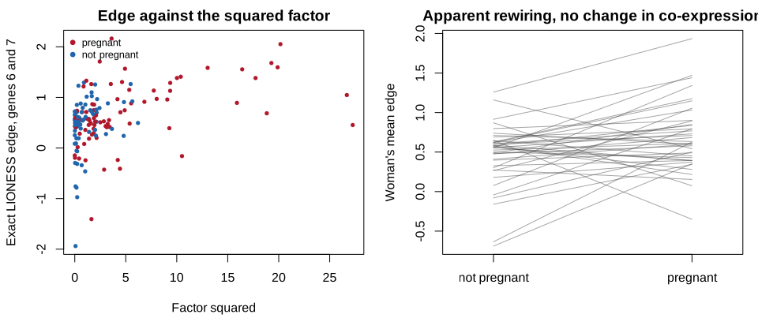
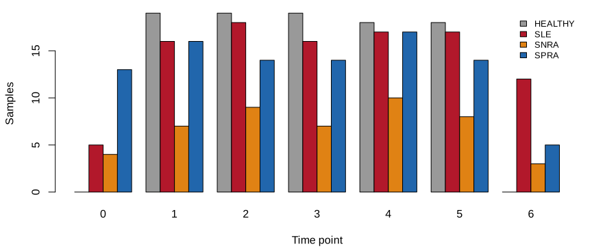
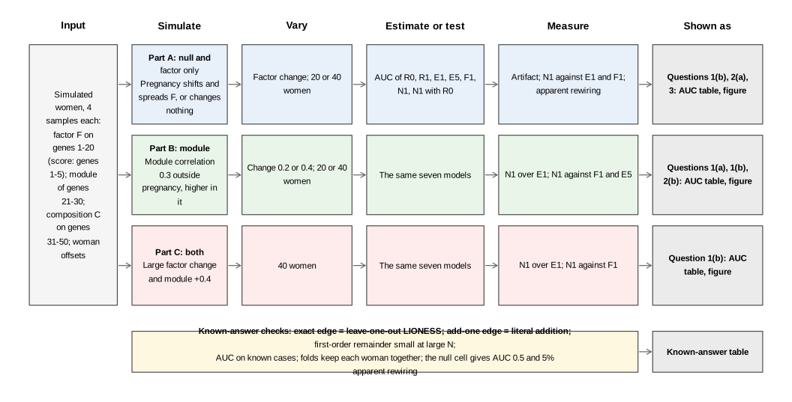
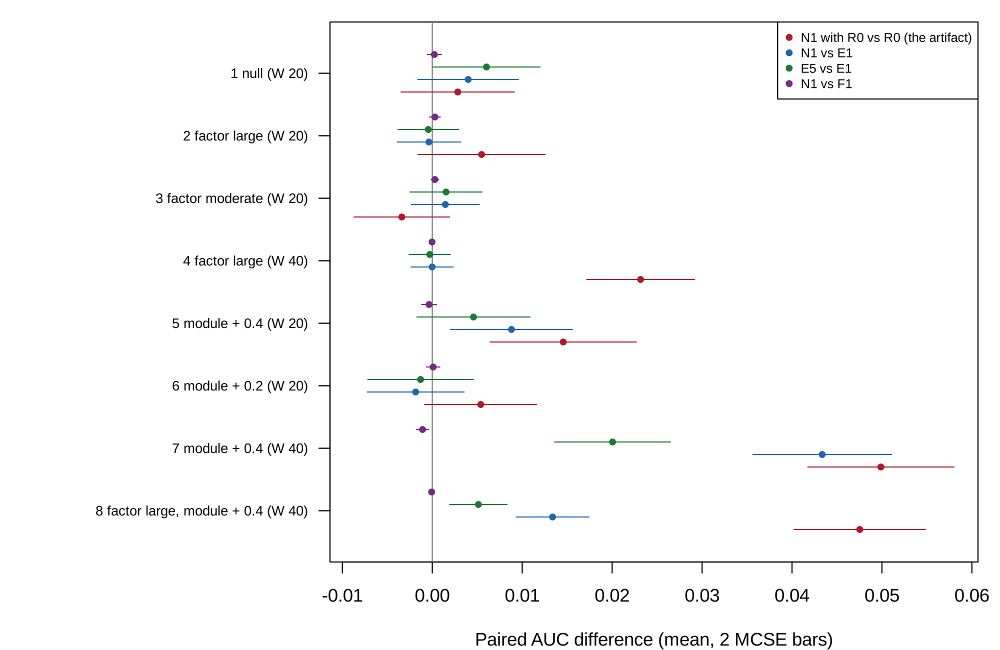

# Pilot report: LIONESS edges across pregnancy in SLE and RA

2026-11-13

# Summary

**Scope.** This document reports the pilot[^1] for the proposal “LIONESS
edges across pregnancy in SLE and RA” (`proposal.md`, section 7). It
covers the idea, how the pilot was run, what it found, the project spec,
and the decisions made along the way. It was built from
`project-spec.md`, `decisions.md`, and the saved results in
`pilot/results/`; every number in the text and figures is computed from
those files when the document renders.

**Status.** In `STATUS.md` the pilot is marked `piloted-close-call`[^2].
No deciding clause failed, but at least one clause failed or landed
within three MCSE of its threshold; the reading is given both ways in
the decisions log.

| Pilot question | Answer | Key evidence |
|----|----|----|
| 1\. Do edges equal their formula over time, with a signal to match? | close call and pass | N1 gained 0.043 (MCSE 0.0039) over E1 in cell 7 (module correlation +0.4, 40 women); N1 and F1 differed by -0.0011 to 0.0003 across all 8 cells. |
| 2\. Large enough at the study’s size (20 women)? | fail and fail | The artifact (N1 with $R_0$ over $R_0$) was 0.005 (MCSE 0.0035) in cell 2 (large factor change, 20 women); N1 gained 0.009 (MCSE 0.0034) over E1 in cell 5 (module correlation +0.4, 20 women). |
| 3\. Does the E1 base remove the artifact? | pass | In the factor-only cells, N1 against E1 ranged over -0.0004 to 0.0015. |

**What needs your decision** (details in [Action items and
limitations](#action-items-and-limitations)): the status call; the open
`[TO CONFIRM]` items in the spec (highlighted in yellow): the journal’s
limits and the milestone dates; and the four open questions of the
proposal (section 9): the comparison, the RA grouping, the healthy
pregnancies, and the counts download.

# The idea

## In plain language

LIONESS[^3] gives every blood sample a value for every pair of genes,
called an edge, meant to say how tightly the two genes move together in
that sample. When the edges of the same women change between pregnancy
and the months after birth, the change is read as the immune network
“rewiring”. The exact formula behind an edge says what it is made of:
the correlation of the two genes across all samples, plus the product of
the sample’s own two standardized values, minus a correction for how far
each gene sits from its average.

Pregnancy moves many genes together: the mix of white cells in blood
changes, and in lupus the interferon[^4] genes rise. Suppose two
interferon genes are each 1 standard deviation above average after birth
and 2 above average in late pregnancy, with nothing else changed. Their
product goes from 1 to 4, so the edge between them grows, although the
two genes are no more coordinated than before. This pilot asks, in
simulated women followed through pregnancy, whether LIONESS edges tell
pregnancy from the postpartum period beyond a simple model that already
holds the interferon score, its square, cell composition, and every
gene’s level; whether the one-line formula does just as well as the
edges; and whether a real change in coordination can be seen at the size
of the study. No patient expression data were analyzed; the real study
was described from its sample records.

## Potential impact

LIONESS builds one network per sample from an aggregate network and has
an R implementation (M. L. Kuijjer et al. 2019; Marieke L. Kuijjer et
al. 2019); its authors suggest such networks for studying change across
time. The product of standardized deviations as an edge goes back to
iENA (Yu et al. 2017), the first-order term is the influence function of
the correlation (Devlin et al. 1975), and a recent review relates sample
edges to covariance products (Kuijjer et al. 2026). The longitudinal
study behind the data described pregnancy in SLE and RA by differential
expression and deconvolution (Lien et al. 2024); no network analysis of
it, or of pregnancy with single-sample networks, was found at stage 1.

The problem is the reading of a change in edges between time points as
rewiring. When a factor that moves many genes changes over time, as
composition does in every pregnancy and interferon does in SLE, the
edges of the genes it moves change with its square. This pilot shows how
large that is in the analysis a longitudinal user runs, a paired test of
each edge between periods: with no change in co-expression at all, the
share of factor-gene pairs called rewired was 0.449 (MCSE 0.0115) at 20
women and 0.818 (MCSE 0.0098) at 40 under a large factor change, against
0.047 (MCSE 0.0022) in the null cell
(<a href="#tbl-rewire" class="quarto-xref">Table 4</a>). A user would
therefore adjust the edges for the squared score before calling anything
rewired.

For classification the picture is different. Edges equal their
first-order formula: N1 and F1 differed by -0.0011 to 0.0003 in AUC
across all cells
(<a href="#fig-gains" class="quarto-xref">Figure 4</a>), so any network
classifier can be reproduced without building a network. With the E1
base, edges added -0.0004 to 0.0015 when only the factor changed. But at
20 women the edges’ gain on a base without squares was only 0.005 (MCSE
0.0035), and a real change in co-expression added only 0.009 (MCSE
0.0034) over E1
(<a href="#tbl-verdict" class="quarto-xref">Table 5</a>): at the size of
GSE235508, classification cannot show either effect. The impact of the
project rests on the paired edge test, which the pilot shows is fooled,
and on a fix for it, which the pilot did not test.

## Application: the study behind the data

### The study

The proposed data come from a Norwegian longitudinal study of pregnancy
in rheumatic disease (Lien et al. 2024),
https://doi.org/10.1136/ard-2023-224644, deposited as GEO series
GSE235508[^5]. Women with systemic lupus erythematosus (SLE)[^6],
seropositive or seronegative rheumatoid arthritis (RA)[^7], and healthy
women gave whole-blood samples for RNA sequencing before pregnancy, in
each trimester, and at 6 weeks, 6 months, and 12 months after birth. The
paper reports that in SLE the interferon signature was augmented during
pregnancy, and that an altered cell type composition strongly influences
the expression profile; the GEO summary notes that RA often improves in
pregnancy while SLE is prone to flare. The processed counts and the
sample records are open on GEO; raw reads are withheld under Norwegian
law. <a href="#tbl-data" class="quarto-xref">Table 1</a> counts, from
the series matrix, the women who gave at least one sample in pregnancy
and at least one outside it, which are the ones a within-woman
comparison can use.

Table 1: GSE235508 by group, from `results/data_summary.rds` (the series
matrix, read by `pilot/describe_data.R`). Usable pregnancies have at
least one pregnant sample (trimesters 1 to 3) and one non-pregnant
sample (pre-pregnancy or postpartum).

| Group | Samples | Pregnancies | Usable pregnancies | Pregnant samples | Non-pregnant samples |
|:---|---:|---:|---:|---:|---:|
| Healthy | 93 | 21 | 20 | 54 | 36 |
| SLE | 101 | 25 | 18 | 48 | 44 |
| Seronegative RA | 48 | 15 | 9 | 20 | 19 |
| Seropositive RA | 93 | 23 | 18 | 42 | 43 |
| RA, both types | 141 | 38 | 27 | 62 | 62 |

### Why the AUC difference between N1 and E1

The quantity that decides the question is the difference in
out-of-sample area under the ROC curve[^8] (AUC) between E1 plus LIONESS
edges (N1) and E1 alone, for telling a woman’s pregnant samples from her
non-pregnant ones. A difference near zero means the edges add nothing to
the interferon score, composition, their squares, and the gene levels,
so the apparent rewiring is the shared factors. Beside it, the
difference between N1 and E1 plus the first-order edges (F1) asks
whether whatever edges add is their formula. In the application both are
computed within SLE (18 usable pregnancies) and within RA (27), never
pooled, with every sample of a woman in the same cross-validation[^9]
fold.

### Did the original study compute it?

No. The original study described expression changes over pregnancy with
differential expression and cell-type deconvolution; it built no
co-expression or single-sample networks and fitted no classifier of
pregnancy stage. The question here, whether edges over pregnancy carry
anything beyond the factors pregnancy moves, is new for this study and,
from the searches logged at stage 1, for pregnancy in general.

## In symbols

The sample’s standardized expression of gene $i$ ($z_{qi}$, its
deviation from the reference mean in units of the reference standard
deviation, divisor $N$), the reference correlation ($r$), and a shared
factor ($F_q$, with loadings $\lambda_i$) determine the LIONESS edge
($e_q$), its first-order form ($f_q$), and the edge’s mean given the
factor:

$$
\begin{aligned}
e_q &= N r - (N-1)\, r_{(-q)}, \\
f_q &= r + z_{qi} z_{qj} - \frac{r}{2}\left(z_{qi}^2 + z_{qj}^2\right), \\
e_q &= f_q + O_p\left(N^{-1}\right), \\
\mathrm{E}\left[e_q \mid F_q\right] &= r + \left[\lambda_i \lambda_j - \frac{r}{2}\left(\lambda_i^2 + \lambda_j^2\right)\right] F_q^2 + \text{const} + O\left(N^{-1}\right).
\end{aligned}
$$

| Symbol | Meaning |
|----|----|
| $N$ | number of samples in the reference set |
| $z_{qi}$ | expression of gene $i$ in sample $q$, standardized by the reference (divisor $N$) |
| $r$, $r_{(-q)}$ | Pearson correlation of genes $i$ and $j$ in the reference, and without sample $q$ |
| $e_q$, $f_q$ | exact LIONESS edge and first-order edge of sample $q$ for the pair $(i, j)$ |
| $F_q$, $\lambda_i$ | shared factor in sample $q$ (composition and interferon), and gene $i$’s loading on it |

The target is the change in correlation between periods,
$\rho_{ij}(\text{pregnant}) - \rho_{ij}(\text{postpartum})$. The
computable quantity, the change in mean edge, equals it plus the
coefficient in brackets times the change in $\mathrm{E}[F^2]$, which is
not zero whenever pregnancy moves the mean or the spread of $F$. In
words: edges change when the shared factor changes, with no change in
coordination.

Figure 1: The idea, an illustration on made-up numbers (not pilot
output): 40 simulated women, four samples each, from the pilot’s large
factor-change setting with no change in co-expression. Left: one
sample’s exact LIONESS edge for two factor genes against the factor
squared. Right: the same edge by period, each line one woman’s mean edge
outside and in pregnancy.

Figure 2: The real data (GSE235508 sample records, from
`results/data_summary.rds`): samples by group and time point. Time
points 1 to 3 are the trimesters; 0 is before pregnancy; 4, 5, 6 are 6
weeks, 6 months, and 12 months after birth.

## Critiquing the model

Any model is a simplification, and the useful question is not whether it
is true but where it bends and whether the bend matters for the question
being asked. The model above was chosen so that the problem could be
written as a formula and checked by simulation, and each simplification
that made that possible is a place where real data may behave
differently. The table lists the main ones. Work through it one row at a
time. The first column names the feature and the symbols in the
equations that carry it, so find them there first. Then decide in your
own words how the feature could fail for real data before reading the
second column, and finally read the third column for what should be done
to check it. Several of these checks are natural first tasks for the
project. Which of them the pilot examined, and which it left open, is
for you to find when you read the Methods and Results that follow.

| Feature of the model | Why it may not be realistic | What should be done to check it |
|----|----|----|
| One shared factor $F$ with equal loadings 0.8 on 20 genes | Pregnancy moves several cell types and interferon separately, with different strengths per gene | Estimate the number of factors and the loadings from GSE235508 counts |
| Pregnancy changes $F$ by a shift and a scale (0.5 and 1.5, or 1 and 2.25) | The real change in the mean and spread of $\mathrm{E}[F^2]$ is not known for SLE or RA | Estimate the shift and the scale of the IFN score over pregnancy in each disease |
| Two pregnant and two non-pregnant samples per woman | The study has up to seven time points, unevenly observed | Mirror each woman’s real time points in a plasmode design |
| The woman’s offsets $u_{wg}$ of variance 0.5, independent across genes | Between-person differences in blood are correlated across genes | Estimate the between-woman covariance from the data |
| Composition $C$ stable over pregnancy and observed without error | Neutrophils rise in pregnancy; deconvolution estimates carry error | Let $C$ shift with pregnancy and add measurement error |
| Normal noise | Log counts have heavier tails, and the remainder $e_q - f_q$ grows with $z^4$ | Resample residuals from the real data |
| The gene levels carry no pregnancy signal in the module cells | Pregnancy changes the level of many genes, so E1 is stronger in blood | Report E1 over $R_1$ in the application |

# Methods

## Design

The pilot simulates cohorts of women in 8 cells. Each woman gives four
samples, two in pregnancy and two outside it. Fifty genes: genes 1 to 20
load on a shared factor $F$ (the composition and interferon changes of
pregnancy), with the interferon score taken as the mean of genes 1 to 5;
genes 21 to 30 form a co-expressed module; genes 31 to 50 load on a
stable composition factor $C$. Each woman has her own level of both
factors and her own offset on every gene. Each cell lets pregnancy
change nothing, the distribution of $F$, the module’s correlation, or
both. In each replicate, seven models are fitted in an outer 5-fold
cross-validation with every woman’s samples in one fold, and every
derived quantity is computed inside the training fold.

Figure 3: The design at a glance. Each row is one part of the pilot,
read from left to right: what is simulated, which factors are varied,
what is estimated, what is measured, and how the result is shown. Every
part feeds the AUC table
(<a href="#tbl-auc" class="quarto-xref">Table 3</a>) and the figure of
differences (<a href="#fig-gains" class="quarto-xref">Figure 4</a>); the
verdict is in <a href="#tbl-verdict" class="quarto-xref">Table 5</a>,
the apparent rewiring in
<a href="#tbl-rewire" class="quarto-xref">Table 4</a>, and the
known-answer checks in
<a href="#tbl-known-answer" class="quarto-xref">Table 2</a>.

Each figure and table in the Results traces back to one row of this
diagram.

| Part | What is simulated | Main factors | Replicates |
|----|----|----|----|
| A | Null (cell 1) and factor change only (cells 2 to 4) | factor change (moderate, large); 20 or 40 women | 200 per cell |
| B | Module correlation change (cells 5 to 7) | change 0.2 or 0.4; 20 or 40 women | 200 per cell |
| C | Both (cell 8) | large factor change, module +0.4, 40 women | 200 per cell |

The seven models are: $R_0$, logistic regression on composition and the
IFN score’s residual on composition; $R_1$, $R_0$ plus both squares; E1,
an elastic net[^10] on the 45 non-score genes with the $R_1$ terms
unpenalized; and three models that add one penalized feature set to E1:
E5 (the 990 pairwise products and 45 squares of the standardized genes),
F1 (the 990 first-order edges), and N1 (the 990 exact LIONESS edges).
The seventh, N1 with $R_0$, puts the LIONESS edges on $R_0$ alone, to
measure the artifact. The large factor change shifts the mean of $F$ by
1 and multiplies its spread by 2.25 in pregnancy, the moderate one by
0.5 and 1.5. Apparent rewiring is the share of gene pairs whose edge
differs between periods by a paired $t$-test across women at the 5%
level, for the 105 pairs of genes 6 to 20 and the 45 module pairs.

## Known-answer checks

Known-answer checks come before any result, because every later number
is only as good as the simulation that produced it. Each check sets up a
case where the correct answer is known from theory, runs the simulation
code on it, and compares the two. Agreement says nothing about the
scientific question or about real data. It says that the code does what
the model says. Disagreement means stopping to look for a bug before
reading anything else, and the same checks apply to any code you write
for the project.

Read each row of the table in four steps: the setting that was
simulated, the known answer for that setting, what the simulation gave,
and whether the gap between the two is small compared with the Monte
Carlo standard error (MCSE). The MCSE is how much a simulated result
moves from run to run because only a finite number of replicates was
used. A gap within about two MCSE is noise, and a gap of several MCSE is
a problem.

Table 2: Known-answer checks, from `results/known_answers.rds`.

| Check | Setting | Known answer | Simulation gave | How to read it |
|----|----|----|----|----|
| Exact LIONESS Pearson edge equals leave-one-out LIONESS | N = 12, 6 genes, one outlier; largest absolute difference | 0.000 | 8.88e-15 | 8.882e-15 from the known value, against a tolerance of 1e-08, so the check passes. |
| Exact add-one edge equals (N + 1) r(+q) - N r | reference N = 12, 5 new samples; largest absolute difference | 0.000 | 5.33e-15 | 5.329e-15 from the known value, against a tolerance of 1e-08, so the check passes. |
| Exact LIONESS Pearson edge equals leave-one-out LIONESS | N = 60, 6 genes, one outlier; largest absolute difference | 0.000 | 1.42e-14 | 1.421e-14 from the known value, against a tolerance of 1e-08, so the check passes. |
| Exact add-one edge equals (N + 1) r(+q) - N r | reference N = 60, 5 new samples; largest absolute difference | 0.000 | 1.07e-14 | 1.066e-14 from the known value, against a tolerance of 1e-08, so the check passes. |
| First-order edge approaches the exact edge as N grows | N = 4000, r = 0.5; largest absolute difference | 0.000 | 0.0123 | 0.01235 from the known value, against a tolerance of 0.05, so the check passes. |
| AUC of perfectly separated scores | 5 against 5 | 1.000 | 1 | 0 from the known value, against a tolerance of 1e-08, so the check passes. |
| AUC of tied scores | all scores equal | 0.500 | 0.5 | 0 from the known value, against a tolerance of 1e-08, so the check passes. |
| Folds keep each woman’s samples together | 20 women, 4 samples each; women split across folds | 0.000 | 0 | 0 from the known value, against a tolerance of 1e-08, so the check passes. |
| AUC of R0 in the null cell | cell 1, 200 replicates | 0.500 | 0.4932 (MCSE 0.0044) | 1.5 MCSE from the known value, so the gap is noise. |
| AUC of R1 in the null cell | cell 1, 200 replicates | 0.500 | 0.4917 (MCSE 0.0049) | 1.7 MCSE from the known value, so the gap is noise. |
| AUC of E1 in the null cell | cell 1, 200 replicates | 0.500 | 0.4908 (MCSE 0.0049) | 1.9 MCSE from the known value, so the gap is noise. |
| AUC of E5 in the null cell | cell 1, 200 replicates | 0.500 | 0.4968 (MCSE 0.0053) | 0.6 MCSE from the known value, so the gap is noise. |
| AUC of F1 in the null cell | cell 1, 200 replicates | 0.500 | 0.4945 (MCSE 0.0052) | 1.0 MCSE from the known value, so the gap is noise. |
| AUC of N1 in the null cell | cell 1, 200 replicates | 0.500 | 0.4947 (MCSE 0.0052) | 1.0 MCSE from the known value, so the gap is noise. |
| AUC of N1R0 in the null cell | cell 1, 200 replicates | 0.500 | 0.4961 (MCSE 0.0051) | 0.8 MCSE from the known value, so the gap is noise. |
| Apparent rewiring (factor pairs) in the null cell | cell 1; share of pairs with p \< 0.05 | 0.050 | 0.0475 (MCSE 0.0022) | 1.2 MCSE from the known value, so the gap is noise. |
| Apparent rewiring (module pairs) in the null cell | cell 1; share of pairs with p \< 0.05 | 0.050 | 0.0488 (MCSE 0.0030) | 0.4 MCSE from the known value, so the gap is noise. |

0 of 9 rows with a standard error are more than 2 MCSE from the known
value.

# Results

## How to read the outputs

Each output traces back to a row of the design diagram (the captions
name the part where one applies). Read each in the same four steps.
First, find its row in the diagram, which says what was simulated and
what was varied. Second, work out what one point or one table entry is,
usually one combination of the varied factors, averaged over replicates.
Third, identify the reference value that would hold if nothing were
wrong, shown as a dashed or grey line wherever possible. Fourth, look
for where the results leave that reference, and for which settings they
do. The outputs report three kinds of quantity.

- **Bias** is the average of an estimate minus its true value. When the
  truth is no difference, any average difference from 0 is a spurious
  difference created by the problem under study.
- **Level** is how often a test rejects when there is truly nothing to
  find. A correct test at 0.05 rejects 5% of the time, so a rate above
  0.05 means too many false alarms.
- **Power** is how often a test rejects when there is a real effect.
  More is better, but only when the level is not inflated, because a
  test that rejects too often also looks powerful.

All rates and averages come from simulation, so each carries Monte Carlo
error. That is why the figures show bars or a grey band, and why small
differences should not be over-read.

This pilot reports AUC and paired AUC differences. A paired difference
is computed within each replicate, between two models fitted to the same
simulated cohort, and then averaged; its MCSE is the replicate standard
deviation of the difference divided by the square root of the number of
replicates. A difference of 0 means the two models did equally well.
Apparent rewiring is a share of gene pairs; its reference value with no
change in co-expression would be 0.05 if edges measured co-expression
alone.

## AUC differences by cell

**Figure guide (all parts).** Each row is one cell, labelled by what
pregnancy changes and the number of women ($W$). The four colored points
are paired AUC differences averaged over 200 replicates: N1 with $R_0$
against $R_0$ (the artifact); N1 against E1; E5 against E1; and N1
against F1. The bars are two MCSE on each side, and the grey line is no
difference. Look for: whether the purple points sit on the line in every
row; whether the blue points sit on the line in the factor-only rows and
away from it in the module rows; how far the red points sit from the
line in the factor-only rows.

Figure 4: Pilot result (all parts): paired AUC differences by cell,
means over replicates with bars of two MCSE, from
`results/cell_summaries.rds`.

## Numbered findings

Each finding is a claim followed by the output behind it. Read the
claim, open the output, and check that you can see the claim there
before accepting it.

1.  **LIONESS edges and their first-order formula perform the same.**
    Their AUC difference ranged over -0.0011 to 0.0003 across all 8
    cells (<a href="#tbl-verdict" class="quarto-xref">Table 5</a>,
    purple points in
    <a href="#fig-gains" class="quarto-xref">Figure 4</a>), inside the
    margin of 0.01 in every cell.
2.  **The signal to match was a little short of the pre-registered
    0.05.** In cell 7 (module correlation +0.4, 40 women), N1 gained
    0.043 (MCSE 0.0039) over E1, within 3 MCSE of 0.05, a close call
    (<a href="#tbl-verdict" class="quarto-xref">Table 5</a>, blue
    points).
3.  **The E1 base removes the artifact from classification.** In the
    factor-only cells, N1 against E1 ranged over -0.0004 to 0.0015,
    while N1 with $R_0$ gained 0.023 (MCSE 0.0030) over $R_0$ at 40
    women (red points).
4.  **At 20 women the classification artifact is small.** N1 with $R_0$
    gained 0.005 (MCSE 0.0035) over $R_0$ in cell 2 (large factor
    change, 20 women), below the 0.02 of clause 2(a); the squared terms
    of $R_1$ themselves gained 0.057 (MCSE 0.0045) over $R_0$ there
    (<a href="#tbl-auc" class="quarto-xref">Table 3</a>).
5.  **At 20 women a real rewiring is hard to see by classification.** N1
    gained 0.009 (MCSE 0.0034) over E1 in cell 5 (module correlation
    +0.4, 20 women), below the 0.03 of clause 2(b), and -0.002 (MCSE
    0.0027) with a change of 0.2
    (<a href="#tbl-verdict" class="quarto-xref">Table 5</a>).
6.  **The paired edge test calls rewiring where there is none.** With no
    change in co-expression, the share of factor-gene pairs called
    rewired was 0.140 (MCSE 0.0057) under a moderate factor change and
    0.449 (MCSE 0.0115) under a large one at 20 women, against 0.047
    (MCSE 0.0022) in the null cell
    (<a href="#tbl-rewire" class="quarto-xref">Table 4</a>). The same
    test found the true module change in 0.272 (MCSE 0.0126) of the
    module pairs at 20 women.
7.  **The known-answer checks hold.** Every code identity agreed to
    better than $10^{-13}$, the folds kept every woman together, the
    null cell’s AUCs sat near 0.5, and its apparent rewiring at its
    nominal level
    (<a href="#tbl-known-answer" class="quarto-xref">Table 2</a>).

## Tables

**Table guide (all parts).** One row per cell; the columns are the mean
out-of-fold AUC of each model over 200 replicates. The reference value
is 0.5 in the null cell. Compare N1 against E1 and F1 in the same row,
and N1 with $R_0$ against $R_0$.

Table 3: Mean out-of-fold AUC by cell and model, from
`results/cell_summaries.rds`. The largest MCSE of any entry is given in
the text below the table.

| Cell | R0 | R1 | E1 (genes) | E5 (E1 + products, squares) | F1 (E1 + first-order edges) | N1 (E1 + edges) | N1 with R0 |
|:---|:---|:---|:---|:---|:---|:---|:---|
| cell 1 (null, 20 women) | 0.493 | 0.492 | 0.491 | 0.497 | 0.495 | 0.495 | 0.496 |
| cell 2 (large factor change, 20 women) | 0.631 | 0.688 | 0.687 | 0.687 | 0.687 | 0.687 | 0.636 |
| cell 3 (moderate factor change, 20 women) | 0.573 | 0.589 | 0.587 | 0.588 | 0.588 | 0.588 | 0.570 |
| cell 4 (large factor change, 40 women) | 0.643 | 0.708 | 0.707 | 0.707 | 0.707 | 0.707 | 0.666 |
| cell 5 (module correlation +0.4, 20 women) | 0.496 | 0.494 | 0.495 | 0.500 | 0.504 | 0.504 | 0.511 |
| cell 6 (module correlation +0.2, 20 women) | 0.491 | 0.491 | 0.496 | 0.495 | 0.494 | 0.494 | 0.496 |
| cell 7 (module correlation +0.4, 40 women) | 0.492 | 0.492 | 0.493 | 0.513 | 0.537 | 0.536 | 0.542 |
| cell 8 (large factor change and module +0.4, 40 women) | 0.644 | 0.704 | 0.704 | 0.709 | 0.718 | 0.718 | 0.692 |

The largest MCSE of an AUC in the table is 0.0053.

**Table guide (apparent rewiring).** One row per cell: the share of gene
pairs whose LIONESS edge differs between pregnancy and the postpartum
period by a paired test at the 5% level, among the factor genes outside
the score and among the module genes. Without any change in
co-expression the share should be near 0.05. Look for: the factor-gene
column in the factor-only cells, where co-expression does not change.

Table 4: Apparent rewiring by cell, mean share of pairs called different
(MCSE), from `results/cell_summaries.rds`.

| Cell | Factor genes 6 to 20 (105 pairs) | Module genes 21 to 30 (45 pairs) |
|:---|:---|:---|
| cell 1 (null, 20 women) | 0.047 (MCSE 0.0022) | 0.049 (MCSE 0.0030) |
| cell 2 (large factor change, 20 women) | 0.449 (MCSE 0.0115) | 0.046 (MCSE 0.0026) |
| cell 3 (moderate factor change, 20 women) | 0.140 (MCSE 0.0057) | 0.048 (MCSE 0.0027) |
| cell 4 (large factor change, 40 women) | 0.818 (MCSE 0.0098) | 0.051 (MCSE 0.0026) |
| cell 5 (module correlation +0.4, 20 women) | 0.048 (MCSE 0.0021) | 0.272 (MCSE 0.0126) |
| cell 6 (module correlation +0.2, 20 women) | 0.046 (MCSE 0.0018) | 0.095 (MCSE 0.0058) |
| cell 7 (module correlation +0.4, 40 women) | 0.052 (MCSE 0.0023) | 0.506 (MCSE 0.0136) |
| cell 8 (large factor change and module +0.4, 40 women) | 0.809 (MCSE 0.0084) | 0.535 (MCSE 0.0137) |

**Table guide (the verdict).** One row per clause of the pre-registered
rule: the quantity, its value with its MCSE, the threshold, and the
outcome, read by `pilot/verdict.R`. Check that each outcome follows from
its value and threshold, and that the combination gives the status.

Table 5: The pass rule applied clause by clause, from
`results/verdict.rds`.

| Q | Clause | Cell | Quantity | Value | MCSE | Threshold | Outcome |
|---:|:---|:---|:---|:---|:---|:---|:---|
| 1 | \(a\) | cell 7 (module correlation +0.4, 40 women) | A(N1) - A(E1) | 0.0434 | 0.0039 | \>= 0.05 and \> 3 MCSE | close |
| 1 | \(b\) | cell 1 (null, 20 women) | A(N1) - A(F1) | 0.0002 | 0.0004 | \|D\| \<= 0.0100 | pass |
| 1 | \(b\) | cell 2 (large factor change, 20 women) | A(N1) - A(F1) | 0.0003 | 0.0003 | \|D\| \<= 0.0100 | pass |
| 1 | \(b\) | cell 3 (moderate factor change, 20 women) | A(N1) - A(F1) | 0.0003 | 0.0002 | \|D\| \<= 0.0100 | pass |
| 1 | \(b\) | cell 4 (large factor change, 40 women) | A(N1) - A(F1) | -0.0000 | 0.0001 | \|D\| \<= 0.0100 | pass |
| 1 | \(b\) | cell 5 (module correlation +0.4, 20 women) | A(N1) - A(F1) | -0.0004 | 0.0004 | \|D\| \<= 0.0100 | pass |
| 1 | \(b\) | cell 6 (module correlation +0.2, 20 women) | A(N1) - A(F1) | 0.0001 | 0.0004 | \|D\| \<= 0.0100 | pass |
| 1 | \(b\) | cell 7 (module correlation +0.4, 40 women) | A(N1) - A(F1) | -0.0011 | 0.0003 | \|D\| \<= 0.0100 | pass |
| 1 | \(b\) | cell 8 (large factor change and module +0.4, 40 women) | A(N1) - A(F1) | -0.0001 | 0.0001 | \|D\| \<= 0.0100 | pass |
| 2 | \(a\) | cell 2 (large factor change, 20 women) | A(N1 with R0) - A(R0) | 0.0055 | 0.0035 | \>= 0.02 | fail |
| 2 | \(b\) | cell 5 (module correlation +0.4, 20 women) | A(N1) - A(E1) | 0.0088 | 0.0034 | \>= 0.03 | fail |
| 3 | \(a\) | cell 2 (large factor change, 20 women) | A(N1) - A(E1) | -0.0004 | 0.0018 | \|E\| \<= 0.0100 | pass |
| 3 | \(a\) | cell 3 (moderate factor change, 20 women) | A(N1) - A(E1) | 0.0015 | 0.0019 | \|E\| \<= 0.0100 | pass |
| 3 | \(a\) | cell 4 (large factor change, 40 women) | A(N1) - A(E1) | -0.0000 | 0.0012 | \|E\| \<= 0.0100 | pass |

**Table guide (numbers quoted in the spec).** Each row recomputes a
number that section 3 of the spec quotes, from the result files.

Table 6: Numbers quoted in the spec’s section 3, recomputed from
`results/cell_summaries.rds` and `results/verdict.rds`.

| Quantity                                    | Value                |
|:--------------------------------------------|:---------------------|
| 1(a): N1 over E1, cell 7                    | 0.0434 (MCSE 0.0039) |
| 1(b): range of A(N1) - A(F1) over all cells | -0.0011 to 0.0003    |
| 2(a): artifact, N1 with R0 over R0, cell 2  | 0.0055 (MCSE 0.0035) |
| 2(b): N1 over E1, cell 5                    | 0.0088 (MCSE 0.0034) |
| 3(a): range of N1 over E1, cells 2, 3, 4    | -0.0004 to 0.0015    |
| Apparent rewiring, factor genes, cell 2     | 0.449 (MCSE 0.0115)  |
| Status                                      | piloted-close-call   |

# The draft spec

This is `project-spec.md`, read from the file when the document renders.
Anything the agent[^11] left for the user to decide is highlighted in
yellow and starts with “To confirm”.

|  |  |
|----|----|
| Proposal | `proposal.md`, final 2026-11-13 |
| Authors | as in `DESCRIPTION`, set by `tools/authors.R` before the final render |
| Written | 2026-11-13 |
| Status | draft; section 3 completed 2026-11-13 after the verdict |

## 1. Question and why it matters

**Question (one sentence):** Do LIONESS edges separate pregnant from
non-pregnant samples of the same women beyond the IFN score, cell
composition, their squares, the gene levels, and their own first-order
features, and does the answer differ between SLE and RA?

**Why it matters:** A change in LIONESS edges over pregnancy is read as
rewiring of immune co-expression. If the mechanism holds, much of that
change is the squared change of the factors pregnancy moves (composition
in every woman, IFN in SLE), and a user would fit the base with the
squared score and the gene levels before claiming that edges add
anything, and would check every network result against the first-order
formula.

## 2. Mechanism we suspect

A LIONESS edge equals, to first order,
$r + z_{qi} z_{qj} - \tfrac{r}{2}(z_{qi}^2 + z_{qj}^2)$. Under a shared
factor $F$ with loadings $\lambda$, its conditional mean is linear in
$F_q^2$ with coefficient
$\lambda_i \lambda_j - \tfrac{r}{2}(\lambda_i^2 + \lambda_j^2)$, so the
difference in mean edge between pregnancy and the postpartum period is
that coefficient times the difference in $\mathrm{E}[F^2]$, with the
period-specific correlation unchanged. The gap is zero when pregnancy
moves neither the mean nor the spread of $F$ (the null cell), and grows
with the shift and the scale of $F$ (the factor cells). If the mechanism
is wrong, edges would gain over E1 in factor-only cells, or edges and
the first-order formula would classify differently.

## 3. Pilot

**Code:** `pilot/pilot.R` (`Rscript pilot/pilot.R --reps <n>`), then
`Rscript pilot/verdict.R`; data description
`Rscript pilot/describe_data.R`.

**Pass rule:** `pilot/preregistration.md`, section 2, copied from
proposal section 7.

**Verdict file:** `pilot/results/verdict.rds`, after the run.

**Plot:** `pilot/results/auc_gains.png`.

**Status:** `piloted-close-call` (2026-11-13), 200 replicates per cell,
8 cells, three cores, 1,622 seconds.

**The three pilot answers** (`pilot/results/verdict.rds`; numbers
rounded from `pilot/results/cell_summaries.rds`):

1.  Does the effect exist? Edges equal their formula: N1 and F1 differed
    by at most 0.0011 in AUC in any cell (1(b) pass). With a module
    change at 40 women, N1 gained 0.043 (MCSE 0.0039) over E1, within 3
    MCSE of 0.05 (1(a) close call).
2.  Is it large enough at realistic sizes? Not by classification at 20
    women: the artifact was 0.005 (MCSE 0.0035), below 0.02 (2(a) fail),
    and real rewiring added 0.009 (MCSE 0.0034) over E1, below 0.03
    (2(b) fail). By the paired edge test, yes: with no change in
    co-expression, 0.45 of factor-gene pairs were called rewired at 20
    women under a large factor change, against 0.047 in the null cell.
3.  Is there a fix? For classification, yes: with the E1 base edges
    added between -0.0004 and 0.0015 in the factor-only cells (3(a)
    pass). For the paired edge test, none was tested.

## 4. ADEMP skeleton

**Aims.** (1) Do LIONESS edges and their first-order formula classify
pregnancy stage alike? (2) How much do edges gain from a factor that
changes over pregnancy, and does the E1 base remove it? (3) When
co-expression truly changes, do edges detect it beyond E1 at the study’s
size?

**Data-generating mechanisms.**

- Factors varied, with levels: what pregnancy changes (nothing; the
  factor $F$, moderate or large; the module’s correlation by 0.2 or 0.4;
  both); the number of women (20, 40).
- Factors fixed, and why: four samples per woman (two in each period,
  the median the study provides per disease); 50 genes (as in the first
  project, so results are comparable); loadings 0.8 and 0.4; woman-level
  gene offsets of variance 0.5 (the between-person part of whole-blood
  expression); normal noise (heavy tails were tested in the first
  project).
- A cell where the answer is known: the null cell, every AUC 0.5.

**Estimands.** The out-of-sample AUC of each model for the period of a
new woman’s sample; the paired AUC differences $\Delta_1$, $\Delta_2$,
and the artifact $G$.

**Methods compared.** $R_0$, $R_1$ (logistic); E1, E5, F1, N1, N1 with
$R_0$ (elastic net, `glmnet` `cv.glmnet`, mixing 0.5, 5 inner folds
grouped by woman, binomial deviance, `lambda.min`, base terms
unpenalized). Outer 5-fold cross-validation by woman.

**Performance measures.** Mean out-of-fold AUC and paired differences
with MCSE; the share of gene pairs called different between periods by a
paired test (apparent rewiring).

**Replicates and Monte Carlo SE target.** 200 per cell in the pilot if
the time box allows, an MCSE of about 0.003 for a difference with
standard deviation 0.04.

## 5. Application

**Dataset:** GSE235508 (Lien et al. 2024), GEO; the series matrix in
`data/raw/` for the pilot’s description, the counts at stage 3 after
approval.

**Comparison:** within SLE and within RA separately, pregnant
(trimesters 1 to 3) against non-pregnant (pre-pregnancy and postpartum)
samples of the same women, folds by woman; counts per group from
`pilot/results/data_summary.rds`.

**What to show:** whether the apparent rewiring over pregnancy, and any
gain of edges over the base, disappears once the squared IFN and
composition scores and the gene levels are in the base, and whether that
differs between SLE and RA.

## 6. Target journal

**Target journal:** BMC Bioinformatics

**Fallback:** Statistical Applications in Genetics and Molecular Biology

**The target’s word limit and AI policy:** **To
confirm:** copied from the journal profile at stage 3

## 7. Milestones

| Stage | Ends with | Due |
|----|----|----|
| 2\. Pilot | `pilot/pilot-report.html`, the verdict file, `pilot/decisions.md` | 2026-11-13 |
| 3\. Manuscript, design stop | `protocol.md` from the approved design | **To confirm:** date |
| 3\. Manuscript, first draft | `manuscript/manuscript.html` in draft mode | **To confirm:** date |
| 3\. Manuscript, settled | the draft after the revision rounds | **To confirm:** date |
| 4\. Background report | `background/background.html` | **To confirm:** date |
| 5\. Mock review | the last `review/round-N/` | **To confirm:** date |
| Submission | the final render and the checker in final mode | **To confirm:** date |

## 8. Out of scope

- A second dataset merged with GSE235508 (the user’s rule: no studies
  combined).
- Pregnancy outcomes or flare prediction (a predictive project of its
  own).
- Other single-sample network methods (SSN, iENA, SWEET, BONOBO):
  covered in the first project.
- Partial-correlation edges and regularized discriminant analysis (the
  first project’s N2 and E4).
- Mixed models of the edges over time: a different estimand, parked as
  its own idea.

## 9. Reading

1.  1.  After reading, a reader can answer: how is a LIONESS sample
        network defined, and what use across time do the authors
        propose?
2.  2.  After reading, a reader can answer: what happens to the IFN
        signature and to cell composition over pregnancy in SLE and in
        RA?
3.  3.  After reading, a reader can answer: what is the influence
        function of the correlation coefficient?

# Decisions log

This is the agent’s `decisions.md` for the pilot, read from the file
when the document renders.

## D0. The literature pass

The proposal’s prior-work section (`proposal.md`, section 5) and
`log/01-idea-review.md` hold the literature read at stage 1: the
mechanism’s sources carried from the first project, the dataset paper
(Lien and colleagues 2024), and three new searches, none of which found
a single-sample network analysis of pregnancy. Nothing was read since.

## D1. The status call: `piloted-close-call`, with both readings

The rule (`pilot/preregistration.md`, section 2) gives a close call: no
deciding clause failed (1(b) and 3(a) passed, 1(a) is within 3 MCSE of
its threshold), and both clauses of question 2 failed. The values are in
`pilot/results/verdict.rds`.

- **The reading that passes.** The claims the critique rests on held:
  LIONESS edges and their first-order formula gave the same AUC in every
  cell (1(b)), and with the E1 base the edges added nothing when only
  the shared factor changed (3(a)). Clause 1(a) fell short of 0.05 by
  about 1.7 MCSE, a value the rule reads as a close call, not a fail.
  The failures of question 2 concern AUC at 20 women; the artifact the
  critique is about is large at 20 women in the analysis that
  longitudinal users run, the paired test of edges between periods: with
  no change in co-expression, the share of factor-gene pairs called
  rewired was about nine times its nominal 5% in the large factor-change
  cell (`pilot/results/cell_summaries.rds`, `rewire_factor`, cell 2),
  and about three times in the moderate cell. Read this way, the project
  goes on with the paired edge test as the primary measure of the
  artifact.
- **The reading that fails.** At the study’s size (20 women), neither
  the artifact nor a real change in co-expression moved the AUC enough
  to matter: the artifact was about a quarter of its 0.02 threshold, and
  N1 gained under a third of 0.03 over E1 in the rewiring cell. The
  classification analysis that the proposal planned for GSE235508 (18
  SLE women, 27 RA women with samples in both periods) would then be
  uninformative in both directions: a null result would not separate “no
  rewiring” from “too few women”. Read this way, the classification aim
  is dropped or the application is re-scoped before stage 3.

The agent’s reading: the deciding claims held, and the result that
matters most for the paper is outside the pass rule (the apparent
rewiring), so the close call is closer to a pass for a critique built on
the paired edge test, and closer to a fail for the classification aim.
The user decides.

## D2. Folds by woman, inner and outer

Every woman’s four samples are in one outer fold, and the inner folds of
`cv.glmnet` are also by woman (`GroupFolds()`). Without this, a woman’s
offsets in the training fold would score her own test samples.
Alternative: stratified folds by sample, as in the first project;
rejected, since it leaks the woman.

## D3. The artifact grows with the number of women

The artifact $A(\text{N1 with } R_0) - A(R_0)$ was small at 20 women and
about four times larger at 40 in the same large factor-change setting
(cells 2 and 4, `cell_summaries.rds`). The elastic net needs enough
samples to use 990 edges; at 80 samples it uses them little. So the AUC
artifact is a function of size as well as of the factor change, and
question 2’s threshold, set at 20 women, judged it where it is weakest.

## D4. Real rewiring is hard to see by classification at 20 women

In the rewiring cell at 20 women (cell 5) N1 gained under 0.01 over E1,
and at 40 women (cell 7) about 0.04; with a change of 0.2 at 20 women
(cell 6) nothing. The paired edge test found the module change in about
a quarter of the module pairs at 20 women and in half at 40. The woman
offsets (variance 0.5 on every gene) dilute the module’s correlation in
the pooled reference, which is the realistic case for repeated samples.

## D5. The paired edge test is fooled in proportion to the factor change, and the fix for it was not tested

The share of factor-gene pairs called rewired with no change in
co-expression grew from about the nominal rate (null) to about 0.14
(moderate), 0.45 (large, 20 women), and 0.82 (large, 40 women). No fix
for the paired test (an edge adjusted for the squared score, or
partial-correlation edges) was in the pre-registration, so none was run;
that is the obvious content of a re-pilot if the user re-scopes to it.

## D6. The null cell

Every model’s AUC in the null cell sat between about 0.49 and 0.50,
within about 2 MCSE of 0.5 except E1 and R1 (about 1.9 MCSE below), the
usual small downward bias of pooled out-of-fold AUC; the apparent
rewiring sat at its nominal 0.05 (`known_answers.rds`). The paired
differences the clauses judge are unaffected, since the bias is shared.

## D7. What was not done

- No gene expression from GSE235508 was analysed; only its sample
  records were read.
- The counts file (25 MB) was not downloaded; it waits for the user’s
  approval.
- One noise distribution (normal), one loading (0.8), four samples per
  woman.
- No fix for the paired edge test was run (D5).

# Action items and limitations

## Action items

1.  **Decide the status.** The rule gives `piloted-close-call`. The
    reading that passes and the reading that fails are in the decisions
    log (D1). Three ways on: read it as a pass and go to stage 3 with
    the classification aim as planned (with the known risk that
    GSE235508 is too small to show it); re-scope to the paired edge test
    as the primary measure, with a re-pilot (`pilot-b/`) that tests a
    fix for it; or drop the classification aim.
2.  **Answer the proposal’s open questions** (section 9): the
    comparison, the RA grouping, the healthy pregnancies, and approval
    of the 25 MB counts download.
3.  **Resolve the yellow `[TO CONFIRM]` items** in the spec: the
    journal’s limits and the milestone dates.
4.  **Verify the citations.** Every entry was copied from its record; 3
    still lacks its full text.

## Limitations

- Everything here is simulation; no gene expression of GSE235508 was
  analysed, only its sample records.
- One shared factor with equal loadings, normal noise, and four samples
  per woman; the real study has up to seven uneven time points.
- The size of the real change in the shared factor over pregnancy is not
  known; the moderate and large levels are the first project’s.
- No fix for the paired edge test was run.

Devlin, Susan J., R. Gnanadesikan, and J. R. Kettenring. 1975. “Robust
Estimation and Outlier Detection with Correlation Coefficients.”
*Biometrika* 62 (3): 531-45. <https://doi.org/10.1093/biomet/62.3.531>.

Kuijjer, M. L., M. G. Tung, G. Yuan, J. Quackenbush, and K. Glass. 2019.
“Estimating Sample-Specific Regulatory Networks.” *iScience* 14: 226-40.
<https://doi.org/10.1016/j.isci.2019.03.021>.

Kuijjer, Marieke L., Ping-Han Hsieh, John Quackenbush, and Kimberly
Glass. 2019. “lionessR: Single Sample
Network Inference in R.” *BMC Cancer* 19 (1): 1003.
<https://doi.org/10.1186/s12885-019-6235-7>.

Kuijjer, Marieke, Margherita De Marzio, and Kimberly Glass. 2026.
*Challenges and Opportunities in Single-Sample Network Modeling*.
<https://doi.org/10.64898/2026.02.27.708608>.

Lien, Hilde Johanne Tokle, Tina T. Pedersen, Bente Jakobsen, et al.
2024. “Single-Cell Resolution of Longitudinal Blood Transcriptome
Profiles in Rheumatoid Arthritis, Systemic Lupus Erythematosus and
Healthy Control Pregnancies.” *Annals of the Rheumatic Diseases* 83 (3):
300-311. <https://doi.org/10.1136/ard-2023-224644>.

Yu, Xiangtian, Jingsong Zhang, Shaoyan Sun, Xin Zhou, Tao Zeng, and
Luonan Chen. 2017. “Individual-Specific Edge-Network Analysis for
Disease Prediction.” *Nucleic Acids Research* 45 (20): e170.
<https://doi.org/10.1093/nar/gkx787>.

[^1]: A pilot is a quick, small first run of the proposal’s simulation,
    done before the project goes further, to check that the idea is
    worth the time. It asks three questions: does the effect exist, is
    it large enough at realistic sample sizes, and is there an obvious
    fix or diagnostic? The proposal (`proposal.md`) holds the pilot plan
    and its pass criteria.

[^2]: `piloted-pass` means all three pilot questions got a clear yes.
    `piloted-fail` means at least one clearly did not, so the project
    should not go on as proposed. `piloted-close-call` means at least
    one answer could be read either way, so the call is stated both
    ways: the reading that passes and the reading that fails.

[^3]: LIONESS (Linear Interpolation to Obtain Network Estimates for
    Single Samples) builds a network from all samples and again without
    one sample, and scales the difference to give that sample’s network.

[^4]: Interferons are signalling proteins of the immune system; many
    genes respond to them together, and their summed expression, the
    interferon score, is high in many patients with lupus.

[^5]: The Gene Expression Omnibus (GEO) is the public archive of the US
    National Center for Biotechnology Information for gene expression
    data; a series (GSE) holds one study’s samples.

[^6]: Systemic lupus erythematosus is an autoimmune disease that can
    affect skin, joints, kidneys, and blood, and often flares in
    pregnancy.

[^7]: Rheumatoid arthritis is an autoimmune disease of the joints;
    seropositive patients carry rheumatoid factor or anti-citrullinated
    protein antibodies, seronegative patients do not. It often improves
    in pregnancy.

[^8]: The area under the ROC curve is the probability that a randomly
    chosen pregnant sample gets a higher score than a randomly chosen
    non-pregnant one; 0.5 is chance and 1 is perfect separation.

[^9]: In cross-validation the data are split into folds, each model is
    fitted without one fold and scored on it, and the scores are pooled;
    here every sample of a woman is in the same fold, so a woman’s own
    samples never help predict each other.

[^10]: The elastic net is logistic regression with a penalty that
    shrinks coefficients and sets many to zero, so it can use more
    features than samples; glmnet is the R package that fits it.

[^11]: The AI agent that ran the pilot, wrote the files this document is
    built from, and kept a log of its decisions.
