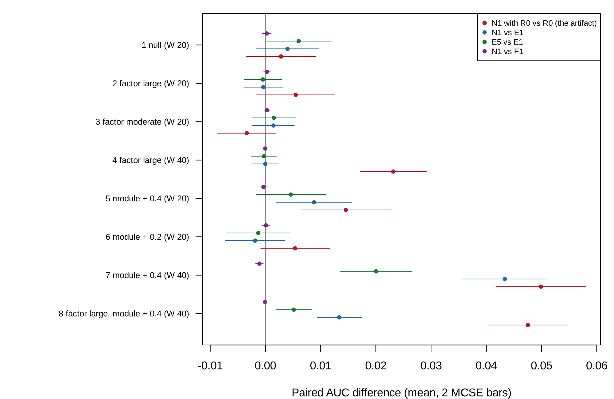

```{r}
#| label: setup
#| include: false

source("../templates/pilot-report/report-helpers.R")
devtools::load_all("..", quiet = TRUE)
s <- readRDS("results/cell_summaries.rds")
v <- readRDS("results/verdict.rds")
ka <- readRDS("results/known_answers.rds")
design <- readRDS("results/design.rds")
run <- readRDS("results/run_info.rds")
dat <- readRDS("results/data_summary.rds")
G <- function(cell, q) s$mean[s$cell == cell & s$quantity == q]
M <- function(cell, q) s$mcse[s$cell == cell & s$quantity == q]
gm <- function(cell, q, d = 3) sprintf("%s (MCSE %s)", fmt(G(cell, q), d), fmt(M(cell, q), 4))
cl <- v$clauses
c1b <- cl[cl$question == 1 & cl$clause == "(b)", ]
c3a <- cl[cl$question == 3 & cl$clause == "(a)", ]
status <- v$status
n_rep <- run$n_rep
minutes <- round(run$elapsed_seconds / 60)
fac_cells <- design$cell[design$change == "factor"]
mod_cells <- design$cell[design$change == "module"]
outcome <- function(q, c) {
  o <- cl$outcome[cl$question == q & cl$clause == c]
  if (any(o == "fail")) "fail" else if (any(o == "close")) "close call" else "pass"
}
cell_lab <- function(cl) {
  d <- design[design$cell == cl, ]
  what <- switch(d$change,
    null = "null",
    factor = sprintf("%s factor change", d$factor),
    module = sprintf("module correlation +%s", d$module),
    `factor and module` = sprintf("%s factor change and module +%s", d$factor, d$module))
  sprintf("cell %d (%s, %d women)", cl, what, d$women)
}
bg <- dat$by_group
row_of <- function(g) bg[bg$group == g, ]
```

# Summary

**Scope.** This document reports the pilot[^pilot] for the proposal "LIONESS edges across pregnancy in SLE and RA" (`proposal.md`, section 7). It covers the idea, how the pilot was run, what it found, the project spec, and the decisions made along the way. It was built from `project-spec.md`, `decisions.md`, and the saved results in `pilot/results/`; every number in the text and figures is computed from those files when the document renders.

**Status.** In `STATUS.md` the pilot is marked `` `r status` ``[^pf]. `r if (status == "piloted-pass") "Every clause of the pre-registered rule passed." else if (status == "piloted-fail") "At least one of the clauses that decide a fail (1(a), 1(b), 3(a)) failed." else "No deciding clause failed, but at least one clause failed or landed within three MCSE of its threshold; the reading is given both ways in the decisions log."`

| Pilot question | Answer | Key evidence |
|---------|-------------|---------------------------------------------|
| 1. Do edges equal their formula over time, with a signal to match? | `r outcome(1, "(a)")` and `r outcome(1, "(b)")` | N1 gained `r gm(7, "d1_N1_vs_E1")` over E1 in `r cell_lab(7)`; N1 and F1 differed by `r fmt_range(c1b$value, 4)` across all `r nrow(design)` cells. |
| 2. Large enough at the study's size (20 women)? | `r outcome(2, "(a)")` and `r outcome(2, "(b)")` | The artifact (N1 with $R_0$ over $R_0$) was `r gm(2, "artifact_N1R0_vs_R0")` in `r cell_lab(2)`; N1 gained `r gm(5, "d1_N1_vs_E1")` over E1 in `r cell_lab(5)`. |
| 3. Does the E1 base remove the artifact? | `r outcome(3, "(a)")` | In the factor-only cells, N1 against E1 ranged over `r fmt_range(c3a$value, 4)`. |

**What needs your decision** (details in [Action items and limitations](#action-items-and-limitations)): the status call; the open `[TO CONFIRM]` items in the spec (highlighted in yellow): the journal's limits and the milestone dates; and the four open questions of the proposal (section 9): the comparison, the RA grouping, the healthy pregnancies, and the counts download.

# The idea

## In plain language

LIONESS[^lioness] gives every blood sample a value for every pair of genes, called an edge, meant to say how tightly the two genes move together in that sample. When the edges of the same women change between pregnancy and the months after birth, the change is read as the immune network "rewiring". The exact formula behind an edge says what it is made of: the correlation of the two genes across all samples, plus the product of the sample's own two standardized values, minus a correction for how far each gene sits from its average.

Pregnancy moves many genes together: the mix of white cells in blood changes, and in lupus the interferon[^ifn] genes rise. Suppose two interferon genes are each 1 standard deviation above average after birth and 2 above average in late pregnancy, with nothing else changed. Their product goes from 1 to 4, so the edge between them grows, although the two genes are no more coordinated than before. This pilot asks, in simulated women followed through pregnancy, whether LIONESS edges tell pregnancy from the postpartum period beyond a simple model that already holds the interferon score, its square, cell composition, and every gene's level; whether the one-line formula does just as well as the edges; and whether a real change in coordination can be seen at the size of the study. No patient expression data were analyzed; the real study was described from its sample records.

## Potential impact

LIONESS builds one network per sample from an aggregate network and has an R implementation [@kuijjer2019lioness; @kuijjer2019lionessr]; its authors suggest such networks for studying change across time. The product of standardized deviations as an edge goes back to iENA [@yu2017iena], the first-order term is the influence function of the correlation [@devlin1975robust], and a recent review relates sample edges to covariance products [@kuijjer2026challenges]. The longitudinal study behind the data described pregnancy in SLE and RA by differential expression and deconvolution [@lien2024pregnancy]; no network analysis of it, or of pregnancy with single-sample networks, was found at stage 1.

The problem is the reading of a change in edges between time points as rewiring. When a factor that moves many genes changes over time, as composition does in every pregnancy and interferon does in SLE, the edges of the genes it moves change with its square. This pilot shows how large that is in the analysis a longitudinal user runs, a paired test of each edge between periods: with no change in co-expression at all, the share of factor-gene pairs called rewired was `r gm(2, "rewire_factor")` at 20 women and `r gm(4, "rewire_factor")` at 40 under a large factor change, against `r gm(1, "rewire_factor")` in the null cell (@tbl-rewire). A user would therefore adjust the edges for the squared score before calling anything rewired.

For classification the picture is different. Edges equal their first-order formula: N1 and F1 differed by `r fmt_range(c1b$value, 4)` in AUC across all cells (@fig-gains), so any network classifier can be reproduced without building a network. With the E1 base, edges added `r fmt_range(c3a$value, 4)` when only the factor changed. But at 20 women the edges' gain on a base without squares was only `r gm(2, "artifact_N1R0_vs_R0")`, and a real change in co-expression added only `r gm(5, "d1_N1_vs_E1")` over E1 (@tbl-verdict): at the size of GSE235508, classification cannot show either effect. The impact of the project rests on the paired edge test, which the pilot shows is fooled, and on a fix for it, which the pilot did not test.

## Application: the study behind the data

### The study

The proposed data come from a Norwegian longitudinal study of pregnancy in rheumatic disease [@lien2024pregnancy], https://doi.org/10.1136/ard-2023-224644, deposited as GEO series GSE235508[^geo]. Women with systemic lupus erythematosus (SLE)[^sle], seropositive or seronegative rheumatoid arthritis (RA)[^ra], and healthy women gave whole-blood samples for RNA sequencing before pregnancy, in each trimester, and at 6 weeks, 6 months, and 12 months after birth. The paper reports that in SLE the interferon signature was augmented during pregnancy, and that an altered cell type composition strongly influences the expression profile; the GEO summary notes that RA often improves in pregnancy while SLE is prone to flare. The processed counts and the sample records are open on GEO; raw reads are withheld under Norwegian law. @tbl-data counts, from the series matrix, the women who gave at least one sample in pregnancy and at least one outside it, which are the ones a within-woman comparison can use.

```{r}
#| label: tbl-data
#| tbl-cap: "GSE235508 by group, from `results/data_summary.rds` (the series matrix, read by `pilot/describe_data.R`). Usable pregnancies have at least one pregnant sample (trimesters 1 to 3) and one non-pregnant sample (pre-pregnancy or postpartum)."

lab <- c(HEALTHY = "Healthy", SLE = "SLE", SNRA = "Seronegative RA", SPRA = "Seropositive RA",
         `RA (SPRA and SNRA)` = "RA, both types")
knitr::kable(data.frame(Group = lab[bg$group], Samples = bg$samples, Pregnancies = bg$pregnancies,
                        `Usable pregnancies` = bg$usable_pregnancies,
                        `Pregnant samples` = bg$pregnant_samples,
                        `Non-pregnant samples` = bg$nonpregnant_samples, check.names = FALSE),
             row.names = FALSE)
```

### Why the AUC difference between N1 and E1

The quantity that decides the question is the difference in out-of-sample area under the ROC curve[^auc] (AUC) between E1 plus LIONESS edges (N1) and E1 alone, for telling a woman's pregnant samples from her non-pregnant ones. A difference near zero means the edges add nothing to the interferon score, composition, their squares, and the gene levels, so the apparent rewiring is the shared factors. Beside it, the difference between N1 and E1 plus the first-order edges (F1) asks whether whatever edges add is their formula. In the application both are computed within SLE (`r row_of("SLE")$usable_pregnancies` usable pregnancies) and within RA (`r row_of("RA (SPRA and SNRA)")$usable_pregnancies`), never pooled, with every sample of a woman in the same cross-validation[^cv] fold.

### Did the original study compute it?

No. The original study described expression changes over pregnancy with differential expression and cell-type deconvolution; it built no co-expression or single-sample networks and fitted no classifier of pregnancy stage. The question here, whether edges over pregnancy carry anything beyond the factors pregnancy moves, is new for this study and, from the searches logged at stage 1, for pregnancy in general.

## In symbols

The sample's standardized expression of gene $i$ ($z_{qi}$, its deviation from the reference mean in units of the reference standard deviation, divisor $N$), the reference correlation ($r$), and a shared factor ($F_q$, with loadings $\lambda_i$) determine the LIONESS edge ($e_q$), its first-order form ($f_q$), and the edge's mean given the factor:

$$
\begin{aligned}
e_q &= N r - (N-1)\, r_{(-q)}, \\
f_q &= r + z_{qi} z_{qj} - \frac{r}{2}\left(z_{qi}^2 + z_{qj}^2\right), \\
e_q &= f_q + O_p\left(N^{-1}\right), \\
\mathrm{E}\left[e_q \mid F_q\right] &= r + \left[\lambda_i \lambda_j - \frac{r}{2}\left(\lambda_i^2 + \lambda_j^2\right)\right] F_q^2 + \text{const} + O\left(N^{-1}\right).
\end{aligned}
$$

| Symbol | Meaning |
|----|------------------------------|
| $N$ | number of samples in the reference set |
| $z_{qi}$ | expression of gene $i$ in sample $q$, standardized by the reference (divisor $N$) |
| $r$, $r_{(-q)}$ | Pearson correlation of genes $i$ and $j$ in the reference, and without sample $q$ |
| $e_q$, $f_q$ | exact LIONESS edge and first-order edge of sample $q$ for the pair $(i, j)$ |
| $F_q$, $\lambda_i$ | shared factor in sample $q$ (composition and interferon), and gene $i$'s loading on it |

The target is the change in correlation between periods, $\rho_{ij}(\text{pregnant}) - \rho_{ij}(\text{postpartum})$. The computable quantity, the change in mean edge, equals it plus the coefficient in brackets times the change in $\mathrm{E}[F^2]$, which is not zero whenever pregnancy moves the mean or the spread of $F$. In words: edges change when the shared factor changes, with no change in coordination.

```{r}
#| label: fig-idea
#| fig-cap: "The idea, an illustration on made-up numbers (not pilot output): 40 simulated women, four samples each, from the pilot's large factor-change setting with no change in co-expression. Left: one sample's exact LIONESS edge for two factor genes against the factor squared. Right: the same edge by period, each line one woman's mean edge outside and in pregnancy."
#| fig-width: 10
#| fig-height: 4.2

set.seed(21)
coh <- SimulatePregnancyCohort(40, "large", 0)
e <- LionessEdges(coh$x[, 6:7])[, 1]
par(mfrow = c(1, 2), mar = c(4.2, 4.2, 2, 1))
plot(coh$f^2, e, pch = 19, cex = 0.6, col = ifelse(coh$y == 1, "#B2182B", "#2166AC"),
     xlab = "Factor squared", ylab = "Exact LIONESS edge, genes 6 and 7", main = "Edge against the squared factor")
legend("topleft", c("pregnant", "not pregnant"), col = c("#B2182B", "#2166AC"), pch = 19, cex = 0.8, bty = "n")
m1 <- tapply(e[coh$y == 1], coh$woman[coh$y == 1], mean)
m0 <- tapply(e[coh$y == 0], coh$woman[coh$y == 0], mean)
plot(NA, xlim = c(0.8, 2.2), ylim = range(c(m0, m1)), xaxt = "n", xlab = "", ylab = "Woman's mean edge",
     main = "Apparent rewiring, no change in co-expression")
axis(1, at = 1:2, labels = c("not pregnant", "pregnant"))
segments(1, m0, 2, m1, col = adjustcolor("grey30", 0.5))
```

```{r}
#| label: fig-data
#| fig-cap: "The real data (GSE235508 sample records, from `results/data_summary.rds`): samples by group and time point. Time points 1 to 3 are the trimesters; 0 is before pregnancy; 4, 5, 6 are 6 weeks, 6 months, and 12 months after birth."
#| fig-width: 9
#| fig-height: 3.8

bt <- dat$by_time
cols <- c("#999999", "#B2182B", "#E08214", "#2166AC")
par(mar = c(4.2, 4.2, 1, 1))
barplot(bt, beside = TRUE, col = cols, xlab = "Time point", ylab = "Samples", legend.text = rownames(bt),
        args.legend = list(x = "topright", bty = "n", cex = 0.8))
```

## Critiquing the model



| Feature of the model | Why it may not be realistic | What should be done to check it |
|-----------|----------------------------------------------|---------------------------------|
| One shared factor $F$ with equal loadings 0.8 on 20 genes | Pregnancy moves several cell types and interferon separately, with different strengths per gene | Estimate the number of factors and the loadings from GSE235508 counts |
| Pregnancy changes $F$ by a shift and a scale (0.5 and 1.5, or 1 and 2.25) | The real change in the mean and spread of $\mathrm{E}[F^2]$ is not known for SLE or RA | Estimate the shift and the scale of the IFN score over pregnancy in each disease |
| Two pregnant and two non-pregnant samples per woman | The study has up to seven time points, unevenly observed | Mirror each woman's real time points in a plasmode design |
| The woman's offsets $u_{wg}$ of variance 0.5, independent across genes | Between-person differences in blood are correlated across genes | Estimate the between-woman covariance from the data |
| Composition $C$ stable over pregnancy and observed without error | Neutrophils rise in pregnancy; deconvolution estimates carry error | Let $C$ shift with pregnancy and add measurement error |
| Normal noise | Log counts have heavier tails, and the remainder $e_q - f_q$ grows with $z^4$ | Resample residuals from the real data |
| The gene levels carry no pregnancy signal in the module cells | Pregnancy changes the level of many genes, so E1 is stronger in blood | Report E1 over $R_1$ in the application |

# Methods

## Design

The pilot simulates cohorts of women in `r nrow(design)` cells. Each woman gives four samples, two in pregnancy and two outside it. Fifty genes: genes 1 to 20 load on a shared factor $F$ (the composition and interferon changes of pregnancy), with the interferon score taken as the mean of genes 1 to 5; genes 21 to 30 form a co-expressed module; genes 31 to 50 load on a stable composition factor $C$. Each woman has her own level of both factors and her own offset on every gene. Each cell lets pregnancy change nothing, the distribution of $F$, the module's correlation, or both. In each replicate, seven models are fitted in an outer 5-fold cross-validation with every woman's samples in one fold, and every derived quantity is computed inside the training fold.

```{r}
#| label: fig-design
#| fig-cap: "The design at a glance. Each row is one part of the pilot, read from left to right: what is simulated, which factors are varied, what is estimated, what is measured, and how the result is shown. Every part feeds the AUC table (@tbl-auc) and the figure of differences (@fig-gains); the verdict is in @tbl-verdict, the apparent rewiring in @tbl-rewire, and the known-answer checks in @tbl-known-answer."
#| fig-width: 11
#| fig-height: 5.6

design_diagram(
  input = "Simulated women, 4 samples each: factor F on genes 1-20 (score: genes 1-5); module of genes 21-30; composition C on genes 31-50; woman offsets",
  lanes = list(
    list(label = "Part A: null and factor only", fill = "#e8f0fa", sim = "Pregnancy shifts and spreads F, or changes nothing", vary = "Factor change; 20 or 40 women", est = "AUC of R0, R1, E1, E5, F1, N1, N1 with R0", meas = "Artifact; N1 against E1 and F1; apparent rewiring", out = "Questions 1(b), 2(a), 3: AUC table, figure"),
    list(label = "Part B: module", fill = "#eaf5ea", sim = "Module correlation 0.3 outside pregnancy, higher in it", vary = "Change 0.2 or 0.4; 20 or 40 women", est = "The same seven models", meas = "N1 over E1; N1 against F1 and E5", out = "Questions 1(a), 1(b), 2(b): AUC table, figure"),
    list(label = "Part C: both", fill = "#fdeceb", sim = "Large factor change and module +0.4", vary = "40 women", est = "The same seven models", meas = "N1 over E1; N1 against F1", out = "Question 1(b): AUC table, figure")),
  harness = list(text = "Known-answer checks: exact edge = leave-one-out LIONESS; add-one edge = literal addition; first-order remainder small at large N;\nAUC on known cases; folds keep each woman together; the null cell gives AUC 0.5 and 5% apparent rewiring", out = "Known-answer table"))
```

Each figure and table in the Results traces back to one row of this diagram.

| Part | What is simulated | Main factors | Replicates |
|----|-------------------------|-------------------------|----------|
| A | Null (cell 1) and factor change only (cells 2 to 4) | factor change (moderate, large); 20 or 40 women | `r n_rep` per cell |
| B | Module correlation change (cells 5 to 7) | change 0.2 or 0.4; 20 or 40 women | `r n_rep` per cell |
| C | Both (cell 8) | large factor change, module +0.4, 40 women | `r n_rep` per cell |

The seven models are: $R_0$, logistic regression on composition and the IFN score's residual on composition; $R_1$, $R_0$ plus both squares; E1, an elastic net[^enet] on the 45 non-score genes with the $R_1$ terms unpenalized; and three models that add one penalized feature set to E1: E5 (the 990 pairwise products and 45 squares of the standardized genes), F1 (the 990 first-order edges), and N1 (the 990 exact LIONESS edges). The seventh, N1 with $R_0$, puts the LIONESS edges on $R_0$ alone, to measure the artifact. The large factor change shifts the mean of $F$ by 1 and multiplies its spread by 2.25 in pregnancy, the moderate one by 0.5 and 1.5. Apparent rewiring is the share of gene pairs whose edge differs between periods by a paired $t$-test across women at the 5% level, for the 105 pairs of genes 6 to 20 and the 45 module pairs.

## Known-answer checks



```{r}
#| label: tbl-known-answer
#| tbl-cap: "Known-answer checks, from `results/known_answers.rds`."

rows <- lapply(seq_len(nrow(ka)), function(i) {
  k <- ka[i, ]
  if (k$type == "identity") {
    tol <- if (grepl("First-order", k$check)) 0.05 else 1e-8
    harness_row(k$check, k$setting, fmt(k$known, 3), formatC(k$computed, format = "g", digits = 3),
                harness_reading_tol(k$computed, k$known, tol))
  } else {
    harness_row(k$check, k$setting, fmt(k$known, 3), sprintf("%s (MCSE %s)", fmt(k$computed, 4), fmt(k$mcse, 4)),
                harness_reading_mcse(k$computed, k$known, k$mcse))
  }
})
harness_table(rows)
```

`r harness_flag_summary((ka$computed - ka$known)[ka$type == "mcse"] / ka$mcse[ka$type == "mcse"])`

# Results

## How to read the outputs



This pilot reports AUC and paired AUC differences. A paired difference is computed within each replicate, between two models fitted to the same simulated cohort, and then averaged; its MCSE is the replicate standard deviation of the difference divided by the square root of the number of replicates. A difference of 0 means the two models did equally well. Apparent rewiring is a share of gene pairs; its reference value with no change in co-expression would be 0.05 if edges measured co-expression alone.

## AUC differences by cell

**Figure guide (all parts).** Each row is one cell, labelled by what pregnancy changes and the number of women ($W$). The four colored points are paired AUC differences averaged over `r n_rep` replicates: N1 with $R_0$ against $R_0$ (the artifact); N1 against E1; E5 against E1; and N1 against F1. The bars are two MCSE on each side, and the grey line is no difference. Look for: whether the purple points sit on the line in every row; whether the blue points sit on the line in the factor-only rows and away from it in the module rows; how far the red points sit from the line in the factor-only rows.

```{r}
#| label: fig-gains
#| fig-cap: "Pilot result (all parts): paired AUC differences by cell, means over replicates with bars of two MCSE, from `results/cell_summaries.rds`."
#| fig-width: 10
#| fig-height: 6.5


```

## Numbered findings

Each finding is a claim followed by the output behind it. Read the claim, open the output, and check that you can see the claim there before accepting it.

1. **LIONESS edges and their first-order formula perform the same.** Their AUC difference ranged over `r fmt_range(c1b$value, 4)` across all `r nrow(design)` cells (@tbl-verdict, purple points in @fig-gains), inside the margin of 0.01 in every cell.
2. **The signal to match was a little short of the pre-registered 0.05.** In `r cell_lab(7)`, N1 gained `r gm(7, "d1_N1_vs_E1")` over E1, within 3 MCSE of 0.05, a close call (@tbl-verdict, blue points).
3. **The E1 base removes the artifact from classification.** In the factor-only cells, N1 against E1 ranged over `r fmt_range(c3a$value, 4)`, while N1 with $R_0$ gained `r gm(4, "artifact_N1R0_vs_R0")` over $R_0$ at 40 women (red points).
4. **At 20 women the classification artifact is small.** N1 with $R_0$ gained `r gm(2, "artifact_N1R0_vs_R0")` over $R_0$ in `r cell_lab(2)`, below the 0.02 of clause 2(a); the squared terms of $R_1$ themselves gained `r gm(2, "gain_R1_vs_R0")` over $R_0$ there (@tbl-auc).
5. **At 20 women a real rewiring is hard to see by classification.** N1 gained `r gm(5, "d1_N1_vs_E1")` over E1 in `r cell_lab(5)`, below the 0.03 of clause 2(b), and `r gm(6, "d1_N1_vs_E1")` with a change of 0.2 (@tbl-verdict).
6. **The paired edge test calls rewiring where there is none.** With no change in co-expression, the share of factor-gene pairs called rewired was `r gm(3, "rewire_factor")` under a moderate factor change and `r gm(2, "rewire_factor")` under a large one at 20 women, against `r gm(1, "rewire_factor")` in the null cell (@tbl-rewire). The same test found the true module change in `r gm(5, "rewire_module")` of the module pairs at 20 women.
7. **The known-answer checks hold.** Every code identity agreed to better than $10^{-13}$, the folds kept every woman together, the null cell's AUCs sat near 0.5, and its apparent rewiring at its nominal level (@tbl-known-answer).

## Tables

**Table guide (all parts).** One row per cell; the columns are the mean out-of-fold AUC of each model over `r n_rep` replicates. The reference value is 0.5 in the null cell. Compare N1 against E1 and F1 in the same row, and N1 with $R_0$ against $R_0$.

```{r}
#| label: tbl-auc
#| tbl-cap: "Mean out-of-fold AUC by cell and model, from `results/cell_summaries.rds`. The largest MCSE of any entry is given in the text below the table."

models <- c("R0", "R1", "E1", "E5", "F1", "N1", "N1R0")
tab <- data.frame(Cell = sapply(design$cell, cell_lab))
for (m in models) tab[[m]] <- fmt(sapply(design$cell, G, q = m), 3)
names(tab) <- c("Cell", "R0", "R1", "E1 (genes)", "E5 (E1 + products, squares)",
                "F1 (E1 + first-order edges)", "N1 (E1 + edges)", "N1 with R0")
knitr::kable(tab, row.names = FALSE)
```

The largest MCSE of an AUC in the table is `r fmt(max(s$mcse[s$quantity %in% models]), 4)`.

**Table guide (apparent rewiring).** One row per cell: the share of gene pairs whose LIONESS edge differs between pregnancy and the postpartum period by a paired test at the 5% level, among the factor genes outside the score and among the module genes. Without any change in co-expression the share should be near 0.05. Look for: the factor-gene column in the factor-only cells, where co-expression does not change.

```{r}
#| label: tbl-rewire
#| tbl-cap: "Apparent rewiring by cell, mean share of pairs called different (MCSE), from `results/cell_summaries.rds`."

knitr::kable(data.frame(Cell = sapply(design$cell, cell_lab),
  `Factor genes 6 to 20 (105 pairs)` = sapply(design$cell, gm, q = "rewire_factor"),
  `Module genes 21 to 30 (45 pairs)` = sapply(design$cell, gm, q = "rewire_module"),
  check.names = FALSE), row.names = FALSE)
```

**Table guide (the verdict).** One row per clause of the pre-registered rule: the quantity, its value with its MCSE, the threshold, and the outcome, read by `pilot/verdict.R`. Check that each outcome follows from its value and threshold, and that the combination gives the status.

```{r}
#| label: tbl-verdict
#| tbl-cap: "The pass rule applied clause by clause, from `results/verdict.rds`."

vt <- cl
vt$cell <- sapply(vt$cell, cell_lab)
vt$value <- fmt(vt$value, 4)
vt$mcse <- fmt(vt$mcse, 4)
knitr::kable(vt[, c("question", "clause", "cell", "quantity", "value", "mcse", "threshold", "outcome")],
             col.names = c("Q", "Clause", "Cell", "Quantity", "Value", "MCSE", "Threshold", "Outcome"),
             row.names = FALSE)
```

**Table guide (numbers quoted in the spec).** Each row recomputes a number that section 3 of the spec quotes, from the result files.

```{r}
#| label: tbl-spec-numbers
#| tbl-cap: "Numbers quoted in the spec's section 3, recomputed from `results/cell_summaries.rds` and `results/verdict.rds`."

knitr::kable(data.frame(
  Quantity = c("1(a): N1 over E1, cell 7",
               "1(b): range of A(N1) - A(F1) over all cells",
               "2(a): artifact, N1 with R0 over R0, cell 2",
               "2(b): N1 over E1, cell 5",
               "3(a): range of N1 over E1, cells 2, 3, 4",
               "Apparent rewiring, factor genes, cell 2",
               "Status"),
  Value = c(gm(7, "d1_N1_vs_E1", 4), fmt_range(c1b$value, 4), gm(2, "artifact_N1R0_vs_R0", 4),
            gm(5, "d1_N1_vs_E1", 4), fmt_range(c3a$value, 4), gm(2, "rewire_factor"), status)),
  row.names = FALSE)
```

# The draft spec {#draft-spec}

This is `project-spec.md`, read from the file when the document renders. Anything the agent[^agent] left for the user to decide is highlighted in yellow and starts with "To confirm".

```{r}
#| label: spec
#| results: asis

cat(read_md_part("../project-spec.md", highlight_to_confirm = TRUE), "\n")
```

# Decisions log {#decisions-log}

This is the agent's `decisions.md` for the pilot, read from the file when the document renders.

```{r}
#| label: decisions
#| results: asis

cat(read_md_part("decisions.md"), "\n")
```

# Action items and limitations {#action-items-and-limitations}

## Action items

1. **Decide the status.** The rule gives `piloted-close-call`. The reading that passes and the reading that fails are in the decisions log (D1). Three ways on: read it as a pass and go to stage 3 with the classification aim as planned (with the known risk that GSE235508 is too small to show it); re-scope to the paired edge test as the primary measure, with a re-pilot (`pilot-b/`) that tests a fix for it; or drop the classification aim.
2. **Answer the proposal's open questions** (section 9): the comparison, the RA grouping, the healthy pregnancies, and approval of the 25 MB counts download.
3. **Resolve the yellow `[TO CONFIRM]` items** in the spec: the journal's limits and the milestone dates.
4. **Verify the citations.** Every entry was copied from its record; @devlin1975robust still lacks its full text.

## Limitations

- Everything here is simulation; no gene expression of GSE235508 was analysed, only its sample records.
- One shared factor with equal loadings, normal noise, and four samples per woman; the real study has up to seven uneven time points.
- The size of the real change in the shared factor over pregnancy is not known; the moderate and large levels are the first project's.
- No fix for the paired edge test was run.



[^lioness]: LIONESS (Linear Interpolation to Obtain Network Estimates for Single Samples) builds a network from all samples and again without one sample, and scales the difference to give that sample's network.

[^ifn]: Interferons are signalling proteins of the immune system; many genes respond to them together, and their summed expression, the interferon score, is high in many patients with lupus.

[^geo]: The Gene Expression Omnibus (GEO) is the public archive of the US National Center for Biotechnology Information for gene expression data; a series (GSE) holds one study's samples.

[^sle]: Systemic lupus erythematosus is an autoimmune disease that can affect skin, joints, kidneys, and blood, and often flares in pregnancy.

[^ra]: Rheumatoid arthritis is an autoimmune disease of the joints; seropositive patients carry rheumatoid factor or anti-citrullinated protein antibodies, seronegative patients do not. It often improves in pregnancy.

[^auc]: The area under the ROC curve is the probability that a randomly chosen pregnant sample gets a higher score than a randomly chosen non-pregnant one; 0.5 is chance and 1 is perfect separation.

[^cv]: In cross-validation the data are split into folds, each model is fitted without one fold and scored on it, and the scores are pooled; here every sample of a woman is in the same fold, so a woman's own samples never help predict each other.

[^enet]: The elastic net is logistic regression with a penalty that shrinks coefficients and sets many to zero, so it can use more features than samples; glmnet is the R package that fits it.
